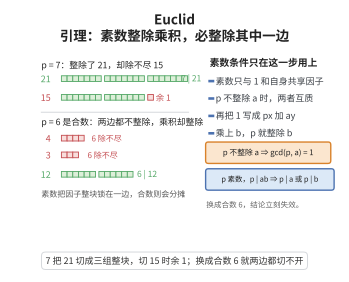

# Euclid 引理

> **一句话大白话**：一个质数能整除两个数的乘积，那它至少能整除其中某一个数。
>
> **小例子**：$7$ 能整除 $21\times15=315$，而 $7$ 确实能整除 $21$；反过来 $6\mid4\times3=12$，但 $6$ 既整除不了 $4$ 也整除不了 $3$——这正是"质数"条件不可缺的原因。

## 介绍

Euclid 引理是数论中的一个核心定理：若素数 $p$ 整除两个整数之积 $ab$，则 $p$ 至少整除 $a$ 或 $b$ 中的一个。这一看似直观的结论在整数范围内并非平凡——例如，6 整除 $4 \times 3 = 12$，但 6 既不整除 4 也不整除 3，这说明"素数"这一条件不可或缺。Euclid 引理是算术基本定理（唯一分解定理）的证明核心，也是整个数论中关于整除性推理的基石。

## 几何直观

图意在说明：素数只有 1 和自身两个因子，所以 p 除不尽 a 时 gcd(p, a) 只能是 1；用 Bezout 把 1 写成 px 加 ay 再乘上 b，p 就顺势整除 b——合数 6 缺的正是这条性质。

## 分析

**前置依赖**：Bezout 引理。

**定理内容**：若 $p$ 是素数，且 $p \mid ab$，则 $p \mid a$ 或 $p \mid b$。

**数学内涵**：
- Euclid 引理本质上是"素数"的刻画性质之一：一个大于 1 的整数 $p$ 是素数当且仅当它满足"若 $p \mid ab$ 则 $p \mid a$ 或 $p \mid b$"。
- 这个性质在一般的整环中被称为"素元"（prime element）的定义，而在整数环中它与"不可约元"（irreducible element）等价。
- 引理的证明依赖于 Bezout 引理：若 $p \nmid a$，则 $\gcd(p, a) = 1$（因为 $p$ 是素数），存在 $x, y$ 使得 $px + ay = 1$，两边乘以 $b$ 可得 $p \mid b$。

**证明策略**：
- 反证法结合 Bezout 引理：假设 $p \nmid a$ 且 $p \nmid b$，导出矛盾。
- 更标准的方法是：$p \nmid a \Rightarrow \gcd(p,a)=1 \Rightarrow$ 存在 $x,y$ 使得 $px+ay=1 \Rightarrow b = b(px+ay) = pbx + aby \Rightarrow p \mid b$。

## 思考过程

Euclid 引理的证明展示了 Bezout 引理的力量。考虑以下场景：已知 $p$ 是素数，$p$ 整除 $ab$。如果 $p$ 不整除 $a$，那么 $a$ 和 $p$ 的唯一公因数就是 1，即 $\gcd(p, a) = 1$。由 Bezout 引理，存在整数 $x, y$ 使得 $px + ay = 1$。

这个等式意味着什么？它告诉我们 1 可以表示为 $p$ 和 $a$ 的线性组合。现在将等式两边乘以 $b$：

$$
b = b(px + ay) = pbx + aby
$$

由于 $p \mid pbx$ 显然成立，且 $p \mid ab$（已知条件），所以 $p \mid aby$。因此 $p$ 整除右边两项之和，即 $p \mid b$。

这个推理的关键在于 Bezout 引理将"互质"转化为了一个线性等式，从而让我们能够将 $p$ 的整除性"传递"到 $b$ 上。

## 证明过程

**定理**：设 $p$ 为素数，$a, b \in \mathbb{Z}$。若 $p \mid ab$，则 $p \mid a$ 或 $p \mid b$。

**证明**：

假设 $p \mid ab$ 但 $p \nmid a$。由于 $p$ 是素数，$a$ 和 $p$ 的唯一公因数是 1 和 $p$，而 $p \nmid a$，故 $\gcd(p, a) = 1$。

由 Bezout 引理，存在整数 $x, y$ 使得

$$
px + ay = 1
$$

两边乘以 $b$ 得：

$$
b = b(px + ay) = pbx + aby
$$

由于 $p \mid pbx$ 且 $p \mid aby$（因为 $p \mid ab$），故 $p \mid (pbx + aby)$，即 $p \mid b$。

因此若 $p \nmid a$，则 $p \mid b$。由对称性，若 $p \nmid b$ 则 $p \mid a$。故 $p \mid a$ 或 $p \mid b$。$\square$

---

**推论**：若 $p$ 是素数且 $p \mid a_1a_2\cdots a_n$，则 $p$ 至少整除其中一个 $a_i$。这一推论可由数学归纳法直接得到。

## 课堂问答

**老师**：$p\mid ab$ 为什么不能直接推出 $p\mid a$ 或 $p\mid b$？给我一个反例，并说明"素数"这个条件用在哪。

**学生**：对合数不成立，反例 $6\mid 4\times3=12$ 但 $6\nmid4$、$6\nmid3$。素数条件的作用是：若 $p\nmid a$，则 $\gcd(p,a)=1$。

**老师（追问）**：有了 $\gcd(p,a)=1$，怎么把整除性"传递"到 $b$ 上？

**学生**：由 Bezout 引理取 $px+ay=1$，两边乘 $b$ 得 $b=pbx+aby$。由于 $p\mid pbx$，又由 $p\mid ab$ 得 $p\mid aby$，两项相加故 $p\mid b$。

**老师（拓展）**：若 $p$ 整除一长串乘积 $a_1a_2\cdots a_n$ 呢？

**学生**：反复使用引理或对 $n$ 归纳，可得 $p$ 必整除某个 $a_i$。这一步正是算术基本定理唯一性证明的核心。
