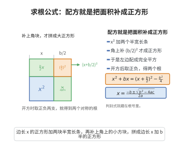

# 二次方程求根公式

> **一句话大白话**：任何一元二次方程都有个"万能钥匙" $x=\frac{-b\pm\sqrt{b^2-4ac}}{2a}$，把系数往里一套就能解出根。
>
> **小例子**：对 $x^2-4x+3=0$，代入 $a=1,b=-4,c=3$ 得 $x=\frac{4\pm\sqrt{16-12}}{2}$，即 $x=3$ 或 $x=1$。

## 介绍

二次方程求根公式是代数学中最基本的公式之一：一元二次方程 $ax^2 + bx + c = 0$（$a \neq 0$）的解为 $x = \frac{-b \pm \sqrt{b^2 - 4ac}}{2a}$。这一公式是人类最早系统掌握的代数方程求解方法之一，其历史可追溯到古巴比伦时期（约公元前 2000 年）。该公式不仅在初等数学中占据核心地位，也是理解高次方程求解、判别式理论以及二次函数性质的起点。

## 几何直观

图意在说明：x² 加 bx 想要配成完全平方，缺的正是角上那块 (b/2)²；补上之后开方取正负两支，就得到两个对称的根，判别式藏在根号里。

## 分析

**前置依赖**：配方法、实数公理。

**定理内容**：一元二次方程 $ax^2 + bx + c = 0$（$a \neq 0$）的解为

$$
x = \frac{-b \pm \sqrt{b^2 - 4ac}}{2a}
$$

其中 $\Delta = b^2 - 4ac$ 称为判别式：
- 当 $\Delta > 0$ 时，方程有两个不相等的实数根；
- 当 $\Delta = 0$ 时，方程有两个相等的实数根（重根）；
- 当 $\Delta < 0$ 时，方程有两个共轭复数根（在实数范围内无解）。

**数学内涵**：
- 求根公式的推导核心是"配方法"——将二次式化为完全平方形式。
- 判别式 $\Delta$ 的符号决定了根的性质，这在二次函数图像中对应着抛物线与 $x$ 轴的交点情况。
- 该公式是 Galois 理论的特例——二次方程总是可以用根式求解。

**结构**：
1. 将方程两边除以 $a$ 化为标准形式。
2. 移项使常数项在右边。
3. 配方：两边加上 $(\frac{b}{2a})^2$。
4. 将左边写为完全平方，右边通分。
5. 开平方并解出 $x$。

## 思考过程

二次方程求根公式的推导思路可以这样理解：我们要解 $ax^2 + bx + c = 0$。首先消除二次项系数，两边除以 $a$ 得 $x^2 + \frac{b}{a}x + \frac{c}{a} = 0$。现在，我们想把 $x^2 + \frac{b}{a}x$ 写成某个完全平方 $(x + k)^2 = x^2 + 2kx + k^2$ 的形式。

比较 $x^2 + \frac{b}{a}x$ 与 $x^2 + 2kx$，可知 $2k = \frac{b}{a}$，即 $k = \frac{b}{2a}$。于是 $(x + \frac{b}{2a})^2 = x^2 + \frac{b}{a}x + \frac{b^2}{4a^2}$。

因此，在原方程两边加上 $\frac{b^2}{4a^2}$ 再移项：

$$
x^2 + \frac{b}{a}x + \frac{b^2}{4a^2} = \frac{b^2}{4a^2} - \frac{c}{a}
$$

左边就是 $(x + \frac{b}{2a})^2$，右边通分后为 $\frac{b^2 - 4ac}{4a^2}$。开平方并解出 $x$，就得到了求根公式。

## 证明过程

**定理**：一元二次方程 $ax^2 + bx + c = 0$（$a \neq 0$）的解为

$$
x = \frac{-b \pm \sqrt{b^2 - 4ac}}{2a}
$$

**证明**：

由 $ax^2 + bx + c = 0$，两边除以 $a$（$a \neq 0$）得

$$
x^2 + \frac{b}{a}x + \frac{c}{a} = 0
$$

移项：

$$
x^2 + \frac{b}{a}x = -\frac{c}{a}
$$

配方：两边同时加上 $(\frac{b}{2a})^2$：

$$
x^2 + \frac{b}{a}x + \left(\frac{b}{2a}\right)^2 = \left(\frac{b}{2a}\right)^2 - \frac{c}{a}
$$

左边写成完全平方，右边通分：

$$
\left(x + \frac{b}{2a}\right)^2 = \frac{b^2 - 4ac}{4a^2}
$$

两边开平方：

$$
x + \frac{b}{2a} = \pm \frac{\sqrt{b^2 - 4ac}}{2a}
$$

解得：

$$
x = -\frac{b}{2a} \pm \frac{\sqrt{b^2 - 4ac}}{2a} = \frac{-b \pm \sqrt{b^2 - 4ac}}{2a}
$$

$\square$

---

**注**：当 $b^2 - 4ac < 0$ 时，$\sqrt{b^2 - 4ac}$ 在实数范围内无意义，此时方程在复数范围内有解，其解为 $x = \frac{-b \pm i\sqrt{4ac - b^2}}{2a}$，其中 $i$ 是虚数单位。

## 课堂问答

**老师**：这把"万能钥匙"是怎么推出来的？核心动作是哪一步？

**学生**：核心是配方。将 $ax^2+bx+c=0$ 除以 $a$ 后两边加 $\left(\frac{b}{2a}\right)^2$，得 $\left(x+\frac{b}{2a}\right)^2=\frac{b^2-4ac}{4a^2}$，再开方即得 $x=\frac{-b\pm\sqrt{b^2-4ac}}{2a}$。

**老师（追问）**：开方时为什么会出现 $\pm$？

**学生**：因为 $u^2=v$ 在实数中有两个解 $u=\pm\sqrt v$（$v\ge0$），所以两根关于 $-\frac{b}{2a}$ 对称。

**老师（拓展）**：若 $\Delta=b^2-4ac<0$，公式还有意义吗？

**学生**：有，在 $\mathbb{C}$ 中把 $\sqrt{\Delta}$ 理解为 $i\sqrt{4ac-b^2}$，得到一对共轭复根。这也说明二次方程总能用根式求解，是 Galois 理论里最简的可解情形。
