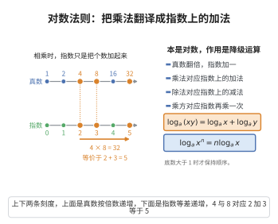

# 对数运算法则

> **一句话大白话**：对数能把"乘除"变成"加减"、把"乘方"变成"相乘"——是专治复杂运算的"降级器"。
>
> **小例子**：$\log_2(4\times8)=\log_2 4+\log_2 8=2+3=5$，而 $\log_2 4^2=2\log_2 4=4$。

## 介绍

对数运算法则是关于对数函数运算的基本规则，包括积的对数、商的对数、幂的对数以及换底公式等。对数的发明（约翰·纳皮尔，1614年）将乘除运算转化为加减运算，极大地简化了天文学和航海中的复杂计算，被誉为"将天文学家的寿命延长了一倍"。对数运算法则与指数运算法则互为逆运算，共同构成了指数和对数函数的核心理论。

## 几何直观

图意在说明：真数按倍数增长，指数按等差增长；两个真数相乘，指数正好相加，于是乘法、除法、乘方都被降级成加法、减法、乘法。

## 分析

**前置依赖**：指数运算法则、指数函数的定义。

**定理内容**：设 $a > 0$，$a \neq 1$，$M,N > 0$，$n$ 为实数，则：

1. 积的对数：$\log_a(MN) = \log_a M + \log_a N$
2. 商的对数：$\log_a\frac{M}{N} = \log_a M - \log_a N$
3. 幂的对数：$\log_a M^n = n\log_a M$
4. 换底公式：$\log_a b = \frac{\log_c b}{\log_c a}$，其中 $c > 0$，$c \neq 1$

**数学内涵**：
- 对数运算法则的本质是将乘法运算降级为加法运算，将幂运算降级为乘法运算——这是对数函数作为"运算降级器"的核心功能。
- 这些法则直接来源于指数运算法则，因为对数是指数函数的反函数，即 $a^{\log_a x} = x$。
- 换底公式将对数计算统一到任意底数，使得常用对数（$\lg$）和自然对数（$\ln$）可以相互转换。

**证明策略**：利用指数与对数的等价关系 $a^{\log_a x} = x$，将待证等式转化为指数形式进行验证。

## 思考过程

对数运算法则的推导核心是利用指数与对数的互逆关系：设 $x = \log_a M$，$y = \log_a N$，则 $a^x = M$，$a^y = N$。于是 $MN = a^x \cdot a^y = a^{x+y}$，由对数定义即得 $\log_a(MN) = x + y = \log_a M + \log_a N$。

类似地，$M^n = (a^x)^n = a^{nx}$，所以 $\log_a M^n = nx = n\log_a M$。

换底公式的推导思路是：设 $x = \log_a b$，则 $a^x = b$，两边取以 $c$ 为底的对数得 $x\log_c a = \log_c b$，解得 $x = \frac{\log_c b}{\log_c a}$。

## 证明过程

**定理**（对数运算法则）：设 $a > 0$，$a \neq 1$，$M,N > 0$，则：

1. $\log_a(MN) = \log_a M + \log_a N$
2. $\log_a\frac{M}{N} = \log_a M - \log_a N$
3. $\log_a M^n = n\log_a M$（$n$ 为任意实数）
4. $\log_a b = \frac{\log_c b}{\log_c a}$（$c > 0$，$c \neq 1$）

**证明**：

1. 设 $x = \log_a M$，$y = \log_a N$，则 $a^x = M$，$a^y = N$。于是
   $$
   MN = a^x \cdot a^y = a^{x+y}
   $$
   由对数的定义得 $\log_a(MN) = x + y = \log_a M + \log_a N$。

2. 设 $x = \log_a M$，$y = \log_a N$，则 $a^x = M$，$a^y = N$。于是
   $$
   \frac{M}{N} = \frac{a^x}{a^y} = a^{x-y}
   $$
   由对数的定义得 $\log_a\frac{M}{N} = x - y = \log_a M - \log_a N$。

3. 设 $x = \log_a M$，则 $a^x = M$。于是
   $$
   M^n = (a^x)^n = a^{nx}
   $$
   由对数的定义得 $\log_a M^n = nx = n\log_a M$。

4. 设 $x = \log_a b$，则 $a^x = b$。两边取以 $c$ 为底的对数：
   $$
   \log_c(a^x) = \log_c b \Rightarrow x\log_c a = \log_c b
   $$
   解得 $x = \frac{\log_c b}{\log_c a}$，即 $\log_a b = \frac{\log_c b}{\log_c a}$。

$\square$

## 课堂问答

**老师**：$\log_a(MN)=\log_aM+\log_aN$ 的本质是什么？它是从哪里来的？

**学生**：本质是把乘法"降级"为加法。设 $x=\log_aM,\ y=\log_aN$，则 $M=a^x,\ N=a^y$，于是 $MN=a^{x+y}$，取对数即得。前提是 $M,N>0$。

**老师（追问）**：换底公式怎么推？它有什么用？

**学生**：设 $x=\log_ab$，则 $a^x=b$，两边取以 $c$ 为底的对数得 $x\log_ca=\log_cb$，故 $\log_ab=\frac{\log_cb}{\log_ca}$。它把任意底统一到 $\lg$ 或 $\ln$。

**老师（拓展）**：使用时最常见的错误是什么？

**学生**：忽视定义域——要求 $M,N>0$ 且底 $a>0,\ a\neq1$；还会误写 $\log_a(M+N)=\log_aM+\log_aN$，那是错的。
