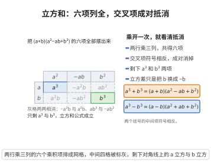

# 立方和与立方差公式

> **一句话大白话**：两个字立方的加减，能拆成一个"一次式"和一个"二次式"的乘积，是平方差公式往上一层的推广。
>
> **小例子**：$x^3+8 = x^3+2^3 = (x+2)(x^2-2x+4)$；$x^3-27=(x-3)(x^2+3x+9)$。

## 介绍

立方和与立方差公式是代数学中重要的多项式因式分解公式：$a^3 \pm b^3 = (a \pm b)(a^2 \mp ab + b^2)$。这些公式在因式分解、分式化简和高次方程求解中有广泛应用，是平方差公式和完全平方公式的自然推广。

## 几何直观

图意在说明：把两个括号的每一项两两相乘，六项全部摆出，符号相反的交叉项成对相消；只剩 a³ 与 b³，立方差公式只需把 b 换成 −b。

## 分析

**前置依赖**：多项式乘法分配律、完全平方公式。

**定理内容**：对于任意实数 $a,b$，有

$$
a^3 + b^3 = (a + b)(a^2 - ab + b^2),\qquad
a^3 - b^3 = (a - b)(a^2 + ab + b^2)
$$

**数学内涵**：
- 立方和与立方差公式揭示了 $a^3 \pm b^3$ 的因式分解结构，其中二次因子 $a^2 \mp ab + b^2$ 无法在实数范围内进一步分解（其判别式 $\Delta = b^2 - 4b^2 = -3b^2 < 0$）。
- 这些公式是 $a^n \pm b^n$ 因式分解模式的特例（$n=3$），也是"单位根"概念的直观体现。
- 在复数域中，$a^3 + b^3 = (a+b)(a+\omega b)(a+\omega^2 b)$，其中 $\omega$ 是三次单位根。

**证明策略**：直接展开右侧乘积，合并同类项后验证等于左侧。

## 思考过程

立方和公式的推导思路是将 $(a+b)(a^2 - ab + b^2)$ 逐项展开：

$$
\begin{aligned}
(a+b)(a^2 - ab + b^2) &= a \cdot a^2 + a \cdot (-ab) + a \cdot b^2 + b \cdot a^2 + b \cdot (-ab) + b \cdot b^2 \\
&= a^3 - a^2b + ab^2 + a^2b - ab^2 + b^3 \\
&= a^3 + b^3
\end{aligned}
$$

其中 $-a^2b$ 与 $+a^2b$ 抵消，$ab^2$ 与 $-ab^2$ 抵消。立方差公式同理，只需将 $b$ 替换为 $-b$ 代入立方和公式即可。

## 证明过程

**定理**（立方和公式）：对于任意实数 $a,b$，有 $a^3 + b^3 = (a + b)(a^2 - ab + b^2)$。

**证明**：

$$
\begin{aligned}
(a+b)(a^2 - ab + b^2) &= a \cdot a^2 + a \cdot (-ab) + a \cdot b^2 + b \cdot a^2 + b \cdot (-ab) + b \cdot b^2 \\
&= a^3 - a^2b + ab^2 + a^2b - ab^2 + b^3 \\
&= a^3 + (-a^2b + a^2b) + (ab^2 - ab^2) + b^3 \\
&= a^3 + b^3
\end{aligned}
$$

$\square$

---

**定理**（立方差公式）：对于任意实数 $a,b$，有 $a^3 - b^3 = (a - b)(a^2 + ab + b^2)$。

**证明**：

将 $b$ 替换为 $-b$ 代入立方和公式：

$$
\begin{aligned}
a^3 - b^3 &= a^3 + (-b)^3 \\
&= [a + (-b)][a^2 - a(-b) + (-b)^2] \\
&= (a - b)(a^2 + ab + b^2)
\end{aligned}
$$

$\square$

## 课堂问答

**老师**：$a^3+b^3=(a+b)(a^2-ab+b^2)$ 里的"减号"位置容易记混，怎么自查？

**学生**：直接展开右侧：$a^3-a^2b+ab^2+a^2b-ab^2+b^3=a^3+b^3$，中间的 $-a^2b$ 与 $+a^2b$、$ab^2$ 与 $-ab^2$ 两两抵消。立方差对称地是 $(a-b)(a^2+ab+b^2)$。

**老师（追问）**：那个二次因子还能再分解吗？

**学生**：在实数上不能。把 $a^2-ab+b^2$ 看成关于 $a$ 的二次式 $a^2-ba+b^2$，其判别式 $b^2-4b^2=-3b^2<0$，无实根。

**老师（拓展）**：这两个公式在更高次与复数视角下的地位如何？

**学生**：它们来自 $x^n-y^n=(x-y)(\cdots)$ 在 $n=3$ 的特例。复数域里 $a^3+b^3=(a+b)(a+\omega b)(a+\omega^2b)$，其中 $\omega$ 是三次单位根，这正是"单位根分解"的雏形。
