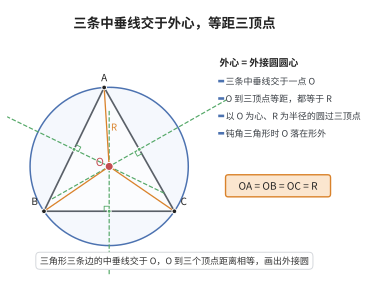

# 三角形外心定理

> **一句话大白话**：三角形三条边的中垂线会交于同一个点（外心），它到三个顶点的距离都一样，正好是外接圆圆心。
>
> **小例子**：直角三角形斜边中点到三个顶点的距离都相等——比如直角边为 $3,4$ 的直角三角形，斜边长 $5$，中点到三个顶点的距离都是 $\frac{5}{2}=2.5$，这个中点就是外心。

## 介绍

三角形外心定理是三角形几何中的基本定理：三角形的三条边的垂直平分线交于一点，这个点称为三角形的外心（circumcenter），它到三角形的三个顶点距离相等。外心是三角形外接圆的圆心，在几何证明、尺规作图以及三角学中有重要应用。

## 几何直观

图意在说明：中垂线是“到两端等距”的轨迹，三条中垂线共点就意味着存在一个点同时到三顶点等距——这正是外接圆的圆心；钝角三角形时它会跑到形外。

## 分析

**前置依赖**：全等三角形判定。

**定理内容**：在 $\triangle ABC$ 中，分别作三边 $BC, CA, AB$ 的垂直平分线，则这三条垂直平分线交于一点 $O$（外心），且 $OA = OB = OC$。

**数学内涵**：
- 外心是三角形外接圆的圆心，到三个顶点的距离相等（都等于外接圆半径 $R$）。
- 外心的位置与三角形的形状有关：锐角三角形的外心在三角形内部；直角三角形的外心在斜边中点；钝角三角形的外心在三角形外部。
- 外心是三角形的一个"中心"，与重心、内心、垂心等一起构成三角形的"五心"。

**证明策略**：
- 先证两条垂直平分线交于一点。
- 证明该点到三个顶点的距离相等，从而第三条垂直平分线也经过该点。

## 思考过程

证明外心定理的关键思路是：垂直平分线上的点到线段两端点的距离相等。先取 $BC$ 的垂直平分线 $l_1$ 和 $CA$ 的垂直平分线 $l_2$，设它们交于 $O$。由垂直平分线性质，$OB = OC$（$O$ 在 $BC$ 的中垂线上），$OC = OA$（$O$ 在 $CA$ 的中垂线上）。因此 $OA = OB = OC$，即 $O$ 到三个顶点等距。于是 $O$ 也在 $AB$ 的垂直平分线上。三线共点得证。

## 证明过程

**定理**（三角形外心定理）：三角形的三条边的垂直平分线交于一点（外心），该点到三个顶点的距离相等。

**证明**：

设 $\triangle ABC$ 的三边 $BC, CA, AB$ 的垂直平分线分别为 $l_a, l_b, l_c$。

$l_a$ 和 $l_b$ 交于点 $O$（若 $l_a \parallel l_b$，则 $BC \parallel CA$，但三角形三边不平行，故 $l_a$ 与 $l_b$ 必相交）。

由于 $O$ 在 $BC$ 的垂直平分线 $l_a$ 上，故 $OB = OC$。
由于 $O$ 在 $CA$ 的垂直平分线 $l_b$ 上，故 $OC = OA$。

因此 $OA = OB = OC$。于是 $O$ 到 $A$ 和 $B$ 的距离相等，故 $O$ 在 $AB$ 的垂直平分线 $l_c$ 上。

所以三条垂直平分线交于同一点 $O$，且 $OA = OB = OC$。$\square$

---

**外心位置**：
- 若 $\triangle ABC$ 是锐角三角形，则外心在三角形内部。
- 若 $\triangle ABC$ 是直角三角形（$\angle C = 90^\circ$），则外心在斜边 $AB$ 的中点。
- 若 $\triangle ABC$ 是钝角三角形，则外心在三角形外部。

**外接圆半径公式**：$R = \frac{abc}{4S}$，其中 $a, b, c$ 为三边长，$S$ 为三角形面积。

## 课堂问答

**老师**：外心是什么？为什么三条中垂线共点？

**学生**：外心 $O$ 是三角形三边垂直平分线的交点。取 $BC$ 与 $CA$ 的中垂线交于 $O$，由中垂线性质 $OB=OC$ 且 $OC=OA$，即 $OA=OB=OC$；于是 $O$ 到 $A,B$ 等距，说明它也在 $AB$ 的中垂线上，故三线共点。

**老师（追问）**：会不会出现两条中垂线平行、无交点的情况？

**学生**：不会。$BC$ 与 $CA$ 相交于 $C$，它们的中垂线必相交，所以 $O$ 总存在。要分清：外心由中垂线定义，内心由角平分线定义，两者性质不能混淆。

**老师（拓展）**：外心的位置随三角形形状如何变化？

**学生**：锐角三角形的外心在形内，直角三角形的外心在斜边中点，钝角三角形的外心在形外。外心到三顶点的相等距离就是外接圆半径 $R=\frac{abc}{4S}$。
