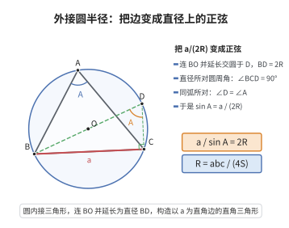

# 三角形外接圆半径公式

> **一句话大白话**：外接圆半径 $R$ 能用"三边长相乘除以 $4$ 倍面积"一步算出来，$R=\frac{abc}{4S}$。
>
> **小例子**：若某三角形三边乘起来 $abc=48$、面积 $S=6$，则 $R=\frac{48}{4\times6}=2$，这正是外接圆半径。

## 介绍

三角形外接圆半径公式 $R = \frac{abc}{4S}$ 给出了三角形的三边与面积同其外接圆半径之间的关系。该公式与正弦定理 $\frac{a}{\sin A} = \frac{b}{\sin B} = \frac{c}{\sin C} = 2R$ 等价，是三角学和几何学中连接边长、角度和面积的重要桥梁，在测量、导航和天文学中有广泛应用。

## 几何直观

图意在说明：直径 BD = 2R 造出一个以 a 为直角边的直角三角形，同弧所对的角相等，于是 sin A = a/(2R)，再配合 S = ½bc sin A 就得到 R = abc/4S。

## 分析

**前置依赖**：正弦定理、三角形面积公式正弦形式 $S = \frac{1}{2}ab\sin C$。

**定理内容**：在 $\triangle ABC$ 中，设三边长分别为 $a,b,c$，面积为 $S$，外接圆半径为 $R$，则

$$
R = \frac{abc}{4S}
$$

**数学内涵**：
- 该公式将三角形外接圆半径表示为三边长的乘积与 $4$ 倍面积之比，形式简洁对称。
- 由正弦定理 $a = 2R\sin A$，代入面积公式 $S = \frac{1}{2}bc\sin A$ 可直接导出 $R = \frac{abc}{4S}$。
- 该公式表明：给定三角形三边，外接圆半径完全确定；面积越大（即三角形越"胖"），外接圆半径越小。

**证明策略**：利用正弦定理将边长用外接圆半径和角的正弦表示，代入三角形面积公式正弦形式即可。

## 思考过程

由正弦定理，$a = 2R\sin A$，$b = 2R\sin B$，$c = 2R\sin C$。代入面积公式 $S = \frac{1}{2}bc\sin A$，得

$$
S = \frac{1}{2} \cdot (2R\sin B) \cdot (2R\sin C) \cdot \sin A = 2R^2\sin A\sin B\sin C
$$

但更直接的方法是将 $S = \frac{1}{2}ab\sin C$ 与正弦定理 $c = 2R\sin C$ 结合，从 $S = \frac{1}{2}ab\sin C$ 中解出 $\sin C = \frac{2S}{ab}$，代入 $\frac{c}{\sin C} = 2R$ 得 $R = \frac{abc}{4S}$。

## 证明过程

**定理**（三角形外接圆半径公式）：在 $\triangle ABC$ 中，外接圆半径 $R = \frac{abc}{4S}$。

**证明**：

由三角形面积公式正弦形式：

$$
S = \frac{1}{2}ab\sin C
$$

解得 $\sin C = \frac{2S}{ab}$。

由正弦定理：

$$
\frac{c}{\sin C} = 2R
$$

代入 $\sin C$ 得：

$$
\frac{c}{\frac{2S}{ab}} = 2R \Rightarrow \frac{abc}{2S} = 2R
$$

因此：

$$
R = \frac{abc}{4S}
$$

$\square$

---

**注**：该公式也可由正弦定理的另一种形式直接导出：由 $a = 2R\sin A$，代入 $S = \frac{1}{2}bc\sin A$，得 $S = \frac{1}{2}bc \cdot \frac{a}{2R} = \frac{abc}{4R}$，即 $R = \frac{abc}{4S}$。

## 课堂问答

**老师**：外接圆半径公式 $R=\frac{abc}{4S}$ 是怎样得来的？

**学生**：由面积公式正弦形式 $S=\frac12 ab\sin C$ 解出 $\sin C=\frac{2S}{ab}$，代入正弦定理 $\frac{c}{\sin C}=2R$，得 $\frac{abc}{2S}=2R$，从而 $R=\frac{abc}{4S}$。

**老师（追问）**：它跟正弦定理是什么关系？

**学生**：它其实是 $\frac{a}{\sin A}=\frac{b}{\sin B}=\frac{c}{\sin C}=2R$ 与面积公式的等价改写。也可由 $a=2R\sin A$ 直接代入 $S=\frac12 bc\sin A$，得 $S=\frac{abc}{4R}$，同样导出结论。

**老师（拓展）**：为什么说"面积越大，外接圆半径越小"？

**学生**：因为三边乘积 $abc$ 固定时，$R$ 与面积 $S$ 成反比；同样三边下三角形越"胖"（$S$ 越大），所需外接圆反而越小。注意别与内切圆的 $r=\frac{S}{s}$ 记混——一个分母是 $4S$，一个是 $s$。
