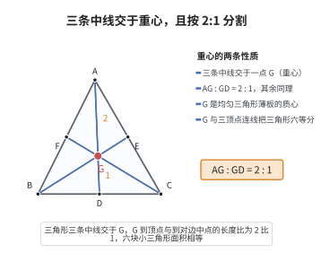

# 三角形重心定理

> **一句话大白话**：三角形的三条中线会交于同一点（重心），而且重心把每条中线切成 $2:1$ 两段，靠近顶点那边更长。
>
> **小例子**：均匀三角形薄板用一根手指顶着重心就能稳稳平衡；若一条中线全长 $9$，则重心到顶点的距离是 $6$，到对边中点只有 $3$（$2:1$）。

## 介绍

三角形重心定理是三角形几何中的基本定理：三角形的三条中线交于一点，这个点称为三角形的重心（centroid），且重心将每条中线分为 $2:1$ 的比例（从顶点到重心：从重心到对边中点）。重心是三角形的三个"中心"之一（其他两个是外心和内心），它在物理学中对应着三角形薄板的质心（或重心），在工程和物理中有重要应用。

## 几何直观

图意在说明：重心把每条中线切成 2:1，这个比例与三角形形状无关；把 G 与三顶点连起来，正好把三角形分成六块等面积图形。

## 分析

**前置依赖**：三角形中位线定理。

**定理内容**：在 $\triangle ABC$ 中，$D, E, F$ 分别为 $BC, CA, AB$ 的中点，则三条中线 $AD, BE, CF$ 交于一点 $G$（重心），且 $AG:GD = BG:GE = CG:GF = 2:1$。

**数学内涵**：
- 重心将每条中线分为 $2:1$ 的比例，即重心到顶点的距离是到对边中点距离的两倍。
- 重心是三角形的"平衡点"——如果三角形是均匀薄板，重心就是物理上的质心。
- 重心的坐标公式：若 $\triangle ABC$ 的顶点坐标为 $(x_1,y_1), (x_2,y_2), (x_3,y_3)$，则重心坐标为 $\left(\frac{x_1+x_2+x_3}{3}, \frac{y_1+y_2+y_3}{3}\right)$。

**证明策略**：
- 先证两条中线交于一点，再证第三条中线经过该点。
- 利用中位线定理和平行四边形性质证明比例关系。

## 思考过程

证明三条中线交于一点，通常的方法是先证明两条中线 $AD$ 和 $BE$ 相交于一点 $G$，然后连接 $C$ 和 $G$ 并延长交 $AB$ 于 $F$，证明 $F$ 是 $AB$ 的中点。

如何证明 $G$ 将中线分为 $2:1$？取 $AD$ 的中点 $H$，连接 $HE$。由于 $E$ 是 $AC$ 的中点，$H$ 是 $AD$ 的中点，$HE$ 是 $\triangle ADC$ 的中位线，$HE \parallel DC$ 且 $HE = \frac{1}{2}DC = \frac{1}{4}BC$。同时，$D$ 是 $BC$ 的中点，$ED$ 是 $\triangle ABC$ 的中位线，$ED \parallel AB$ 且 $ED = \frac{1}{2}AB$。通过这些平行关系可以推出 $G$ 的位置。

## 证明过程

**定理**（三角形重心定理）：三角形的三条中线交于一点（重心），且重心将每条中线分为 $2:1$ 的比例。

**证明**：

设 $D$ 是 $BC$ 的中点，$E$ 是 $AC$ 的中点，$F$ 是 $AB$ 的中点。

**第一步**：证明三条中线交于一点。

$AD$ 和 $BE$ 交于 $G$。连接 $DE$，则 $DE$ 是 $\triangle ABC$ 的中位线，$DE \parallel AB$ 且 $DE = \frac{1}{2}AB$。

在 $\triangle ABG$ 和 $\triangle DEG$ 中：
- $\angle GAB = \angle GDE$（内错角，$DE \parallel AB$）
- $\angle GBA = \angle GED$（内错角）
- $\angle AGB = \angle DGE$（对顶角）

故 $\triangle ABG \sim \triangle DEG$（AAA）。由相似得 $\frac{AG}{DG} = \frac{BG}{EG} = \frac{AB}{DE} = 2$。

因此 $AG:GD = 2:1$，$BG:GE = 2:1$。

**第二步**：证明 $CF$ 也经过 $G$。

连接 $C$ 和 $G$，延长交 $AB$ 于 $F'$。需要证明 $F'$ 是 $AB$ 的中点。

由 $\triangle ABG \sim \triangle DEG$ 得 $\frac{AG}{DG} = 2$，即 $AG = 2DG$，故 $AD = 3DG$。

同理，考虑中线 $CF'$ 与 $AD$ 的交点 $G'$，则有 $AG':G'D = 2:1$，即 $G'$ 将 $AD$ 分成了 $2:1$ 的比例。由于 $AD$ 上满足 $AG:GD = 2:1$ 的点是唯一的，故 $G' = G$，即 $CF$ 经过 $G$。因此三条中线交于同一点 $G$。

$\square$

---

**重心坐标公式**：若 $\triangle ABC$ 的顶点坐标分别为 $A(x_1,y_1)$，$B(x_2,y_2)$，$C(x_3,y_3)$，则重心 $G$ 的坐标为

$$
G\left(\frac{x_1+x_2+x_3}{3},\ \frac{y_1+y_2+y_3}{3}\right)
$$

## 课堂问答

**老师**：重心定理有哪两条结论？

**学生**：一是三条中线共点（重心 $G$）；二是 $G$ 把每条中线分成 $2:1$，即 $AG:GD=BG:GE=CG:GF=2:1$。

**老师（追问）**：这个 $2:1$ 是怎么得到的？

**学生**：连接中点 $D,E$，则 $DE$ 是 $\triangle ABC$ 的中位线，$DE\parallel AB$ 且 $DE=\frac12 AB$。由 $DE\parallel AB$ 得 $\triangle ABG\sim\triangle DEG$，相似比 $\frac{AB}{DE}=2$，于是 $\frac{AG}{DG}=\frac{BG}{EG}=2$。

**老师（拓展）**：怎么证第三条中线也经过这个点？

**学生**：设 $CF'$ 与 $AD$ 交于 $G'$，由同样的推理有 $AG':G'D=2:1$，而 $AD$ 上满足这一比值的点唯一，故 $G'=G$。重心还是均匀薄板的质心，其坐标是顶点坐标的算术平均 $\left(\frac{x_1+x_2+x_3}{3},\frac{y_1+y_2+y_3}{3}\right)$。
