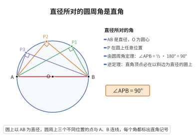

# 泰勒斯定理

> **一句话大白话**：只要把这个圆任意一点和对径两端连起来，构成的那个角一定是直角——"直径所对的圆周角是直角"。
>
> **小例子**：以线段 $AB$ 为直径画圆，圆上任取一点 $C$（不与 $A,B$ 重合），$\angle ACB$ 恒等于 $90^\circ$——这也常用来现场测量、判定直角。

## 介绍

泰勒斯定理（Thales' theorem）是古希腊数学家泰勒斯提出的几何定理：直径所对的圆周角是直角。即，若 $A, B, C$ 是圆上的三点且 $AB$ 是直径，则 $\angle ACB = 90^\circ$。该定理是圆周角定理的特殊情形，也是几何学中最早被证明的定理之一，在几何证明和实际测量（如利用相似三角形测距）中有广泛应用。

## 几何直观

图意在说明：直径对应的圆心角是 180°，圆周角自动减半为 90°；反过来，所有以 AB 为斜边的直角顶点，都落在以 AB 为直径的圆上。

## 分析

**前置依赖**：三角形内角和定理、等腰三角形性质。

**定理内容**：设 $AB$ 是圆 $O$ 的直径，$C$ 是圆上不同于 $A, B$ 的任意一点，则 $\angle ACB = 90^\circ$。

**数学内涵**：
- 泰勒斯定理是圆周角定理的特例：直径所对的圆心角为 $180^\circ$，故所对的圆周角为 $90^\circ$。
- 该定理的逆定理也成立：若 $\angle ACB = 90^\circ$，则 $C$ 在以 $AB$ 为直径的圆上。
- 逆定理常用于判定直角三角形和构造外接圆。

**证明策略**：
- 连接圆心 $O$ 与 $C$，则 $OA = OB = OC = R$（半径）。
- 得到两个等腰三角形 $\triangle AOC$ 和 $\triangle BOC$。
- 利用等腰三角形底角相等和三角形内角和为 $180^\circ$ 推算。

## 思考过程

泰勒斯定理的证明利用了"圆心到圆上任意一点的距离相等"这一基本性质。连接 $OC$ 后，$OA = OC$ 和 $OB = OC$ 意味着 $\triangle AOC$ 和 $\triangle BOC$ 都是等腰三角形。设 $\angle OAC = \angle OCA = \alpha$，$\angle OBC = \angle OCB = \beta$，则 $\angle ACB = \alpha + \beta$。在 $\triangle ABC$ 中，内角和为 $2\alpha + 2\beta = 180^\circ$，故 $\alpha + \beta = 90^\circ$。

这个证明简洁而优雅，只需用到等腰三角形性质和三角形内角和定理。

## 证明过程

**定理**（泰勒斯定理）：若 $AB$ 是圆 $O$ 的直径，$C$ 是圆上不同于 $A, B$ 的点，则 $\angle ACB = 90^\circ$。

**证明**：

连接 $OC$。由于 $OA = OB = OC = R$（半径），$\triangle AOC$ 和 $\triangle BOC$ 都是等腰三角形。

设 $\angle OAC = \angle OCA = \alpha$，$\angle OBC = \angle OCB = \beta$。

在 $\triangle ABC$ 中，三个内角分别为：
- $\angle A = \angle OAC = \alpha$
- $\angle B = \angle OBC = \beta$
- $\angle C = \angle OCA + \angle OCB = \alpha + \beta$

由三角形内角和定理：$\alpha + \beta + (\alpha + \beta) = 180^\circ$，即 $2(\alpha + \beta) = 180^\circ$。

故 $\angle ACB = \alpha + \beta = 90^\circ$。$\square$

---

**逆定理**：若 $\angle ACB = 90^\circ$，则 $C$ 在以 $AB$ 为直径的圆上。

**证明概要**：设 $O$ 为 $AB$ 的中点，连接 $CO$，可证 $CO = \frac{1}{2}AB = AO = BO$，故 $C$ 在以 $O$ 为圆心、$OA$ 为半径的圆上。

## 课堂问答

**老师**：直径所对的圆周角为什么是直角？

**学生**：设 $AB$ 是直径，$C$ 在圆上，则 $\angle ACB=90^\circ$。连接 $OC$，由 $OA=OB=OC=R$ 知 $\triangle AOC$ 与 $\triangle BOC$ 都是等腰三角形，设底角分别为 $\alpha,\beta$，则 $\angle ACB=\alpha+\beta$；而内角和 $2\alpha+2\beta=180^\circ$，故 $\alpha+\beta=90^\circ$。

**老师（追问）**：它的逆命题成立吗？

**学生**：成立。若 $\angle ACB=90^\circ$，取 $AB$ 的中点 $O$，可证 $CO=\frac12 AB=AO=BO$，即 $C$ 落在以 $AB$ 为直径的圆上。逆定理常用于判定直角或构造外接圆。

**老师（拓展）**：它与圆周角定理有什么联系？

**学生**：它是圆周角定理的特例——直径对应的圆心角为 $180^\circ$，其一半正是 $90^\circ$。它也是历史上最早被证明的几何定理之一，并可由外心定理在直角三角形中直接看出。
