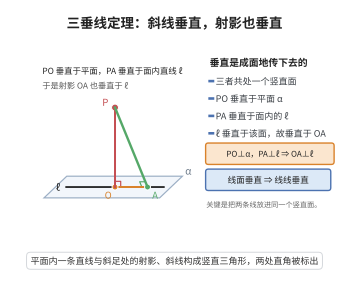

# 三垂线定理

> **一句话大白话**：一根斜棍在地面上的投影，如果被地面上的一条线压着垂直（成直角），那这条线跟斜棍本身也是垂直的。
>
> **小例子**：斜棍 $PO$ 在地面的投影是 $OA$，地面上直线 $l\perp OA$，则必有 $l\perp PO$——好比墙根到你的那条视线横过来看，只要和影子垂直就和棍子本身垂直。

## 介绍

三垂线定理是立体几何中关于线面垂直关系的重要定理：如果平面内的一条直线垂直于斜线在平面上的射影，那么它也垂直于这条斜线。该定理揭示了空间中线线垂直、线面垂直之间的转化关系，是解决立体几何中垂直关系问题的常用工具。

## 几何直观

图意在说明：PO 垂直于平面，PA 垂直于面内的 ℓ，于是 ℓ 垂直于整个竖直面 POA，射影 OA 自然也就垂直于 ℓ。

## 分析

**前置依赖**：线面垂直判定定理。

**定理内容**：设 $PO$ 是平面 $\alpha$ 的斜线，$O$ 为斜足，$PA \perp \alpha$ 于 $A$，则 $OA$ 是 $PO$ 在平面 $\alpha$ 上的射影。若平面 $\alpha$ 内的直线 $l$ 垂直于 $OA$，则 $l \perp PO$。

**数学内涵**：
- 三垂线定理建立了"平面内直线 $\perp$ 射影 $\Rightarrow$ 平面内直线 $\perp$ 斜线"的推理路径。
- 它是"线面垂直判定定理"的一个推论，本质上是将三维空间中的垂直关系转化为二维平面上的垂直关系。
- 三垂线定理在计算空间距离、空间角以及证明空间垂直关系中有广泛应用。

**证明策略**：
- 由 $PA \perp \alpha$ 得 $PA \perp l$。
- 由 $l \perp OA$ 且 $PA \perp l$ 得 $l \perp$ 平面 $PAO$。
- 故 $l \perp PO$。

## 思考过程

三垂线定理的证明利用了线面垂直的判定定理。已知 $PA \perp \alpha$，所以 $PA$ 垂直于平面 $\alpha$ 内的任何直线，包括 $l$。又已知 $l \perp OA$，因此 $l$ 垂直于平面 $PAO$ 内的两条相交直线 $PA$ 和 $OA$，由线面垂直判定定理，$l \perp$ 平面 $PAO$。于是 $l$ 垂直于平面 $PAO$ 内的任何直线，包括 $PO$。

这个证明的关键在于将"垂直于射影"和"垂直于斜线"通过线面垂直联系起来。

## 证明过程

**定理**（三垂线定理）：设 $PO$ 是平面 $\alpha$ 的斜线，$PA \perp \alpha$ 于 $A$，$OA$ 是 $PO$ 在 $\alpha$ 上的射影。若 $l \subset \alpha$ 且 $l \perp OA$，则 $l \perp PO$。

**证明**：

由于 $PA \perp \alpha$，且 $l \subset \alpha$，故 $PA \perp l$（线面垂直的定义：垂直于平面的直线垂直于平面内的任何直线）。

已知 $l \perp OA$，且 $PA \perp l$，即 $l$ 垂直于平面 $PAO$ 内的两条相交直线 $PA$ 和 $OA$（$PA \cap OA = A$）。

由线面垂直判定定理：若一条直线垂直于平面内的两条相交直线，则该直线垂直于该平面，故 $l \perp$ 平面 $PAO$。

由于 $PO \subset$ 平面 $PAO$，故 $l \perp PO$。$\square$

---

**三垂线逆定理**：若 $l \subset \alpha$ 且 $l \perp PO$，则 $l \perp OA$。证明思路与三垂线定理类似，从 $l \perp PO$ 和 $PA \perp l$ 推出 $l \perp$ 平面 $PAO$，从而 $l \perp OA$。

## 课堂问答

**老师**：平面内一条直线垂直于斜线的射影，凭什么它也垂直于斜线本身？

**学生**：结论：若 $PA\perp\alpha$、$OA$ 为 $PO$ 在 $\alpha$ 上的射影、$l\subset\alpha$ 且 $l\perp OA$，则 $l\perp PO$。理由：由 $PA\perp\alpha$ 得 $PA\perp l$；又 $l\perp OA$，于是 $l$ 垂直于平面 $PAO$ 内两条相交直线 $PA,OA$，由线面垂直判定定理得 $l\perp$ 平面 $PAO$，而 $PO\subset$ 平面 $PAO$，故 $l\perp PO$。

**老师（追问）**：关键一步是哪一步？为什么非要有 $PA\perp\alpha$？

**学生**：关键是把"$l\perp$ 射影"升级为"$l\perp$ 平面 $PAO$"。若没有 $PA\perp\alpha$，就得不到 $PA\perp l$，凑不齐两条相交直线，结论会失效。所以三垂线定理本质是线面垂直判定定理的应用。

**老师（拓展）**："三垂线"这三条垂线分别指什么？凭什么这样命名？

**学生**：指 $PA\perp\alpha$（线面垂）、$l\perp OA$（线线垂）以及推出的 $l\perp PO$，三者串成空间垂直关系的一条链。它把三维判定降为平面内垂直，常用于求二面角与点面距。常见误区是忘了 $l$ 必须落在平面 $\alpha$ 内，$OA$ 必须是射影而非任意连线。
