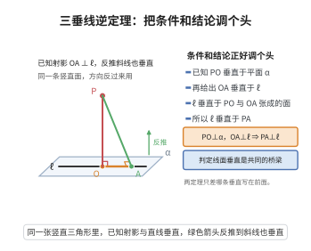

# 三垂线逆定理

> **一句话大白话**：反过来也成立——地面上那条线要是跟斜棍本身垂直，那它也跟斜棍在地上的投影垂直。
>
> **小例子**：$l\perp PO$ 时必有 $l\perp OA$（$OA$ 是 $PO$ 在地面的投影）。就像你把一根棍斜立在地上，只要从侧面看它与你的取向线成直角，从上方俯视它也一定和它的影子成直角。

## 介绍

三垂线逆定理是三垂线定理的逆命题：如果平面内的一条直线垂直于斜线，那么它也垂直于斜线在平面上的射影。该定理与三垂线定理一起构成了立体几何中处理线线垂直与线面垂直关系的完整工具，在空间几何证明和计算中有着广泛应用。

## 几何直观

图意在说明：已知 PO 垂直于平面、射影 OA 垂直于 ℓ，同样由 ℓ 垂直于竖直面推出 PA 垂直于 ℓ；两定理共用一座桥，只是先后互换。

## 分析

**前置依赖**：线面垂直判定定理。

**定理内容**：设 $PO$ 是平面 $\alpha$ 的斜线，$PA \perp \alpha$ 于 $A$，$OA$ 是 $PO$ 在平面 $\alpha$ 上的射影。若平面 $\alpha$ 内的直线 $l$ 垂直于 $PO$，则 $l \perp OA$。

**数学内涵**：
- 三垂线逆定理建立了"平面内直线 $\perp$ 斜线 $\Rightarrow$ 平面内直线 $\perp$ 射影"的推理路径。
- 它与三垂线定理互为逆命题，合称"三垂线定理及其逆定理"。
- 这一对定理在空间几何中具有广泛的应用，特别是在计算空间角、距离时。

**证明策略**：
- 由 $PA \perp \alpha$ 得 $PA \perp l$。
- 由 $l \perp PO$ 且 $PA \perp l$ 得 $l \perp$ 平面 $PAO$。
- 故 $l \perp OA$。

## 思考过程

三垂线逆定理的证明与三垂线定理几乎完全对称。已知 $PA \perp \alpha$，所以 $PA \perp l$。又已知 $l \perp PO$，因此 $l$ 垂直于平面 $PAO$ 内的两条相交直线 $PO$ 和 $PA$，由线面垂直判定定理，$l \perp$ 平面 $PAO$，从而 $l \perp OA$。

## 证明过程

**定理**（三垂线逆定理）：设 $PO$ 是平面 $\alpha$ 的斜线，$PA \perp \alpha$ 于 $A$，$OA$ 是 $PO$ 在 $\alpha$ 上的射影。若 $l \subset \alpha$ 且 $l \perp PO$，则 $l \perp OA$。

**证明**：

由于 $PA \perp \alpha$，且 $l \subset \alpha$，故 $PA \perp l$（线面垂直的定义）。

已知 $l \perp PO$，且 $PA \perp l$，即 $l$ 垂直于平面 $PAO$ 内的两条相交直线 $PO$ 和 $PA$（$PO \cap PA = P$）。

由线面垂直判定定理，$l \perp$ 平面 $PAO$。

由于 $OA \subset$ 平面 $PAO$，故 $l \perp OA$。$\square$

---

**注**：三垂线定理及其逆定理通常被合称为"三垂线定理"，在解题时可以根据已知条件灵活选择使用正定理或逆定理。它们共同揭示了斜线、射影以及平面内直线之间的垂直关系链。

## 课堂问答

**老师**：反过来问：平面内一条直线垂直于斜线，是否垂直于它的射影？

**学生**：成立。若 $PA\perp\alpha$、$OA$ 是 $PO$ 在 $\alpha$ 上的射影、$l\subset\alpha$ 且 $l\perp PO$，则 $l\perp OA$。理由：$PA\perp\alpha\Rightarrow PA\perp l$；又 $l\perp PO$，于是 $l$ 垂直于平面 $PAO$ 内相交直线 $PO,PA$，得 $l\perp$ 平面 $PAO$，而 $OA\subset$ 平面 $PAO$，故 $l\perp OA$。

**老师（追问）**：它和正定理的证明差在哪？为什么要分开记？

**学生**：证明几乎对称，只是把"$l\perp OA$"与"$l\perp PO$"的已知、结论互换，落脚点也随之互换。分开记是因为用哪个取决于已知是"垂直射影"还是"垂直斜线"。两者都要求 $l$ 在 $\alpha$ 内且 $PA\perp\alpha$，缺一不成立。

**老师（拓展）**：正逆合起来给了什么统一的图景？

**学生**：给出"平面内直线 $\perp$ 射影 $\iff$ 平面内直线 $\perp$ 斜线"的等价链，因为 $l\perp$ 平面 $PAO$ 是二者共同的充要内核。它把空间垂直判定归结为平面内垂直，可正用逆用灵活切换；误区是把它当成普通逆命题而忽视前提条件。
