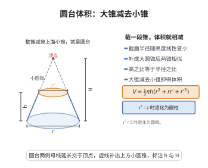

# 圆台体积公式

> **一句话大白话**：圆台体积等于一个大圆锥挖掉顶上小圆锥后剩下的部分，公式 $V=\frac{\pi h}{3}(r_1^2+r_1r_2+r_2^2)$ 就是算这“剩下一截”的体积。
>
> **小例子**：上底半径 $r_1=1$、下底半径 $r_2=3$、高 $h=3$ 的圆台，体积 $V=\frac{\pi\cdot 3}{3}(1+3+9)=13\pi$，相当于底面积约 $\pi\cdot 3^2$ 的大圆锥削去顶点那些料。

## 介绍

圆台体积公式是立体几何中的重要公式：上底面半径为 $r_1$、下底面半径为 $r_2$、高为 $h$ 的圆台体积为 $V = \frac{\pi h}{3}(r_1^2 + r_2^2 + r_1 r_2)$。该公式可以看作是大圆锥减去小圆锥的结果，是圆锥体积公式的直接推广。在工程容器设计、建筑结构、机械制造等领域有广泛应用。

## 几何直观

图意在说明：上下底面相似，两条母线延长后交于一点，把圆台补成大圆锥；大锥减去上面的小圆锥，就是圆台的体积。

## 分析

**前置依赖**：圆锥体积公式。

**定理内容**：上底面半径为 $r_1$、下底面半径为 $r_2$、高为 $h$ 的圆台体积为 $V = \frac{\pi h}{3}(r_1^2 + r_2^2 + r_1 r_2)$。

**数学内涵**：
- 该公式是圆锥体积公式的直接推论：圆台可以看作是大圆锥截去顶部小圆锥后剩余的部分。
- 当 $r_1 = 0$（上底面缩为一点）时，公式退化为圆锥体积公式 $V = \frac{1}{3}\pi r_2^2 h$。
- 当 $r_1 = r_2$（上下底面半径相等）时，公式退化为圆柱体积公式 $V = \pi r^2 h$。
- 该公式与棱台体积公式 $V = \frac{h}{3}(S_1 + S_2 + \sqrt{S_1 S_2})$ 一致，其中 $S_1 = \pi r_1^2$，$S_2 = \pi r_2^2$。

**证明策略**：
- 将圆台补全为大圆锥，利用相似比求出小圆锥的高，然后大圆锥体积减去小圆锥体积。
- 或利用积分法，沿高度方向积分。

## 思考过程

圆台体积公式的推导与棱台完全类似，只需将棱台的上底面积 $S_1$ 和下底面积 $S_2$ 分别替换为 $\pi r_1^2$ 和 $\pi r_2^2$ 即可。圆台可以看作是由直角梯形绕垂直于底边的腰旋转一周得到的旋转体，因此也可以用旋转体体积积分直接计算。

## 证明过程

**定理**（圆台体积公式）：上底面半径为 $r_1$、下底面半径为 $r_2$、高为 $h$ 的圆台体积为 $V = \frac{\pi h}{3}(r_1^2 + r_2^2 + r_1 r_2)$。

**证明**（补全法）：

将圆台补全为大圆锥。设顶点到上底面的距离为 $h_1$，顶点到下底面的距离为 $h_2$，则圆台高 $h = h_2 - h_1$。

由相似三角形，半径之比等于高度之比：

$$
\frac{r_1}{r_2} = \frac{h_1}{h_2} \quad \Rightarrow \quad h_1 = \frac{r_1}{r_2} h_2
$$

因此 $h = h_2 - h_1 = \left(1 - \frac{r_1}{r_2}\right) h_2$，即 $h_2 = \frac{r_2}{r_2 - r_1} h$。

大圆锥体积为 $V_2 = \frac{1}{3}\pi r_2^2 h_2$，小圆锥体积为 $V_1 = \frac{1}{3}\pi r_1^2 h_1 = \frac{1}{3}\pi r_1^2 \cdot \frac{r_1}{r_2} h_2 = \frac{1}{3}\pi \frac{r_1^3}{r_2} h_2$。

圆台体积为

$$
V = V_2 - V_1 = \frac{1}{3}\pi h_2 \left(r_2^2 - \frac{r_1^3}{r_2}\right) = \frac{1}{3}\pi \cdot \frac{r_2}{r_2 - r_1} h \cdot \frac{r_2^3 - r_1^3}{r_2}
$$

利用立方差公式 $r_2^3 - r_1^3 = (r_2 - r_1)(r_2^2 + r_1 r_2 + r_1^2)$，得

$$
V = \frac{1}{3}\pi h \cdot \frac{r_2^3 - r_1^3}{r_2 - r_1} = \frac{1}{3}\pi h (r_2^2 + r_1 r_2 + r_1^2)
$$

即

$$
V = \frac{\pi h}{3}(r_1^2 + r_2^2 + r_1 r_2)
$$

$\square$

---

**证明**（旋转体积分法）：

将圆台视为由直角梯形绕 $x$ 轴旋转一周得到的旋转体。梯形的斜边对应直线方程：在 $x$ 高度处，半径 $r(x) = r_1 + \frac{r_2 - r_1}{h} x$（$0 \leq x \leq h$）。

由旋转体体积公式：

$$
V = \pi \int_0^h [r(x)]^2\,dx = \pi \int_0^h \left(r_1 + \frac{r_2 - r_1}{h} x\right)^2 dx
$$

令 $t = \frac{x}{h}$，则 $dx = h\,dt$，积分得

$$
V = \pi h \int_0^1 (r_1 + (r_2 - r_1)t)^2\,dt
$$

展开并积分：

$$
V = \pi h \int_0^1 [r_1^2 + 2r_1(r_2 - r_1)t + (r_2 - r_1)^2 t^2]\,dt
$$

$$
V = \pi h \left[r_1^2 + r_1(r_2 - r_1) + \frac{1}{3}(r_2 - r_1)^2\right]
$$

化简得

$$
V = \frac{\pi h}{3}(r_1^2 + r_2^2 + r_1 r_2)
$$

$\square$

## 课堂问答

**老师**：上底半径 $r_1$、下底半径 $r_2$、高 $h$ 的圆台体积是多少？

**学生**：$V=\frac{\pi h}{3}(r_1^2+r_2^2+r_1r_2)$。理由：补成大圆锥，由相似比 $r_1/r_2=h_1/h_2$ 消去小锥得 $V=V_2-V_1$，再用立方差 $r_2^3-r_1^3=(r_2-r_1)(r_2^2+r_1r_2+r_1^2)$ 化简即得。也可把半径视为 $x$ 的线性函数做旋转体积分 $\pi\int_0^h r(x)^2\,dx$，结果一致。

**老师（追问）**：怎么验证两端退化、并与棱台公式一致？

**学生**：$r_1=0$ 得 $\frac13\pi r_2^2h$（圆锥）；$r_1=r_2=r$ 得 $\pi r^2h$（圆柱）。把 $S_i=\pi r_i^2$ 代入棱台 $\frac h3\left(S_1+S_2+\sqrt{S_1S_2}\right)$，因 $\sqrt{\pi r_1^2\pi r_2^2}=\pi r_1r_2$，两者完全一致。

**老师（拓展）**：这里最容易错的地方是什么？

**学生**：错在漏掉或写错交叉项，以及把斜高或母线当高 $h$。真正的高是两底面间的垂直距离；半径线性插值 $r(x)=r_1+\frac{r_2-r_1}{h}x$，平方积分后自然冒出 $r_1r_2$ 项，这是 $\int x^2$ 型积分的印记，绝非可省的常数项。
