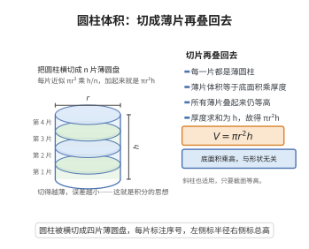

# 圆柱体积公式

> **一句话大白话**：圆柱的体积就是“底面积 × 高”，把盖子掀开能放多少东西，全看底面的大小和高度。
>
> **小例子**：半径 $r=2$、高 $h=5$ 的水杯，底面积 $\pi\cdot 2^2=4\pi$，体积 $V=4\pi\cdot 5=20\pi$，即能装约 $62.8$ 立方单位的水。

## 介绍

圆柱体积公式是立体几何中最基本的公式之一：底面半径为 $r$、高为 $h$ 的圆柱体的体积为 $V = \pi r^2 h$。该公式早在古希腊时期就被阿基米德等数学家掌握，是积分学思想的早期体现。在工程、建筑、容器设计等领域有广泛应用。

## 几何直观

图意在说明：把圆柱横切成许多薄圆盘，每片体积约为底面积乘厚度；所有厚度加起来正好是高，于是总体积为 πr²h。

## 分析

**前置依赖**：祖暅原理。

**定理内容**：底面半径为 $r$、高为 $h$ 的圆柱体体积为 $V = \pi r^2 h$。

**数学内涵**：
- 圆柱体积等于底面积乘以高，这是直柱体体积公式 $V = Sh$ 的特例。
- 该公式体现了"二维截面积沿高度方向积分"的三维体积计算思想。
- 无论圆柱是直圆柱还是斜圆柱，体积公式相同（祖暅原理）。

**证明策略**：
- 方法一（祖暅原理）：利用底面积和高直接得出。
- 方法二（积分法）：将圆柱沿高度方向分割为薄圆片，积分求和。

## 思考过程

圆柱体积公式的直观理解十分简单：将圆柱想象为一叠薄圆片，每个圆片的面积为 $\pi r^2$，厚度为 $dh$，体积为 $\pi r^2\,dh$，将所有这些薄片从 $0$ 到 $h$ 累加，就得到 $V = \pi r^2 h$。这本质上就是积分思想。

## 证明过程

**定理**（圆柱体积公式）：底面半径为 $r$、高为 $h$ 的圆柱体体积为 $V = \pi r^2 h$。

**证明**（祖暅原理法）：

将圆柱的底面放在 $x=0$ 平面，顶面在 $x=h$ 平面。在高度 $x$ 处（$0 \leq x \leq h$），截面是半径为 $r$ 的圆，截面面积为

$$
A(x) = \pi r^2
$$

由祖暅原理，体积等于截面积沿高度的积分：

$$
V = \int_0^h A(x)\,dx = \int_0^h \pi r^2\,dx = \pi r^2 h
$$

$\square$

---

**证明**（积分法）：

将圆柱视为由直线 $y = r$（$0 \leq x \leq h$）绕 $x$ 轴旋转一周得到的旋转体。由旋转体体积公式：

$$
V = \pi \int_0^h r^2\,dx = \pi r^2 h
$$

$\square$

## 课堂问答

**老师**：圆柱体积为什么直接就是底面积乘高？

**学生**：$V=\pi r^2 h=Sh$。理由：把圆柱看成无数薄圆片，每片面积都是 $\pi r^2$、厚度 $dx$，累加得 $V=\int_0^h\pi r^2\,dx=\pi r^2 h$。截面面积在高度上恒为常数，是祖暅原理最平凡的情形。

**老师（追问）**：那斜圆柱（像斜着切的柱子）体积会变吗？

**学生**：不变。沿高度方向取截面，每个截面仍与底全等、面积为 $\pi r^2$，面积函数相同，由祖暅原理体积相等。误区是拿"侧棱长度"当高——决定体积的是两底面间的垂直距离 $h$，不是母线长。

**老师（拓展）**：能把这个结论看作更一般公式的特例吗？

**学生**：能。棱台公式令 $S_1=S_2=S$ 化为 $V=Sh$，圆台公式令 $r_1=r_2=r$ 化为 $V=\pi r^2h$，都退化为柱体。柱体是"截面不变"的极端，锥体是"截面线性缩到零"的极端，二者由 $V=\int_0^h A(x)\,dx$ 统一。
