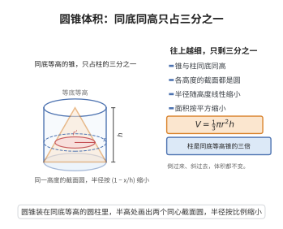

# 圆锥体积公式

> **一句话大白话**：圆锥能装的料，只有同底等高的圆柱的三分之一，因为越往上截面越小。
>
> **小例子**：半径 $r=3$、高 $h=4$ 的圆锥，同底等高的圆柱体积 $=9\pi\cdot4=36\pi$，圆锥体积 $V=\frac13\cdot9\pi\cdot4=12\pi$，正好是三分之一。

## 介绍

圆锥体积公式是立体几何中的基本公式：底面半径为 $r$、高为 $h$ 的圆锥体体积为 $V = \frac{1}{3}\pi r^2 h$。该公式最早由古希腊数学家欧几里得在《几何原本》中给出证明，是等底等高圆柱体积的三分之一。该公式在工程、建筑、物理等领域有广泛应用。

## 几何直观

图意在说明：同一高度的截面都是圆，半径按 1 减 x/h 线性缩小，面积按平方缩小；累加起来，锥的体积正好是等底等高柱的三分之一。

## 分析

**前置依赖**：祖暅原理。

**定理内容**：底面半径为 $r$、高为 $h$ 的圆锥体体积为 $V = \frac{1}{3}\pi r^2 h$。

**数学内涵**：
- 圆锥体积是等底等高圆柱体积的三分之一，这一比例关系是锥体体积公式 $V = \frac{1}{3}Sh$ 的特例。
- 该公式揭示了"锥体"与"柱体"之间的本质体积关系，系数 $\frac{1}{3}$ 来源于积分中 $x^2$ 项的积分结果。
- 无论圆锥是直圆锥还是斜圆锥，体积公式相同（祖暅原理）。

**证明策略**：
- 方法一（祖暅原理）：构造与圆锥等底等高的圆柱和棱锥进行比较。
- 方法二（积分法）：将圆锥沿高度方向分割为薄圆片，利用相似三角形确定截面半径，积分求和。

## 思考过程

圆锥体积公式的推导可以通过积分直观理解：将圆锥沿高度方向切成无数薄片，在高度 $x$ 处，截面半径与高度成正比（由相似三角形，$\frac{r(x)}{r} = \frac{x}{h}$，即 $r(x) = \frac{r}{h}x$），截面面积为 $\pi \left(\frac{r}{h}x\right)^2$，从 $0$ 到 $h$ 积分即得体积。

## 证明过程

**定理**（圆锥体积公式）：底面半径为 $r$、高为 $h$ 的圆锥体体积为 $V = \frac{1}{3}\pi r^2 h$。

**证明**（积分法）：

将圆锥的顶点放在 $x=0$ 处，底面在 $x=h$ 处。在高度 $x$ 处（$0 \leq x \leq h$），由相似三角形，截面半径为

$$
r(x) = \frac{r}{h}x
$$

截面面积为

$$
A(x) = \pi \left(\frac{r}{h}x\right)^2 = \frac{\pi r^2}{h^2} x^2
$$

因此体积为

$$
V = \int_0^h A(x)\,dx = \frac{\pi r^2}{h^2} \int_0^h x^2\,dx = \frac{\pi r^2}{h^2} \cdot \frac{h^3}{3} = \frac{1}{3}\pi r^2 h
$$

$\square$

---

**证明**（祖暅原理法）：

考虑一个底面半径为 $r$、高为 $h$ 的圆锥和一个等底等高的棱锥。由祖暅原理，在任意高度 $x$ 处，圆锥的截面面积与棱锥的截面面积之比等于底面面积之比，但两者形状不同而不直接可比。更直接的方法是将圆锥与一个同底等高的圆柱对比，并利用三棱锥体积公式（$V = \frac{1}{3}Sh$）通过积分思想推广。

实际上，利用祖暅原理可证明：任何锥体（圆锥、棱锥）的体积都是等底等高柱体体积的三分之一。因此

$$
V = \frac{1}{3} \times (\pi r^2) \times h = \frac{1}{3}\pi r^2 h
$$

$\square$

## 课堂问答

**老师**：底面半径 $r$、高 $h$ 的圆锥体积是多少？凭什么和圆柱差了三倍？

**学生**：结论是 $V=\frac{1}{3}\pi r^2 h$，恰为等底等高圆柱的 $\frac13$。理由是把圆锥沿高切成薄片，由相似比得高度 $x$ 处半径 $r(x)=\frac{r}{h}x$，截面面积 $A(x)=\frac{\pi r^2}{h^2}x^2$，于是 $V=\int_0^h A(x)\,dx=\frac{\pi r^2}{h^2}\cdot\frac{h^3}{3}$。系数 $\frac13$ 来自 $\int x^2$ 而不是 $\int x$，所以绝不是二分之一。

**老师（追问）**：若把顶点平移，变成一个斜圆锥，公式还成立吗？

**学生**：照样成立。斜圆锥在高度 $x$ 处的截面虽然偏心，但仍是半径按 $\frac{x}{h}$ 线性缩放的圆，面积函数与直圆锥完全相同，由祖暅原理体积相等。真正决定体积的只是"截面面积随高度的函数"，与形状和摆放无关。

**老师（拓展）**：那凭什么说一般锥体体积普遍是柱体的三分之一？

**学生**：因为任何锥体的截面都按相似比平方缩放，$A(x)=S\cdot\left(\frac{x}{h}\right)^2$，积分恒得 $\frac13 Sh$，圆锥 $S=\pi r^2$ 只是特例。常见误区是以为 $\frac13$ 来自"平均高度"，其实它是 $x^2$ 积分的必然结果；若误把截面当线性变化就会算成 $\frac12$。
