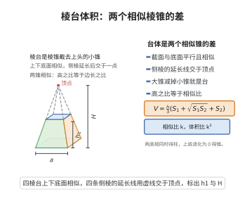

# 棱台体积公式

> **一句话大白话**：棱台是一只大棱锥被削掉尖顶后剩下的“平头锥”，体积按底面大小错开两截之和来加权平均。
>
> **小例子**：上底 $S_1=1$、下底 $S_2=4$、高 $h=3$ 的棱台，$V=\frac{3}{3}\bigl(1+4+\sqrt{1\times4}\bigr)=1+4+2=7$。

## 介绍

棱台体积公式是立体几何中的重要公式：设棱台的上底面积为 $S_1$、下底面积为 $S_2$、高为 $h$，则体积为 $V = \frac{h}{3}(S_1 + S_2 + \sqrt{S_1 S_2})$。该公式可以看作是大棱锥减去小棱锥的结果，是棱锥体积公式的直接推广。在土方工程、建筑结构设计等领域有广泛应用。

## 几何直观

图意在说明：棱台的侧棱延长后交于一点，可补成一个大棱锥；上下两个棱锥相似，高之比等于边长之比，台体体积就是两者之差。

## 分析

**前置依赖**：棱锥体积公式。

**定理内容**：上底面积为 $S_1$、下底面积为 $S_2$、高为 $h$ 的棱台体积为 $V = \frac{h}{3}(S_1 + S_2 + \sqrt{S_1 S_2})$。

**数学内涵**：
- 该公式是棱锥体积公式的直接推论：棱台可以看作是大棱锥截去顶部小棱锥后剩余的部分。
- 当 $S_1 = 0$（上底面缩为一点）时，公式退化为棱锥体积公式 $V = \frac{1}{3} S_2 h$。
- 当 $S_1 = S_2$（上下底面相等）时，公式退化为棱柱体积公式 $V = S h$。
- 此公式对圆台也同样适用（将 $S_1$、$S_2$ 替换为上下底面圆的面积）。

**证明策略**：
- 将棱台补全为大棱锥，利用相似比求出小棱锥的高，然后大棱锥体积减去小棱锥体积。
- 或利用积分法，沿高度方向积分。

## 思考过程

棱台体积公式的推导关键在于将棱台视为大棱锥截去小棱锥的结果。设大棱锥的高为 $h_2$，小棱锥的高为 $h_1$，棱台的高为 $h = h_2 - h_1$。由相似性，面积比等于相似比的平方：$\frac{S_1}{S_2} = \left(\frac{h_1}{h_2}\right)^2$，由此可解出 $h_1$ 和 $h_2$，进而得到体积差。

## 证明过程

**定理**（棱台体积公式）：上底面积为 $S_1$、下底面积为 $S_2$、高为 $h$ 的棱台体积为 $V = \frac{h}{3}(S_1 + S_2 + \sqrt{S_1 S_2})$。

**证明**（补全法）：

将棱台补全为一个大棱锥。设顶点到上底面的距离为 $h_1$，顶点到下底面的距离为 $h_2$，则棱台高 $h = h_2 - h_1$。

由相似性，棱锥在高度 $x$ 处的截面面积与底面面积之比为 $\left(\frac{x}{h_2}\right)^2$，因此

$$
\frac{S_1}{S_2} = \left(\frac{h_1}{h_2}\right)^2 \quad \Rightarrow \quad \frac{h_1}{h_2} = \sqrt{\frac{S_1}{S_2}}
$$

设 $k = \frac{h_1}{h_2} = \sqrt{\frac{S_1}{S_2}}$，则 $h_1 = k h_2$，$h = h_2 - h_1 = (1 - k)h_2$。

大棱锥体积为 $V_2 = \frac{1}{3} S_2 h_2$，小棱锥体积为 $V_1 = \frac{1}{3} S_1 h_1 = \frac{1}{3} S_1 k h_2$。

棱台体积为

$$
V = V_2 - V_1 = \frac{1}{3} S_2 h_2 - \frac{1}{3} S_1 k h_2
$$

由 $k = \sqrt{\frac{S_1}{S_2}}$ 和 $h_2 = \frac{h}{1 - k}$，代入得

$$
V = \frac{1}{3} h_2 (S_2 - S_1 k) = \frac{1}{3} \cdot \frac{h}{1 - k} \cdot (S_2 - S_1 k)
$$

由于 $k = \sqrt{\frac{S_1}{S_2}}$，有 $S_1 = S_2 k^2$，代入得

$$
V = \frac{h}{3(1 - k)} (S_2 - S_2 k^2 \cdot k) = \frac{h}{3(1 - k)} \cdot S_2 (1 - k^3)
$$

利用因式分解 $1 - k^3 = (1 - k)(1 + k + k^2)$，得

$$
V = \frac{h}{3} \cdot S_2 (1 + k + k^2) = \frac{h}{3} \left(S_2 + S_2 k + S_2 k^2\right)
$$

由于 $S_2 k = S_2 \sqrt{\frac{S_1}{S_2}} = \sqrt{S_1 S_2}$，$S_2 k^2 = S_1$，因此

$$
V = \frac{h}{3} (S_1 + S_2 + \sqrt{S_1 S_2})
$$

$\square$

## 课堂问答

**老师**：上底 $S_1$、下底 $S_2$、高 $h$ 的棱台体积是多少？为什么中间带个根号？

**学生**：$V=\frac{h}{3}\left(S_1+S_2+\sqrt{S_1S_2}\right)$。理由：补成大棱锥，由面积比等于相似比平方得 $S_1/S_2=(h_1/h_2)^2$，即 $k=h_1/h_2=\sqrt{S_1/S_2}$；由 $V=V_2-V_1=\frac13 h_2(S_2-S_1k)$ 代入 $h_2=\frac{h}{1-k}$，并用 $1-k^3=(1-k)(1+k+k^2)$，即得三项之和，根号项 $S_2k=\sqrt{S_1S_2}$。

**老师（追问）**：两个极端情形能对得上吗？

**学生**：能。$S_1=0$ 得 $V=\frac13 S_2h$，退化为棱锥；$S_1=S_2=S$ 得 $V=Sh$，退化为棱柱。公式在两端连续过渡，说明它是锥与柱的插值。常见误区是把 $\sqrt{S_1S_2}$ 写成算术平均 $\frac{S_1+S_2}{2}$，那样连 $S_1=S_2$ 都凑不对。

**老师（拓展）**：圆台也用它吗？

**学生**：用，把 $S_1=\pi r_1^2$、$S_2=\pi r_2^2$ 代入即得 $V=\frac{\pi h}{3}(r_1^2+r_2^2+r_1r_2)$，因为 $\sqrt{\pi r_1^2\cdot\pi r_2^2}=\pi r_1r_2$。可见根号项正是几何平均的平方根，是与算术平均的本质区别。
