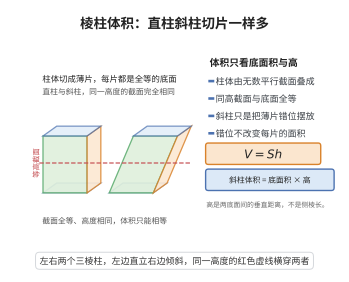

# 棱柱体积公式

> **一句话大白话**：棱柱就是一叠形状不变、厚度相加的薄片，体积 = 底面积 × 高。
>
> **小例子**：三棱柱底面积 $S=6$、高 $h=5$，体积 $V=6\times5=30$；哪怕把它斜着推，只要底面积和高不变，体积仍是 $30$。

## 介绍

棱柱体积公式是立体几何中最基本的公式之一：底面积为 $S$、高为 $h$ 的棱柱体积为 $V = Sh$。该公式是柱体体积计算的通用公式，适用于三棱柱、四棱柱、五棱柱等任意棱柱。该公式在建筑、工程、几何计算等领域有广泛应用。

## 几何直观

图意在说明：柱体由无数平行于底面的薄片叠成，同一高度的截面与底面全等；斜柱只是把薄片错位摆放，错位不改变面积，所以体积仍是底面积乘高。

## 分析

**前置依赖**：祖暅原理。

**定理内容**：底面积为 $S$、高为 $h$ 的棱柱体积为 $V = Sh$。

**数学内涵**：
- 棱柱体积等于底面积乘以高，这是所有直柱体（包括圆柱、棱柱）体积计算的统一公式。
- 对于斜棱柱，只要底面积和高（两平行底面之间的垂直距离）不变，体积不变，体现了祖暅原理的核心思想。
- 该公式为 $V = Sh$ 是三维空间中"面积沿直线方向均匀扫掠"的度量。

**证明策略**：
- 方法一（祖暅原理）：将棱柱与等底面积、等高的长方体进行比较。
- 方法二（积分法）：将棱柱沿高度方向分割为薄片，积分求和。

## 思考过程

棱柱体积公式的直观理解非常自然：将棱柱想象为一叠薄片，每个薄片的面积都是底面积 $S$，厚度为 $dh$，体积为 $S\,dh$，将所有薄片的体积从 $0$ 到 $h$ 累加，即得 $V = Sh$。对于斜棱柱，只要每个水平截面的面积都等于底面积 $S$，公式仍然成立。

## 证明过程

**定理**（棱柱体积公式）：底面积为 $S$、高为 $h$ 的棱柱体积为 $V = Sh$。

**证明**（祖暅原理法）：

将棱柱的底面放在 $x=0$ 平面，顶面在 $x=h$ 平面。在高度 $x$ 处（$0 \leq x \leq h$），截面是与底面全等的多边形，面积为

$$
A(x) = S
$$

由祖暅原理，体积等于截面积沿高度的积分：

$$
V = \int_0^h A(x)\,dx = \int_0^h S\,dx = Sh
$$

$\square$

---

**证明**（积分法——斜棱柱情况）：

对于斜棱柱，在垂直于高的方向上进行截割，每个水平截面的面积仍然等于底面积 $S$，因此积分结果相同：

$$
V = \int_0^h S\,dx = Sh
$$

$\square$

## 课堂问答

**老师**：五棱柱、斜棱柱的体积公式都是 $V=Sh$ 吗？

**学生**：是，$V=Sh$，$S$ 为底面积、$h$ 为两平行底面间的垂直距离。理由：每个平行于底的截面都与底全等、面积为 $S$，截面面积函数恒为常数，$V=\int_0^h S\,dx=Sh$。斜棱柱也一样，这正是祖暅原理。

**老师（追问）**：把棱柱斜推得"瘦"了，直观上体积该变小，怎么不矛盾？

**学生**：斜推只改变水平位移，不改变每个水平截面的形状与面积，也不改变高 $h$。体积是"截面积沿高度积分"，位移不参与，故体积不变。误区在于把"看起来占地变大或变小"误当成体积变化。

**老师（拓展）**：棱柱与圆柱、长方体是什么关系？

**学生**：都是"截面恒定"的柱体，共用 $V=Sh$：长方体是 $S=ab$ 的棱柱，圆柱是截面为圆的曲边柱。把它们放进棱台公式取 $S_1=S_2$ 即可统一，可见 $V=Sh$ 就是三维中面积沿直线均匀扫掠的度量。
