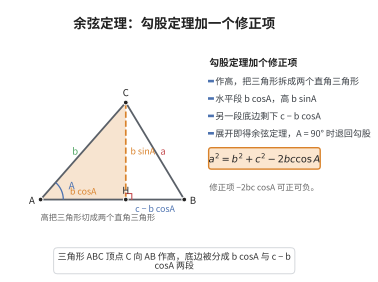

# 余弦定理

> **一句话大白话**：只要知道三角形两条边和它们夹的角，就能算出第三条边——勾股定理升级版，夹的角不是直角也照样算。
>
> **小例子**：$b=5$、$c=7$、夹角 $A=60^\circ$，则 $a^2=5^2+7^2-2\cdot5\cdot7\cdot\cos60^\circ=25+49-35=39$，故 $a=\sqrt{39}$。当 $A=90^\circ$ 时回到勾股定理。

## 介绍

余弦定理（Law of Cosines）是三角学中的基本定理，勾股定理的推广：在任意三角形中，一边的平方等于其他两边的平方和减去这两边与它们夹角的余弦的乘积的两倍，即 $a^2 = b^2 + c^2 - 2bc\cos A$。该定理解释了三角形边与角之间的完整关系，是解三角形、向量分析、解析几何中不可或缺的工具。

## 几何直观

图意在说明：高把斜三角形切成两个直角三角形，底边因此被分成 b cosA 与 c − b cosA；对后者用勾股定理，展开就得到余弦定理。

## 分析

**前置依赖**：勾股定理、坐标几何。

**定理内容**：在 $\triangle ABC$ 中，$a = BC$，$b = CA$，$c = AB$，则

$$
a^2 = b^2 + c^2 - 2bc\cos A
$$
$$
b^2 = a^2 + c^2 - 2ac\cos B
$$
$$
c^2 = a^2 + b^2 - 2ab\cos C
$$

**数学内涵**：
- 当 $A = 90^\circ$ 时，$\cos A = 0$，余弦定理退化为勾股定理 $a^2 = b^2 + c^2$。
- 余弦定理揭示了三角形中"两边及其夹角"与"第三边"之间的定量关系。
- 在向量形式中，余弦定理等价于 $|\mathbf{b} - \mathbf{c}|^2 = |\mathbf{b}|^2 + |\mathbf{c}|^2 - 2\mathbf{b} \cdot \mathbf{c}$。

**证明策略**：
- 坐标法：将三角形顶点放在坐标系中，利用两点间距离公式计算。
- 向量法：利用向量点积的性质。
- 高线法：作高线，利用勾股定理分情况计算。

## 思考过程

余弦定理的证明可以通过坐标法简洁地完成。将 $\triangle ABC$ 的顶点 $A$ 放在原点，$AB$ 沿 $x$ 轴正方向，则 $A(0,0)$，$B(c,0)$，$C(b\cos A, b\sin A)$。由两点间距离公式：

$$
a^2 = BC^2 = (b\cos A - c)^2 + (b\sin A - 0)^2 = b^2\cos^2 A - 2bc\cos A + c^2 + b^2\sin^2 A = b^2 + c^2 - 2bc\cos A
$$

这个推导简洁明了，将几何问题转化为代数计算。

## 证明过程

**定理**（余弦定理）：在 $\triangle ABC$ 中，$a^2 = b^2 + c^2 - 2bc\cos A$。

**证明**（坐标法）：

建立坐标系：令 $A$ 为原点，$AB$ 在 $x$ 轴正方向上。则

$$
A(0,0),\quad B(c,0),\quad C(b\cos A, b\sin A)
$$

由两点间距离公式：

$$
\begin{aligned}
a^2 &= BC^2 = (b\cos A - c)^2 + (b\sin A - 0)^2 \\
&= b^2\cos^2 A - 2bc\cos A + c^2 + b^2\sin^2 A \\
&= b^2(\cos^2 A + \sin^2 A) + c^2 - 2bc\cos A \\
&= b^2 + c^2 - 2bc\cos A
\end{aligned}
$$

$\square$

---

**证明**（向量法）：

设 $\overrightarrow{AB} = \mathbf{c}$，$\overrightarrow{AC} = \mathbf{b}$，则 $\overrightarrow{BC} = \mathbf{b} - \mathbf{c}$。

$$
\begin{aligned}
a^2 &= |\mathbf{b} - \mathbf{c}|^2 = (\mathbf{b} - \mathbf{c}) \cdot (\mathbf{b} - \mathbf{c}) \\
&= \mathbf{b} \cdot \mathbf{b} + \mathbf{c} \cdot \mathbf{c} - 2\mathbf{b} \cdot \mathbf{c} \\
&= |\mathbf{b}|^2 + |\mathbf{c}|^2 - 2|\mathbf{b}||\mathbf{c}|\cos A \\
&= b^2 + c^2 - 2bc\cos A
\end{aligned}
$$

$\square$

## 课堂问答

**老师**：勾股定理只解决直角三角形，若夹角不是直角，第三边怎么算？

**学生**：用余弦定理 $a^2=b^2+c^2-2bc\cos A$。它相当于给勾股结果加一个修正项 $-2bc\cos A$：当 $A=90^\circ$ 时 $\cos A=0$ 退回 $a^2=b^2+c^2$，当 $A$ 为钝角时 $\cos A<0$，该项变正，第三边比勾股结果更长。

**老师（追问）**：坐标法里凭什么把 $C$ 取成 $(b\cos A,\,b\sin A)$？

**学生**：因为 $AC=b$ 且 $AC$ 与 $x$ 轴（即 $AB$）的夹角就是 $A$，按三角函数定义横坐标是 $b\cos A$、纵坐标是 $b\sin A$。代两点间距离公式平方展开，再用 $\sin^2 A+\cos^2 A=1$ 即得结论。

**老师（拓展）**：反过来，已知三边如何判断三角形形状？

**学生**：比较 $a^2$ 与 $b^2+c^2$：$a^2<b^2+c^2$ 为锐角，相等为直角，$a^2>b^2+c^2$ 为钝角。这是余弦定理的推论，不必先求角。
