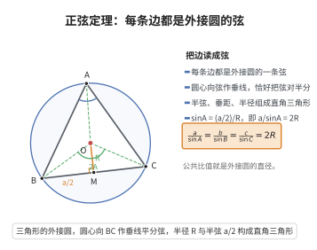

# 正弦定理

> **一句话大白话**：三角形里，每条边比上它对角的正弦，比值全都一样，正好等于外接圆直径——边越大，对角的正弦越大。
>
> **小例子**：在 $\triangle ABC$ 中，$\frac{a}{\sin A}=\frac{b}{\sin B}=\frac{c}{\sin C}=2R$。若 $A=30^\circ$、$a=4$，则 $2R=\frac{4}{\sin30^\circ}=8$。

## 介绍

正弦定理（Law of Sines）是三角学中的基本定理：在任意三角形中，各边与其对角的正弦之比相等，且等于外接圆直径，即 $\frac{a}{\sin A} = \frac{b}{\sin B} = \frac{c}{\sin C} = 2R$。该定理建立了三角形边与角之间的定量关系，是解三角形（已知部分边角求其余边角）的核心工具之一，广泛应用于测量学、导航、物理学等领域。

## 几何直观

图意在说明：边 a 是外接圆的一条弦，圆心到弦的垂线把它对半分；半弦、垂距与半径构成直角三角形，正弦与 2R 的关系一次读出。

## 分析

**前置依赖**：圆周角定理、三角函数定义。

**定理内容**：在 $\triangle ABC$ 中，设 $a = BC$，$b = CA$，$c = AB$，$R$ 为外接圆半径，则

$$
\frac{a}{\sin A} = \frac{b}{\sin B} = \frac{c}{\sin C} = 2R
$$

**数学内涵**：
- 正弦定理将三角形的边与角的正弦值联系起来，是解三角形的基础公式。
- 该定理的几何意义是：三角形外接圆直径等于任意边与其对角正弦的比值。
- 当 $C = 90^\circ$ 时，$\sin C = 1$，$c = 2R$，即直角三角形的斜边是外接圆直径——这与泰勒斯定理一致。

**证明策略**：
- 方法一：作外接圆，利用圆周角定理将角转化为圆心角，通过直径和三角函数定义证明。
- 方法二：作高线，利用三角函数定义直接计算。

## 思考过程

正弦定理的证明非常直观。考虑 $\triangle ABC$ 的外接圆，半径为 $R$，$a = BC$ 是对应于 $\angle A$ 的边。连接 $BO$ 并延长交圆于 $D$，则 $BD = 2R$，且 $\angle BDC = \angle A$（同弧所对的圆周角相等）。在 $\triangle BCD$ 中，$\angle BCD = 90^\circ$（直径所对的圆周角是直角），故 $\sin A = \sin \angle BDC = \frac{BC}{BD} = \frac{a}{2R}$，即 $\frac{a}{\sin A} = 2R$。

## 证明过程

**定理**（正弦定理）：在 $\triangle ABC$ 中，$\frac{a}{\sin A} = \frac{b}{\sin B} = \frac{c}{\sin C} = 2R$，其中 $R$ 为外接圆半径。

**证明**（外接圆法）：

作 $\triangle ABC$ 的外接圆 $O$，半径为 $R$。连接 $BO$ 并延长交圆于 $D$，则 $BD$ 是直径，$BD = 2R$，连接 $CD$。

由圆周角定理，$\angle BDC = \angle BAC = A$（同弧 $BC$ 所对的圆周角相等）。

由于 $BD$ 是直径，由泰勒斯定理，$\angle BCD = 90^\circ$。

在 $\triangle BCD$ 中，$\sin \angle BDC = \frac{BC}{BD}$，即

$$
\sin A = \frac{a}{2R}
$$

故 $\frac{a}{\sin A} = 2R$。

同理可得 $\frac{b}{\sin B} = 2R$，$\frac{c}{\sin C} = 2R$。$\square$

---

**证明**（高线法）：

作 $AD \perp BC$ 于 $D$。在 $\triangle ABD$ 中，$\sin B = \frac{AD}{c}$，故 $AD = c \sin B$。在 $\triangle ACD$ 中，$\sin C = \frac{AD}{b}$，故 $AD = b \sin C$。

因此 $c \sin B = b \sin C$，即 $\frac{b}{\sin B} = \frac{c}{\sin C}$。同理可得 $\frac{a}{\sin A} = \frac{b}{\sin B}$。$\square$

## 课堂问答

**老师**：三角形的边与角之间有没有统一的比值关系？

**学生**：有正弦定理 $\frac{a}{\sin A}=\frac{b}{\sin B}=\frac{c}{\sin C}=2R$，$R$ 为外接圆半径，公共比值正是外接圆直径。

**老师（追问）**：外接圆法怎么证？

**学生**：延长 $BO$ 交圆于 $D$，则 $BD=2R$；由同弧圆周角相等得 $\angle BDC=\angle A$，又因 $BD$ 是直径故 $\angle BCD=90^\circ$，于是 $\sin A=\frac{a}{2R}$，即 $\frac{a}{\sin A}=2R$。

**老师（拓展）**：特殊情况会退到什么熟悉的定理？

**学生**：当 $C=90^\circ$ 时 $\sin C=1$，得 $c=2R$，即斜边等于外接圆直径，正是泰勒斯定理。另外已知两边及其中一边对角时可能出现两解，用正弦定理求角要警惕 $\sin$ 的补角歧义。
