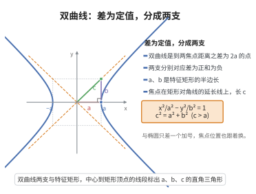

# 双曲线标准方程

> **一句话大白话**：双曲线是“到两个定点距离之差固定”的点的轨迹，方程里是两个平方相减等于 $1$，所以有两支向外张开的翅膀。
>
> **小例子**：$\frac{x^2}{4}-\frac{y^2}{9}=1$ 即 $a=2,b=3$，焦点到中心距离 $c=\sqrt{4+9}=\sqrt{13}$，渐近线 $y=\pm\frac32 x$。对比椭圆：那里是 $+$，这里是 $-$。

## 介绍

双曲线的标准方程是解析几何中描述双曲线的基本形式：$\frac{x^2}{a^2} - \frac{y^2}{b^2} = 1$（焦点在 $x$ 轴上）。双曲线定义为到两个定点（焦点）距离之差的绝对值等于常数的点的轨迹。

## 几何直观

图意在说明：双曲线是到两焦点距离之差为定值的点，差为正和为负各得一支；a、b 是特征矩形的半边长，c 是对角线长。

## 分析

**前置依赖**：双曲线的定义、两点间距离公式。

**定理内容**：双曲线的标准方程为 $\frac{x^2}{a^2} - \frac{y^2}{b^2} = 1$（$a, b > 0$），其中 $c = \sqrt{a^2 + b^2}$ 为焦距的一半。

## 思考过程

**与椭圆推导的对比**是理解双曲线的关键。椭圆和双曲线有着相似的定义方式——都是到两个定点（焦点）距离之和（或差）为定值的点的轨迹：

| 曲线 | 定义 | 代数表达式 | $a, b, c$ 关系 |
|------|------|-----------|--------------|
| 椭圆 | $|PF_1| + |PF_2| = 2a$ | $\frac{x^2}{a^2} + \frac{y^2}{b^2} = 1$ | $c^2 = a^2 - b^2$ |
| 双曲线 | $||PF_1| - |PF_2|| = 2a$ | $\frac{x^2}{a^2} - \frac{y^2}{b^2} = 1$ | $c^2 = a^2 + b^2$ |

两者在推导过程中的代数运算高度相似，只是符号不同：椭圆推导中遇到的是 $+$ 号，而双曲线因差的绝对值引入了 $\pm$ 号。这一符号差异导致了本质不同的几何形状。

**双曲线有两支的几何意义**：定义中的绝对值 $||PF_1| - |PF_2|| = 2a$ 意味着 $|PF_1| - |PF_2| = 2a$ 或 $|PF_2| - |PF_1| = 2a$。前者对应靠近 $F_2$ 的一支（$PF_1 > PF_2$），后者对应靠近 $F_1$ 的一支（$PF_2 > PF_1$）。这两支关于 $y$ 轴对称，彼此分离，互不相交。

**参数 $a, b, c$ 的关系**：在双曲线中，$c^2 = a^2 + b^2$（而椭圆中是 $c^2 = a^2 - b^2$），这意味着 $c > a$，即焦点在顶点之外。双曲线还有两条渐近线 $y = \pm \frac{b}{a}x$，当 $x$ 趋近于无穷大时，双曲线无限逼近但永不触及渐近线，这是双曲线区别于椭圆和抛物线的独特性质。

## 证明过程

**证明**：设焦点为 $F_1(-c, 0)$、$F_2(c, 0)$，双曲线上任意一点 $P(x, y)$ 满足 $||PF_1| - |PF_2|| = 2a$（$c > a > 0$）。由两点间距离公式：

$$
|\sqrt{(x + c)^2 + y^2} - \sqrt{(x - c)^2 + y^2}| = 2a
$$

平方化简得 $a^2 - cx = \pm a\sqrt{(x - c)^2 + y^2}$，再平方得 $(c^2 - a^2)x^2 - a^2y^2 = a^2(c^2 - a^2)$。令 $b^2 = c^2 - a^2$，得 $\frac{x^2}{a^2} - \frac{y^2}{b^2} = 1$。$\square$

## 课堂问答

**老师**：双曲线的标准方程是什么？

**学生**：$\frac{x^2}{a^2}-\frac{y^2}{b^2}=1$（焦点在 $x$ 轴上）。它来自定义 $\big||PF_1|-|PF_2|\big|=2a$，与椭圆方程只差一个符号。

**老师（追问）**：$a,b,c$ 的关系与椭圆有何不同？

**学生**：椭圆是 $c^2=a^2-b^2$（$c<a$），双曲线是 $c^2=a^2+b^2$（$c>a$），焦点落在顶点之外；把方程右侧的 $1$ 换成 $0$，因式分解即得渐近线 $y=\pm\frac{b}{a}x$。

**老师（拓展）**：定义里的绝对值为什么对应两支？

**学生**：绝对值意味着 $|PF_1|-|PF_2|=2a$ 或 $|PF_2|-|PF_1|=2a$ 两种情形，前者对应靠近 $F_2$ 的一支，后者对应靠近 $F_1$ 的一支；两支关于 $y$ 轴对称、彼此分离且不相交，这是双曲线区别于椭圆的关键。
