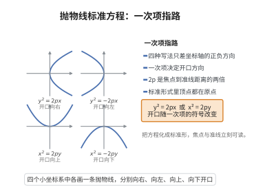

# 抛物线标准方程

> **一句话大白话**：抛物线是“到焦点和到准线一样远”的点的轨迹，把这对等距关系整理一下就成了方程 $y^2=2px$。
>
> **小例子**：$y^2=2px$ 的焦点在 $(\frac p2,0)$、准线 $x=-\frac p2$。取 $p=2$ 得 $y^2=4x$，焦点 $(1,0)$、准线 $x=-1$。

## 介绍

抛物线的标准方程是解析几何中描述抛物线的基本形式：$y^2 = 2px$（焦点在 $x$ 轴正半轴上）。抛物线定义为到定点（焦点）和定直线（准线）距离相等的点的轨迹。

## 几何直观

图意在说明：四种标准形式只差一次项所在的字母与符号，一次项指向开口方向，顶点始终在原点，形状由 2p 决定。

## 分析

**前置依赖**：抛物线的定义、两点间距离公式。

**定理内容**：抛物线 $y^2 = 2px$（$p > 0$）的焦点为 $(\frac{p}{2}, 0)$，准线为 $x = -\frac{p}{2}$。

## 思考过程

抛物线的定义是三大圆锥曲线中最简洁的：**到定点（焦点）的距离等于到定直线（准线）的距离**。与椭圆和双曲线不同，抛物线只有一个焦点和一条准线，且没有中心对称性。

**推导思路**：设焦点 $F(\frac{p}{2}, 0)$，准线 $x = -\frac{p}{2}$。对任意点 $P(x, y)$，到焦点的距离为 $\sqrt{(x - \frac{p}{2})^2 + y^2}$，到准线的距离为 $|x + \frac{p}{2}|$。令两者相等并平方化简，即得 $y^2 = 2px$。化简过程中 $x^2$ 和常数项恰好抵消，这是抛物线区别于椭圆和双曲线的关键特征——其方程中只含一个平方项。

**四种标准形式的区别**：根据抛物线的开口方向，标准方程有四种形式：

| 标准方程 | 焦点 | 准线 | 开口方向 |
|---------|------|------|---------|
| $y^2 = 2px$ | $(\frac{p}{2}, 0)$ | $x = -\frac{p}{2}$ | 向右 |
| $y^2 = -2px$ | $(-\frac{p}{2}, 0)$ | $x = \frac{p}{2}$ | 向左 |
| $x^2 = 2py$ | $(0, \frac{p}{2})$ | $y = -\frac{p}{2}$ | 向上 |
| $x^2 = -2py$ | $(0, -\frac{p}{2})$ | $y = \frac{p}{2}$ | 向下 |

其中 $p > 0$ 始终表示焦点到准线的距离。需要注意的是，$p$ 的几何意义是"焦点到准线的距离"而非"焦距"——抛物线没有传统意义上的焦距概念。在实际应用中，选择哪种形式取决于抛物线的开口方向，这由问题的对称性和坐标轴的选取决定。

## 证明过程

**证明**：设焦点为 $F(\frac{p}{2}, 0)$，准线为 $x = -\frac{p}{2}$。抛物线上任意一点 $P(x, y)$ 满足 $P$ 到焦点的距离等于 $P$ 到准线的距离：

$$
\sqrt{(x - \frac{p}{2})^2 + y^2} = |x + \frac{p}{2}|
$$

两边平方：$(x - \frac{p}{2})^2 + y^2 = (x + \frac{p}{2})^2$，展开得 $x^2 - px + \frac{p^2}{4} + y^2 = x^2 + px + \frac{p^2}{4}$，化简得 $y^2 = 2px$。$\square$

## 课堂问答

**老师**：抛物线的标准方程是什么？

**学生**：$y^2=2px$（$p>0$，开口向右），来自定义"到焦点的距离等于到准线的距离"；其中焦点为 $\left(\frac{p}{2},0\right)$、准线为 $x=-\frac{p}{2}$。

**老师（追问）**：推导过程中有什么特别之处？

**学生**：令 $\sqrt{\left(x-\frac{p}{2}\right)^2+y^2}=\left|x+\frac{p}{2}\right|$，两边平方后 $x^2$ 项与常数项恰好抵消，只剩 $y^2=2px$——方程只含一个平方项，这正是抛物线区别于椭圆、双曲线的标志。

**老师（拓展）**：$p$ 是通常说的焦距吗？

**学生**：不是。$p$ 是焦点到准线的距离（焦参数），抛物线没有椭圆那样的"半焦距"意义。四种开口方向对应 $y^2=\pm2px$、$x^2=\pm2py$，选哪一种取决于开口方向，且 $p$ 始终取正。
