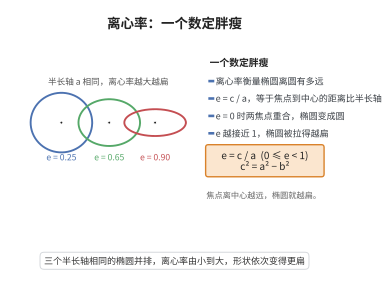

# 椭圆离心率公式

> **一句话大白话**：离心率就是椭圆“扁不扁”的尺子：越接近 $0$ 越像圆，越接近 $1$ 越像压扁的橄榄。
>
> **小例子**：$a=5,b=3$ 的椭圆 $e=\frac{c}{a}=\frac{4}{5}=0.8$。地球轨道 $e\approx0.017$（几乎是个圆），哈雷彗星 $e\approx0.967$（很扁）。

## 介绍

椭圆的离心率 $e$ 是描述椭圆扁平程度的重要参数，定义为焦距与长轴长度之比：$e = c/a$，其中 $c$ 为半焦距，$a$ 为半长轴。由椭圆标准方程 $\dfrac{x^2}{a^2} + \dfrac{y^2}{b^2} = 1$（$a > b > 0$）及关系 $c^2 = a^2 - b^2$，可得 $e = \sqrt{1 - b^2/a^2}$。离心率 $e$ 的取值范围为 $0 < e < 1$，$e$ 越接近 $0$，椭圆越接近圆；$e$ 越接近 $1$，椭圆越扁平。

## 几何直观

图意在说明：离心率是焦点到中心的距离与半长轴之比，它只描述形状；同一个 a 下，e 越大椭圆越扁，e 等于零就退化成圆。

## 分析

**前置依赖**：椭圆标准方程。

**定理内容**：设椭圆的标准方程为 $\dfrac{x^2}{a^2} + \dfrac{y^2}{b^2} = 1$（$a > b > 0$），其中 $a$ 为半长轴，$b$ 为半短轴，$c = \sqrt{a^2 - b^2}$ 为半焦距。则椭圆的离心率为

$$
e = \frac{c}{a} = \sqrt{1 - \frac{b^2}{a^2}},\quad 0 < e < 1
$$

**数学内涵**：
- 离心率 $e$ 是椭圆最本质的几何不变量之一，不随坐标系的选择而改变。
- $e = 0$ 对应圆（$a = b$），$e \to 1$ 对应极端扁平的椭圆（$b \ll a$）。
- 离心率也刻画了椭圆上点到焦点距离与到准线距离的比值，即椭圆的第二定义：$|PF|/|Pl| = e$。
- 在天体力学中，行星轨道的离心率决定了轨道形状，地球轨道 $e \approx 0.0167$，哈雷彗星轨道 $e \approx 0.967$。

**证明策略**：由椭圆定义（点到两焦点距离之和为常数 $2a$）推导出 $a^2 = b^2 + c^2$，再由离心率定义 $e = c/a$ 得到公式。

## 思考过程

椭圆的离心率 $e$ 是理解椭圆形状的关键参数。标准方程 $\dfrac{x^2}{a^2} + \dfrac{y^2}{b^2} = 1$ 中，$a$ 和 $b$ 分别决定了椭圆在 $x$ 轴和 $y$ 轴方向上的"伸展程度"。当 $a = b$ 时，椭圆退化为圆，离心率 $e = 0$；当 $a$ 固定而 $b$ 减小时，椭圆越来越扁，$e$ 趋近于 $1$。

从几何角度看，椭圆有两个焦点，焦距 $2c$ 反映了焦点偏离中心的程度。$c$ 越大，焦点越远离中心，椭圆越扁。离心率 $e = c/a$ 正是这一偏离程度的归一化度量——除以 $a$ 使得 $e$ 成为无量纲量，便于比较不同大小的椭圆。

## 证明过程

**定理**（椭圆离心率公式）：设椭圆标准方程为 $\dfrac{x^2}{a^2} + \dfrac{y^2}{b^2} = 1$（$a > b > 0$），则离心率

$$
e = \frac{c}{a} = \sqrt{1 - \frac{b^2}{a^2}},\quad 0 < e < 1
$$

其中 $c = \sqrt{a^2 - b^2}$。

**证明**：

由椭圆定义：椭圆上任意一点 $P$ 到两焦点 $F_1(-c, 0)$、$F_2(c, 0)$ 的距离之和为常数 $2a$。

取椭圆右顶点 $(a, 0)$，它到两焦点的距离分别为 $a - c$ 和 $a + c$，和为 $2a$，与定义一致。

取椭圆上顶点 $(0, b)$，它到两焦点的距离均为 $\sqrt{b^2 + c^2}$，由定义：

$$
\sqrt{b^2 + c^2} + \sqrt{b^2 + c^2} = 2a
$$

即 $\sqrt{b^2 + c^2} = a$，两边平方得：

$$
b^2 + c^2 = a^2
$$

因此 $c = \sqrt{a^2 - b^2}$。代入离心率定义 $e = c/a$：

$$
e = \frac{\sqrt{a^2 - b^2}}{a} = \sqrt{1 - \frac{b^2}{a^2}}
$$

由于 $a > b > 0$，故 $0 < e < 1$。$\square$

**注**：对于圆，$a = b$，$e = 0$；当 $b \to 0$ 时，$e \to 1$，椭圆趋于退化。

## 课堂问答

**老师**：椭圆的离心率是什么？

**学生**：$e=\frac{c}{a}=\sqrt{1-\frac{b^2}{a^2}}$，取值范围 $0<e<1$；$e$ 越接近 $0$ 越像圆，越接近 $1$ 越扁平。

**老师（追问）**：为什么由椭圆定义能推出 $e$ 的这个表达式？

**学生**：取上顶点 $(0,b)$，它到两焦点的距离都是 $\sqrt{b^2+c^2}$，由定义之和为 $2a$ 得 $\sqrt{b^2+c^2}=a$，即 $b^2+c^2=a^2$，故 $c=\sqrt{a^2-b^2}$，代入 $e=\frac{c}{a}$ 即得。

**老师（拓展）**：离心率还有别的几何含义吗？

**学生**：它是椭圆不受坐标系选择影响的几何不变量，也等于椭圆第二定义中的比值 $\frac{|PF|}{|Pl|}$。圆是 $a=b$、$e=0$ 的极限，$e\to1$ 时椭圆退化；地球轨道 $e\approx0.017$ 近圆，哈雷彗星 $e\approx0.967$ 极扁。
