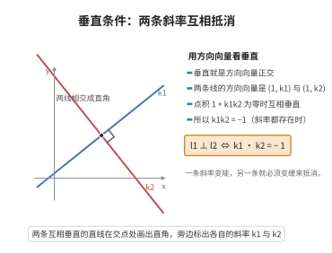

# 直线垂直条件

> **一句话大白话**：两条直线互相垂直，只要它们的斜率乘起来等于 $-1$ 就行——一条爬得越陡，另一条就跌得越狠。
>
> **小例子**：$l_1$ 斜率 $k_1=2$，$l_2$ 斜率 $k_2=-\frac12$，则 $k_1k_2=2\times(-\frac12)=-1$，故 $l_1\perp l_2$。

## 介绍

两条直线垂直的充要条件是它们的斜率乘积为 $-1$：若两条直线 $l_1$ 和 $l_2$ 的斜率分别为 $k_1$ 和 $k_2$，则 $l_1 \perp l_2$ 当且仅当 $k_1 k_2 = -1$（当斜率存在时）。该条件是解析几何中处理垂直关系的基础。

## 几何直观

图意在说明：垂直就是两个方向向量正交，点积为零逼出 k1k2 = −1；一条变陡，另一条就必须变缓来抵消。

## 分析

勾股定理、直线的斜率公式。

**定理内容**：两条非垂直直线 $l_1$、$l_2$ 的斜率分别为 $k_1$、$k_2$，则 $l_1 \perp l_2 \iff k_1 k_2 = -1$。

## 思考过程

**从斜率关系推导垂直条件**是最直观的方法。设两条直线的倾斜角分别为 $\theta_1$ 和 $\theta_2$，则 $k_1 = \tan\theta_1$，$k_2 = \tan\theta_2$。两条直线垂直等价于 $|\theta_1 - \theta_2| = 90^\circ$，不妨设 $\theta_2 = \theta_1 + 90^\circ$。由三角诱导公式 $\tan(\theta_1 + 90^\circ) = -\cot\theta_1 = -\frac{1}{\tan\theta_1}$，立即得 $k_2 = -\frac{1}{k_1}$，即 $k_1 k_2 = -1$。

**向量点积为零的几何解释**提供了另一条理解路径。在解析几何中，用方向向量描述直线更为本质。直线 $l_1$ 的方向向量可设为 $\mathbf{v}_1 = (1, k_1)$（当斜率存在时），$l_2$ 的方向向量为 $\mathbf{v}_2 = (1, k_2)$。两条直线垂直等价于方向向量点积为零：
$$
\mathbf{v}_1 \cdot \mathbf{v}_2 = 1 \times 1 + k_1 \times k_2 = 1 + k_1 k_2 = 0 \implies k_1 k_2 = -1
$$
这一方法无需使用三角诱导公式，仅用代数运算即可得出结论，且自然地推广到三维空间。

**特殊情况处理**：当一条直线水平（$k_1 = 0$）、另一条垂直（$k_2$ 不存在）时，$k_1 k_2 = -1$ 在形式上不再适用。此时应回到几何定义：水平直线与垂直直线显然垂直。更一般地，当一条直线斜率为 $0$ 时，与其垂直的直线必无斜率（即垂直于 $x$ 轴），反之亦然。因此在使用该条件时，务必先排除斜率不存在的情况。

## 证明过程

**证明**：设 $l_1$ 的倾斜角为 $\theta_1$，$l_2$ 的倾斜角为 $\theta_2$，则 $k_1 = \tan\theta_1$，$k_2 = \tan\theta_2$。

$l_1 \perp l_2$ 等价于 $|\theta_1 - \theta_2| = 90^\circ$，即 $\theta_2 = \theta_1 + 90^\circ$（或 $\theta_1 = \theta_2 + 90^\circ$）。

由诱导公式：$\tan(\theta_1 + 90^\circ) = -\cot\theta_1 = -\frac{1}{\tan\theta_1}$（$\tan\theta_1 \neq 0$）。

故 $k_2 = \tan\theta_2 = \tan(\theta_1 + 90^\circ) = -\frac{1}{k_1}$，即 $k_1 k_2 = -1$。

当 $k_1 = 0$ 时（$l_1$ 水平），$l_1 \perp l_2$ 等价于 $l_2$ 垂直，即 $k_2$ 不存在，此时 $k_1 k_2 = -1$ 在广义上理解为 0 $\times$ 无穷大 $= -1$。$\square$

## 课堂问答

**老师**：两条直线垂直怎样判断？

**学生**：当两直线斜率都存在且 $k_1k_2=-1$ 时它们互相垂直。由 $k=\tan\theta$ 及 $\tan(\theta_1+90^\circ)=-\cot\theta_1=-\frac{1}{\tan\theta_1}$，可得 $\theta_2=\theta_1+90^\circ$，故 $k_1k_2=-1$。

**老师（追问）**：有没有不用三角函数诱导公式的办法？

**学生**：有，用方向向量。取 $\mathbf{v}_1=(1,k_1)$、$\mathbf{v}_2=(1,k_2)$，两直线垂直等价于点积为零，即 $\mathbf{v}_1\cdot\mathbf{v}_2=1+k_1k_2=0$；此法纯代数，还能自然推广到高维空间。

**老师（拓展）**：这个条件有例外情形吗？

**学生**：有。当其中一条直线斜率不存在（竖直）时，$k_1k_2=-1$ 在形式上失效，必须回到几何定义判断；所以使用该条件前一定要先排除斜率不存在的情况，这是典型易错点。
