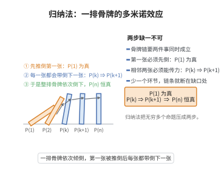

# 数学归纳法原理

> **一句话大白话**：就像推多米诺骨牌——第一张倒下（验证 $P(1)$），且每张倒下都会推倒下一张（$P(k)\Rightarrow P(k+1)$），那么所有骨牌都会倒下。
>
> **小例子**：只要验证 $P(1)$ 成立、再由 $P(k)$ 能推出 $P(k+1)$，即可断言 $1+2+\cdots+n=\frac{n(n+1)}2$ 对所有自然数都成立。

## 介绍

数学归纳法原理是证明关于自然数命题的基本方法。若 $P(1)$ 为真，且对任意 $k$，$P(k) \Rightarrow P(k+1)$ 为真，则 $P(n)$ 对所有自然数 $n$ 为真。详见第01级同名文档。

## 几何直观

图意在说明：归纳法像推骨牌，只要第一张倒下、并且每一张都能带倒下一张，整排骨牌就会依次倒下。

## 分析

**前置依赖**：Peano 公理。

**定理内容**：设 $P(n)$ 是关于自然数 $n$ 的命题。若 $P(1)$ 真且 $P(k) \Rightarrow P(k+1)$ 对所有 $k \geq 1$ 真，则 $P(n)$ 对所有 $n \in \mathbb{N}^+$ 真。

## 思考过程

### 1. 直观理解

数学归纳法类似于"多米诺骨牌"效应：第一块骨牌倒下（$P(1)$ 真），且每块骨牌倒下时必然推倒下一块（$P(k) \Rightarrow P(k+1)$），则所有骨牌都会倒下。初学时常犯的错误是忘记验证基础步 $P(1)$，这就好比虽然每块骨牌都会推倒下一块，但第一块骨牌从未倒下。

### 2. 归纳法与演绎法的区别

数学归纳法虽然名字中带有"归纳"，但它实际上是一种**演绎推理**，而非经验归纳。它通过有限步的推理，证明了关于无穷多个自然数的命题，这是数学归纳法的精妙之处。

### 3. 与良序原理的等价性

数学归纳法原理与良序原理（自然数任意非空子集有最小元）是等价的，都可以从 Peano 公理中的归纳公理导出。理解这种等价性有助于更深刻地把握自然数结构。

## 证明过程

**证明**（从良序原理出发）：

假设 $P(1)$ 真且 $P(k) \Rightarrow P(k+1)$ 真，但存在 $n$ 使 $P(n)$ 假。令 $S = \{n \in \mathbb{N}^+ \mid P(n) \text{ 假}\}$，$S$ 非空。由良序原理，$S$ 有最小元 $m$。$m > 1$（因 $P(1)$ 真）。$m-1 \notin S$，故 $P(m-1)$ 真。由归纳假设，$P(m)$ 真，矛盾。故 $S = \varnothing$，$P(n)$ 对所有 $n$ 真。$\square$

## 课堂问答

**老师**：数学归纳法名字里带"归纳"，它是归纳推理吗？

**学生**：不是，它是演绎推理。它只做两步——验证 $P(1)$ 并由 $P(k)$ 推出 $P(k+1)$——就断言了对无穷多个 $n$ 成立。常见误区是只证递推不验基础步：若缺 $P(1)$，就像骨牌第一块没倒，命题可整体为假。

**老师（追问）**：那它凭什么能跨越无穷？根基在哪里？

**学生**：根基是自然数的良序原理。反设存在使命题为假的最小元 $m$，则 $m-1 \notin S$ 使 $P(m-1)$ 真，由递推得 $P(m)$ 真，与 $m \in S$ 矛盾，故 $S=\varnothing$。这说明归纳法本质上是良序原理的推理形式，二者等价。

**老师（拓展）**：把 $P(1)$ 换成 $P(n_0)$ 会怎样？

**学生**：就成了从 $n_0$ 起的归纳法，结论只对 $n \ge n_0$ 成立。可见归纳法的关键在于"起点成立"与"相邻可传递"两条同时满足，改变起点并不改变推理结构。

## 相关条目

- [数学归纳法原理（第01级-算术基础）](../第01级-算术基础/数学归纳法原理.md)：与本条目为同一定理，另收录于第01级-算术基础，可交叉参考。
