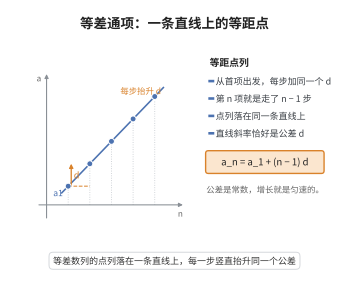

# 等差数列通项公式

> **一句话大白话**：第 $n$ 项等于首项加上 $(n-1)$ 个公差，相当于从第一格起每走一格就加上一个固定的 $d$。
>
> **小例子**：首项 $1$、公差 $3$ 的数列 $1,4,7,10,13,\dots$，第 $10$ 项 $a_{10}=1+9\times3=28$。

## 介绍

等差数列是最基本的数列类型之一，其特点是任意相邻两项的差为常数。等差数列的通项公式 $a_n = a_1 + (n-1)d$ 给出了数列中第 $n$ 项与首项 $a_1$、公差 $d$ 之间的直接关系，是研究等差数列性质的基础。

## 几何直观

图意在说明：等差数列的每一项都落在同一条直线上，竖直方向每走一格抬升固定的公差。

## 分析

**前置依赖**：等差数列定义。

**定理内容**：设等差数列 $\{a_n\}$ 的首项为 $a_1$，公差为 $d$，则其通项公式为

$$
a_n = a_1 + (n-1)d,\quad n \in \mathbb{N}^*
$$

**数学内涵**：
- 等差数列的通项是关于 $n$ 的一次函数：$a_n = dn + (a_1 - d)$，公差 $d$ 即为斜率。
- 等差数列的任意两项满足 $a_n = a_m + (n-m)d$，这一形式不依赖于首项。
- 若三个数 $a, b, c$ 成等差数列，则 $b = \dfrac{a + c}{2}$，$b$ 称为 $a$ 和 $c$ 的等差中项。

**证明策略**：利用等差数列定义 $a_{k+1} - a_k = d$，通过累加法或数学归纳法求通项。

## 思考过程

等差数列的通项公式非常直观：首项为 $a_1$，每增加一项就加一个公差 $d$，因此第 $n$ 项就是在首项的基础上加 $(n-1)$ 个公差。这一朴素的理解正是公式 $a_n = a_1 + (n-1)d$ 的来源。

从函数观点看，$a_n$ 是 $n$ 的线性函数。这意味着等差数列的项在坐标平面上呈直线排列，直线的斜率就是公差 $d$。这一几何直观有助于理解等差数列的许多性质，如等差中项、求和公式等。

## 证明过程

**定理**（等差数列通项公式）：若数列 $\{a_n\}$ 满足 $a_{n+1} - a_n = d$（$d$ 为常数，$n \in \mathbb{N}^*$），则

$$
a_n = a_1 + (n-1)d
$$

**证明**（累加法）：

由等差数列定义：

$$
a_2 - a_1 = d
$$
$$
a_3 - a_2 = d
$$
$$
\vdots
$$
$$
a_n - a_{n-1} = d
$$

将以上 $n-1$ 个等式相加，左边逐项抵消得 $a_n - a_1$，右边为 $(n-1)d$：

$$
a_n - a_1 = (n-1)d
$$

因此

$$
a_n = a_1 + (n-1)d
$$

$\square$

**证明**（数学归纳法）：

1. 当 $n = 1$ 时，$a_1 = a_1 + (1-1)d = a_1$，成立。
2. 假设 $n = k$ 时成立，即 $a_k = a_1 + (k-1)d$。则 $n = k+1$ 时，
   $$
   a_{k+1} = a_k + d = a_1 + (k-1)d + d = a_1 + kd = a_1 + [(k+1) - 1]d
   $$
   成立。
3. 由数学归纳法，对任意 $n \in \mathbb{N}^*$，$a_n = a_1 + (n-1)d$ 成立。$\square$

## 课堂问答

**老师**：$a_n=a_1+(n-1)d$ 为什么是 $(n-1)d$ 而不是 $nd$？

**学生**：因为从 $a_1$ 到 $a_n$ 只需累加 $n-1$ 次公差，$a_n-a_1$ 恰好有 $n-1$ 段间隔。证明用累加：把 $a_2-a_1=d,\dots,a_n-a_{n-1}=d$ 相加，中间消去得 $a_n-a_1=(n-1)d$。

**老师（追问）**：换个视角，这个公式在结构上像什么？

**学生**：$a_n=dn+(a_1-d)$ 是 $n$ 的一次函数，公差 $d$ 就是斜率，所以等差数列的点落在一条直线上。由此立刻有 $a_n=a_m+(n-m)d$，与首项无关，还有等差中项 $b=\frac{a+c}{2}$。

**老师（拓展）**：若 $d=0$ 或 $d<0$ 呢？

**学生**：$d=0$ 时退化为常数列；$d<0$ 时数列单调递减，一次函数的斜率变负。两种情形都不影响公式本身，只是几何上直线水平或下降。
