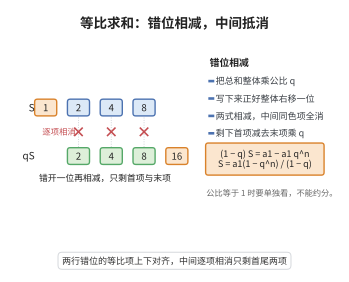

# 等比数列求和公式

> **一句话大白话**：把总和乘上公比 $q$，再错开一位和原来的总和相减，中间一大片会彼此抵消，只剩首尾两项，就能轻松解出总和。
>
> **小例子**：$1,2,4,8,16$ 的前 $5$ 项和，用公式 $S_n=a_1\frac{1-q^n}{1-q}$ 得 $S_5=1\times\frac{1-2^5}{1-2}=31$，正好等于 $1+2+4+8+16$。

## 介绍

等比数列求和公式是数列理论中的基本公式：首项为 $a_1$、公比为 $q$（$q \neq 1$）的等比数列的前 $n$ 项和为 $S_n = a_1 \frac{1 - q^n}{1 - q}$。该公式的推导使用了"错位相减法"，是数列求和的经典方法。

## 几何直观

图意在说明：把总和乘以公比后错开一位相减，上下对齐的项全部抵消，只剩首尾两项。

## 分析

**前置依赖**：数学归纳法原理。

**定理内容**：对等比数列 $\{a_n\}$，$a_n = a_1 q^{n-1}$，当 $q \neq 1$ 时，$S_n = a_1 \frac{1 - q^n}{1 - q}$；当 $q = 1$ 时，$S_n = na_1$。

## 思考过程

等比数列求和的核心障碍在于：相邻项之间虽有固定倍数关系，但直接相加无法像等差数列那样利用对称性化简。错位相减法正是针对这一结构而设计的巧妙技巧——将 $S_n$ 乘以公比 $q$ 得到 $qS_n$，二者除首尾项外中间部分完全相同，相减后大量项抵消，仅剩首项和末项，从而简洁地解出 $S_n$。

这一方法的本质是**构造一个与原数列平行的新数列，利用其比例关系制造大量抵消**。其思想在后续数学中反复出现，例如生成函数、差分方程、甚至信号处理中的 $Z$ 变换都与之同源。

需要特别注意的是 $q = 1$ 这一退化情形：此时数列退化为常数列 $a_1, a_1, \ldots, a_1$，求和公式的分母 $1 - q$ 为零，不能直接代入，但直观上 $n$ 个 $a_1$ 相加即为 $na_1$，与极限 $\lim_{q \to 1} a_1 \frac{1 - q^n}{1 - q} = na_1$ 一致（可用洛必达法则验证），体现了数学中"特殊情形需单独处理"的严谨性。

进一步推广，当 $|q| < 1$ 时，令 $n \to \infty$ 可得无穷等比级数求和公式 $\sum_{k=0}^{\infty} a_1 q^k = \frac{a_1}{1 - q}$。这一结论是微积分中幂级数展开的基础，例如 $1 + x + x^2 + \cdots = \frac{1}{1 - x}$（$|x| < 1$）正是等比数列求和公式的直接应用。

## 证明过程

**证明**（错位相减法）：

$$
S_n = a_1 + a_1 q + a_1 q^2 + \cdots + a_1 q^{n-1}
$$

两边乘以 $q$：

$$
qS_n = a_1 q + a_1 q^2 + a_1 q^3 + \cdots + a_1 q^n
$$

两式相减：

$$
S_n - qS_n = a_1 - a_1 q^n \Rightarrow (1 - q)S_n = a_1(1 - q^n)
$$

当 $q \neq 1$ 时，$S_n = a_1 \frac{1 - q^n}{1 - q}$。当 $q = 1$ 时，$S_n = na_1$。$\square$

## 课堂问答

**老师**：为什么等式两边要乘 $q$ 再相减？

**学生**：因为乘 $q$ 相当于把每项"错开一位"，$S_n$ 与 $qS_n$ 除首尾外中间项完全相同，相减后大量抵消，只剩 $a_1-a_1q^n$，解出 $(1-q)S_n=a_1(1-q^n)$。这就是错位相减法。

**老师（追问）**：$q=1$ 时公式为什么失效？

**学生**：分母 $1-q=0$。此时数列是常数列，应单独处理：$S_n=na_1$。可用 $\lim_{q\to1}a_1\frac{1-q^n}{1-q}=na_1$ 验证，这体现了"退化情形需单独讨论"的严谨。

**老师（拓展）**：让 $n\to\infty$ 会得到什么？

**学生**：当 $|q|<1$ 时 $q^n\to0$，得 $\sum_{k\ge0}a_1q^k=\frac{a_1}{1-q}$，即无穷等比级数公式，它也是幂级数 $\frac{1}{1-x}=1+x+x^2+\cdots$ 的来源。
