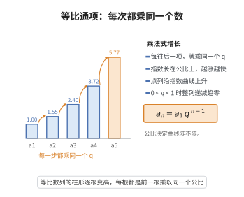

# 等比数列通项公式

> **一句话大白话**：第 $n$ 项等于首项乘以公比的 $n-1$ 次方——每往后一项就把前一项乘一次固定的公比。
>
> **小例子**：首项 $2$、公比 $3$ 的数列 $2,6,18,54,\dots$，第 $5$ 项 $a_5=2\times3^{4}=162$。

## 介绍

等比数列是另一类基本数列，其特点是任意相邻两项的比为常数。等比数列的通项公式 $a_n = a_1 \cdot q^{n-1}$ 给出了数列中第 $n$ 项与首项 $a_1$、公比 $q$ 之间的直接关系，是研究等比数列性质的基础，在金融复利、人口增长、放射性衰变等指数增长或衰减模型中有着广泛应用。

## 几何直观

图意在说明：等比数列每项乘同一个公比，柱子成倍变高，增长快慢由公比的幂次决定。

## 分析

**前置依赖**：等比数列定义。

**定理内容**：设等比数列 $\{a_n\}$ 的首项为 $a_1$（$a_1 \neq 0$），公比为 $q$（$q \neq 0$），则其通项公式为

$$
a_n = a_1 \cdot q^{n-1},\quad n \in \mathbb{N}^*
$$

**数学内涵**：
- 等比数列的通项是关于 $n$ 的指数函数：$a_n = (a_1/q) \cdot q^n$，公比 $q$ 即为底数。
- 等比数列的任意两项满足 $a_n = a_m \cdot q^{n-m}$，这一形式不依赖于首项。
- 若三个数 $a, b, c$ 成等比数列，则 $b^2 = ac$，$b$ 称为 $a$ 和 $c$ 的等比中项。
- 当 $|q| < 1$ 时，$a_n \to 0$（$n \to \infty$）；当 $|q| > 1$ 时，$|a_n| \to \infty$。

**证明策略**：利用等比数列定义 $a_{k+1}/a_k = q$，通过累乘法或数学归纳法求通项。

## 思考过程

等比数列的通项公式同样直观：首项为 $a_1$，每乘一次公比 $q$ 得到下一项，因此第 $n$ 项就是首项乘以 $n-1$ 个公比，即 $a_n = a_1 \cdot q^{n-1}$。

从函数观点看，$a_n$ 是 $n$ 的指数函数。当 $q > 1$ 时，数列呈指数增长；当 $0 < q < 1$ 时，数列呈指数衰减；当 $q < 0$ 时，数列正负交替。这一指数增长/衰减的特性使等比数列在金融（复利计算）、物理（半衰期）、生物学（种群增长）等领域有着广泛应用。

## 证明过程

**定理**（等比数列通项公式）：若数列 $\{a_n\}$ 满足 $\dfrac{a_{n+1}}{a_n} = q$（$q$ 为非零常数，$n \in \mathbb{N}^*$），且 $a_1 \neq 0$，则

$$
a_n = a_1 \cdot q^{n-1}
$$

**证明**（累乘法）：

由等比数列定义：

$$
\frac{a_2}{a_1} = q,\quad \frac{a_3}{a_2} = q,\quad \ldots,\quad \frac{a_n}{a_{n-1}} = q
$$

将以上 $n-1$ 个等式相乘，左边逐项抵消得 $\dfrac{a_n}{a_1}$，右边为 $q^{n-1}$：

$$
\frac{a_n}{a_1} = q^{n-1}
$$

因此

$$
a_n = a_1 \cdot q^{n-1}
$$

$\square$

**证明**（数学归纳法）：

1. 当 $n = 1$ 时，$a_1 = a_1 \cdot q^{0} = a_1$，成立。
2. 假设 $n = k$ 时成立，即 $a_k = a_1 \cdot q^{k-1}$。则 $n = k+1$ 时，
   $$
   a_{k+1} = a_k \cdot q = a_1 \cdot q^{k-1} \cdot q = a_1 \cdot q^k = a_1 \cdot q^{(k+1)-1}
   $$
   成立。
3. 由数学归纳法，对任意 $n \in \mathbb{N}^*$，$a_n = a_1 \cdot q^{n-1}$ 成立。$\square$

## 课堂问答

**老师**：为什么等比通项是 $q^{n-1}$ 而不是 $q^n$？

**学生**：因为首项本身对应 $q^0=1$，从 $a_1$ 到 $a_n$ 只乘了 $n-1$ 次公比。用累乘：$\frac{a_2}{a_1}\cdots\frac{a_n}{a_{n-1}}=q^{n-1}$，左边逐项抵消得 $\frac{a_n}{a_1}$，故 $a_n=a_1q^{n-1}$。

**老师（追问）**：$a_n$ 作为 $n$ 的函数是什么类型？这带来什么？

**学生**：是指数函数 $a_n=\frac{a_1}{q}\cdot q^n$，公比是底数。所以 $|q|<1$ 时 $a_n\to0$，$|q|>1$ 时 $|a_n|\to\infty$，$q<0$ 时正负交替。常见误区是忽略 $q^n$ 的符号，把 $q=-2$ 当成单调。

**老师（拓展）**：任意两项之间呢？

**学生**：$a_n=a_m q^{n-m}$，与首项无关；三数成等比则 $b^2=ac$，$b$ 为等比中项。这与等差数列的线性关系形成鲜明对照。
