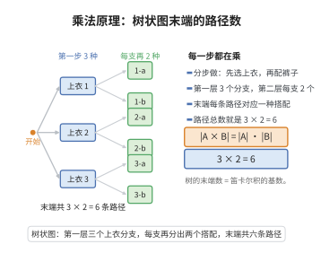

# 乘法原理

> **一句话大白话**：做一件事要依次分几步完成，且每步的选项数互不干扰，那么总方案数就是各步选项数直接相乘。
>
> **小例子**：选一件上衣（$3$ 种）再配一条裤子（$2$ 种），共 $3\times2=6$ 种搭配方式。

## 介绍

乘法原理是组合计数中的基本原理：若事件 $A$ 有 $m$ 种发生方式，事件 $B$ 有 $n$ 种发生方式，且 $A$ 与 $B$ 相互独立，则事件"$A$ 和 $B$ 依次发生"有 $m \times n$ 种方式。该原理是排列公式、组合公式等的基础。

## 几何直观

图意在说明：分步完成一件事时，每一步的选项都在上一层基础上成倍展开，末端路径数正是各步选项数之积。

## 分析

**前置依赖**：集合笛卡尔积。

**定理内容**：$|A \times B| = |A| \times |B|$，其中 $A \times B$ 为笛卡尔积。

## 思考过程

乘法原理的核心思想是"分步计数"：当完成一件事需要依次经过若干步骤，且每一步的选项数不受前面步骤影响时，总方案数等于各步骤选项数的乘积。

用树状图可以直观理解：第一步有 $m$ 个分支，每个分支下第二步又有 $n$ 个分支，因此末端共有 $m \times n$ 条路径。从集合论角度看，这对应笛卡尔积 $A \times B$ 的基数计算。

乘法原理与加法原理常结合使用：先用加法原理对问题分类，再对每一类用乘法原理计算；或先用乘法原理分步，再对某一步用加法原理处理子情形。这种"先分步，再分类"或"先分类，再分步"的策略是组合计数的核心技巧。

**应用场景**：排列数的推导、密码学中密码空间的计算、概率论中独立事件的概率计算等。

## 证明过程

**证明**：设 $A = \{a_1, \ldots, a_m\}$，$B = \{b_1, \ldots, b_n\}$。$A \times B = \{(a_i, b_j) \mid 1 \leq i \leq m, 1 \leq j \leq n\}$，共有 $m$ 行 $n$ 列，共 $m \times n$ 个有序对，故 $|A \times B| = mn = |A| \cdot |B|$。$\square$

## 课堂问答

**老师**：乘法原理为什么能想成"相乘"？

**学生**：因为各步选项相互独立，第一步的 $m$ 种每种都对应第二步的 $n$ 种，构成 $m\times n$ 个有序组合。集合语言就是 $|A\times B|=|A|\cdot|B|$，即笛卡尔积的基数。

**老师（追问）**：树状图如何体现这一点？

**学生**：根节点分出 $m$ 个分支，每个分支再分 $n$ 个，末端共 $mn$ 条路径，每条路径对应一个结果。路径计数正是相乘的直观来源。

**老师（拓展）**：它和排列公式是什么关系？

**学生**：排列公式 $P(n,k)=n(n-1)\cdots(n-k+1)$ 就是连续 $k$ 步应用乘法原理：第 $i$ 步有 $n-i+1$ 种选择，各步独立故相乘。可见乘法原理是排列、组合计数的地基。
