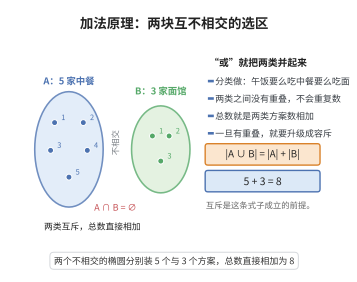

# 加法原理

> **一句话大白话**：有几种互不相撞（互斥）的选择方式时，总方案数就是把各类的方案数直接相加。
>
> **小例子**：午饭要么从 $5$ 家中餐里选、要么从 $3$ 家面馆中选（不能同时吃两顿），所以共有 $5+3=8$ 种选择。

## 介绍

加法原理是组合数学中最基本的计数原理之一：若事件 $A$ 有 $m$ 种发生方式，事件 $B$ 有 $n$ 种发生方式，且 $A$ 与 $B$ 互斥（不能同时发生），则事件"$A$ 或 $B$"有 $m + n$ 种发生方式。它是计数问题的基础，与乘法原理一起构成了组合计数的核心。

## 几何直观

图意在说明：分类计数要求各类互不重叠，正因为没有交集，两个集合的元素个数才能直接相加。

## 分析

**前置依赖**：集合基数。

**定理内容**：若 $A \cap B = \varnothing$，则 $|A \cup B| = |A| + |B|$。

## 思考过程

加法原理的核心思想是"分类计数"：当完成一件事有若干类互斥的方式时，总方案数等于各类方案数之和。从集合论角度看，这是集合基数在互不相交集合上的可加性 $|A \cup B| = |A| + |B|$（当 $A \cap B = \varnothing$）。

直觉上，可以把每个分类看作一个互不重叠的抽屉，每个抽屉里的物品数相加即得总数。与乘法原理的关键区别在于：加法原理处理的是"或"关系（选择其中一类），乘法原理处理的是"且"关系（依次完成每一步）。

**应用场景**：枚举所有可能的密码组合（按首位数字分类）、计算概率中的互斥事件概率等。

## 证明过程

**证明**：设 $A$ 和 $B$ 是互不相交的有限集合。由集合基数的定义，$|A|$ 表示 $A$ 中元素个数。$A \cup B$ 的元素由 $A$ 的元素和 $B$ 的元素组成，且无重复（因为 $A \cap B = \varnothing$），故 $|A \cup B| = |A| + |B|$。$\square$

## 课堂问答

**老师**：加法原理和乘法原理的分界线在哪？

**学生**：看关键字——"或"还是"且"。若完成一件事有若干互斥的类别，选其一即可，则总数相加；若需依次完成各步骤，则相乘。加法原理的集合形式是 $A\cap B=\varnothing$ 时 $|A\cup B|=|A|+|B|$。

**老师（追问）**：如果 $A$ 与 $B$ 有重叠，直接相加会怎样？

**学生**：会重复计数交集中的元素。这时要把加法原理升级为容斥原理 $|A\cup B|=|A|+|B|-|A\cap B|$。所以加法原理前提中的"互斥"绝非多余。

**老师（拓展）**：两个原理怎么配合使用？

**学生**：常见套路是"先分类再分步"或"先分步再分类"：用加法原理把问题分成互斥情形，再对每种情形用乘法原理。这种组合是计数问题的核心技巧。
