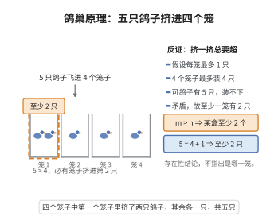

# 鸽巢原理

> **一句话大白话**：鸽子比窝多的时候，肯定至少有一个窝要挤进两只甚至更多的鸽子。
>
> **小例子**：$13$ 个人落到 $12$ 个月份里（出生月份），因为 $13=12+1$，所以一定有至少两个人在同一个月出生。

## 介绍

鸽巢原理（Dirichlet 抽屉原理）是组合数学中最直观的原理之一：若 $n+1$ 个物体放入 $n$ 个盒子，则至少有一个盒子包含至少 $2$ 个物体。该原理虽然简单，却是许多数学存在性证明的重要工具。

## 几何直观

图意在说明：物体数超过盒子数时，无论怎么分配，总有一个盒子被迫装进不止一个物体。

## 分析

**前置依赖**：反证法。

**定理内容**：若 $m > n$，将 $m$ 个物体放入 $n$ 个盒子，则至少有一个盒子包含至少 $\lceil m/n \rceil$ 个物体。

## 思考过程

### 1. 直观理解

鸽巢原理的直观性使其看起来"过于简单"，但它的力量在于将存在性问题转化为计数问题。例如，在 13 个人中，至少有两个人在同一个月出生——这就是鸽巢原理的直接应用。

### 2. 一般形式

鸽巢原理的一般形式是：若 $m$ 个物体放入 $n$ 个盒子，则至少有一个盒子包含至少 $\lceil m/n \rceil$ 个物体。这一定量形式在组合数学中更为有用。

### 3. 应用范围

尽管证明极其简单，鸽巢原理在数论（如 Dirichlet 逼近定理）、组合数学（如 Ramsey 理论）、图论、计算机科学中都有深刻应用。它是最基本的"存在性证明"工具之一。

## 证明过程

**证明**（反证法）：假设每个盒子至多放 $1$ 个物体，则 $n$ 个盒子至多放 $n$ 个物体，但物体有 $n+1$ 个，矛盾。故至少有一个盒子有至少 $2$ 个物体。$\square$

## 课堂问答

**老师**：鸽巢原理这么简单，凭什么有用？

**学生**：因为它把存在性问题转成计数问题：只要物体数超过盒子数，必有盒子"挤"。一般形式是 $m$ 个物体入 $n$ 个盒，至少有一个盒含 $\lceil m/n\rceil$ 个。

**老师（追问）**：证明的思路？

**学生**：反证。若每个盒至多放 $1$ 个，则 $n$ 个盒至多放 $n$ 个物体，可实际有 $n+1$ 个，矛盾。所以至少一个盒有至少 $2$ 个。定量版的 $\lceil m/n\rceil$ 可由平均思想得到。

**老师（拓展）**：它引出了哪些深刻结果？

**学生**：Dirichlet 逼近定理、Ramsey 理论、图论与计算机科学中的许多存在性结论都源于它。它虽然证明极简，却是组合数学中"非构造性存在证明"的原型。
