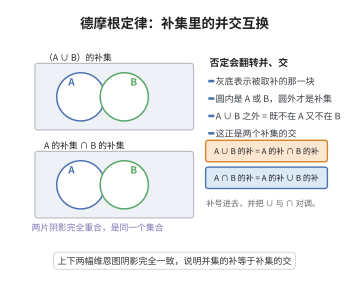

# 德摩根定律

> **一句话大白话**：对整体取“非/补”时，“或/并”会翻成“且/交”，反过来也一样——否定会把运算符号一并反过来。
>
> **小例子**：“不是（今天是周一 或 下雨）”等价于“今天不是周一 且 没下雨”，写成集合就是 $\overline{A\cup B}=\overline A\cap\overline B$。

## 介绍

德摩根定律是集合论和逻辑学中的基本定律：$\overline{A \cup B} = \overline{A} \cap \overline{B}$，$\overline{A \cap B} = \overline{A} \cup \overline{B}$。该定律揭示了并集与交集的互补关系，在集合运算、逻辑推理和计算机科学中有着广泛应用。

## 几何直观

图意在说明：对并集取补，等价于分别取补后再取交，否定运算会把并和交互相翻转。

## 分析

**前置依赖**：集合定义。

**定理内容**：$\overline{A \cup B} = \overline{A} \cap \overline{B}$，$\overline{A \cap B} = \overline{A} \cup \overline{B}$。

## 思考过程

德摩根定律的核心在于集合运算的**对偶性**（duality）——补集运算将并集与交集互换。这种对偶关系可以用维恩图直观验证：绘制两个相交的圆 $A$ 和 $B$，其并集 $A \cup B$ 的补集恰好是 $A$ 和 $B$ 各自补集的交集，反之亦然。

从逻辑学角度看，该定律对应着命题逻辑中的对偶关系：

- $\neg(p \lor q) \iff \neg p \land \neg q$
- $\neg(p \land q) \iff \neg p \lor \neg q$

这正是集合论中 $\overline{\cdot}$（补集）对应逻辑否定 $\neg$、$\cup$（并集）对应 $\lor$（析取）、$\cap$（交集）对应 $\land$（合取）的自然结果。德摩根定律的深刻之处在于，它揭示了"否定"运算会翻转"且"与"或"的结构，这一思想在布尔代数、电路设计和计算机科学中都有着核心地位。

## 证明过程

**证明**：对任意元素 $x$，
$$
x \in \overline{A \cup B} \iff x \notin A \cup B \iff x \notin A \land x \notin B \iff x \in \overline{A} \cap \overline{B}
$$
故 $\overline{A \cup B} = \overline{A} \cap \overline{B}$。另一式同理。$\square$

## 课堂问答

**老师**：取补集为什么要把并换成交？这两条式子背后有没有更统一的东西？

**学生**：结论是 $\overline{A \cup B} = \overline{A} \cap \overline{B}$ 与 $\overline{A \cap B} = \overline{A} \cup \overline{B}$。统一的东西叫对偶性：补运算把并、交互换，正如逻辑里否定把"或"与"且"互换。

**老师（追问）**：怎么证？给个干净的一句话推导。

**学生**：对任意元素 $x$，
$$
x \in \overline{A \cup B} \iff x \notin A \cup B \iff x \notin A \ \text{且}\ x \notin B \iff x \in \overline{A} \cap \overline{B},
$$
每一式都是定义层面的等价改写。要防的误区是只把补作用于某一个集合：$\overline{A \cup B}$ 是对整个并取补，不能错写成 $\overline{A} \cup \overline{B}$——后者恰好是另一条定律的右端。

**老师（拓展）**：它为什么会在计算机科学里出现？

**学生**：因为它逐字对应命题逻辑的 $\neg(p \lor q) \iff \neg p \land \neg q$ 与 $\neg(p \land q) \iff \neg p \lor \neg q$：集合的 $\overline{\cdot}, \cup, \cap$ 分别对应 $\neg, \lor, \land$。它揭示"否定是一个把 $\lor$ 与 $\land$ 互换的反自同构"，这正是布尔代数、电路化简里与非门与或非门可以互换的原理；推广到无限情形即 $\overline{\bigcup_\alpha A_\alpha} = \bigcap_\alpha \overline{A_\alpha}$，也是把开集公理搬运到闭集公理的桥梁。
