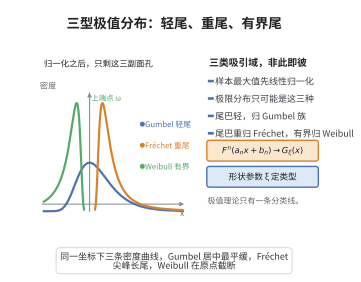

# Fisher-Tippett-Gnedenko定理

> **一句话大白话**：无论数据本身是什么分布，经过适当归一化后样本最大值的极限分布只可能长成三种样子：Gumbel（轻尾）、Fréchet（重尾）、Weibull（有界尾）。
>
> **小例子**：指数样本最大值标准化后收敛到 Gumbel，Pareto 样本的最大值标准化后收敛到 Fréchet，它们都属于这"三大极限类型"之一。

## 一、定理介绍

> **前置依赖**：独立同分布随机变量、样本最大值的分布 $F^n$、依分布收敛、极值指数与MDA的刻画（von_Mises条件）、幂函数与指数函数性质。

设 $X_1,\dots,X_n$ 为 i.i.d. 随机变量，分布函数 $F$，$M_n=\max\{X_1,\dots,X_n\}$。若存在归一化常数 $a_n>0$、$b_n\in\mathbb{R}$ 使 $(M_n-b_n)/a_n\xrightarrow{d}G$（$G$ 非退化），则 $G$ 必属于三种标准类型之一：Gumbel $G_0(x)=e^{-e^{-x}}$、Fréchet $G_{1,\alpha}(x)=e^{-x^{-\alpha}}(x>0)$、Weibull $G_{2,\alpha}(x)=e^{-(-x)^\alpha}(x<0)$。这一分类是极值理论的基础。

## 几何直观

图意在说明：无论原始分布是什么，最大值归一化后的极限只能是 Gumbel、Fréchet、Weibull 三种之一。

## 二、原理思路

关键在"可稳定性"。因 $M_{mn}=\max\{M_n^{(1)},\dots,M_n^{(m)}\}$ 且各组独立，极限分布 $G$ 必须满足极值类型方程 $G^m(x)=G(A(m)x+B(m))$。取对数令 $H=-\log G$，得 $mH(x)=H(A(m)x+B(m))$，用函数方程理论分三种情形求解 $H$ 的解析形式，分别对应 Gumbel、Weibull、Fréchet，进而统一为 GEV 分布。

## 三、定理的严格表述

令 $M_n=\max\{X_1,\dots,X_n\}$，$X_i$ i.i.d.。若存在 $a_n>0,b_n$ 使
$$
\frac{M_n-b_n}{a_n}\xrightarrow{d}G,\qquad n\to\infty,
$$
且 $G$ 非退化，则 $G$ 属于以下之一（经位置尺度变换）：
$$
G_0(x)=e^{-e^{-x}}\;(x\in\mathbb{R}),\quad
G_{1,\alpha}(x)=e^{-x^{-\alpha}}\;(x>0,\alpha>0),\quad
G_{2,\alpha}(x)=e^{-(-x)^\alpha}\;(x<0,\alpha>0).
$$
统一为 GEV 形式（$\xi=0$ 为 Gumbel，$\xi>0$ 为 Fréchet，$\xi<0$ 为 Weibull）：
$$
G_\xi(x)=\exp\left\{-\left[1+\xi\frac{x-\mu}{\sigma}\right]^{-1/\xi}\right\}.
$$

## 四、证明过程

**步骤1：稳定性方程。** 由 $M_{mn}=\max\{M_n^{(j)}\}$、独立性得 $\mathbb P(M_{mn}\le x)=[\mathbb P(M_n\le x)]^m$，迫使极限 $G$ 满足 $G^m(x)=G(A(m)x+B(m))$。

**步骤2：化对数。** 令 $H=-\log G$，$mH(x)=H(A(m)x+B(m))$，$H$ 非负单调递增。

**步骤3：分情形求解。**
- 若 $H(x)=0(\forall x\le\omega)$ 且 $\omega<\infty$：设 $H(x)=c(\omega-x)^\alpha$，解得 $A(m)=m^{-1/\alpha}$、$B(m)=\omega(1-m^{-1/\alpha})$，得 Weibull $G(x)=e^{-c(\omega-x)^\alpha}$。
- 若 $H(x)>0(\forall x)$ 且严格递减：设 $H(x)=e^{-x}$，解得 $A(m)=1$、$B(m)=\log m$，得 Gumbel $G(x)=e^{-e^{-x}}$。
- 若 $H(x)=0(x\le0)$ 且 $H(x)>0(x>0)$：设 $H(x)=x^{-\alpha}$，解得 $A(m)=m^{1/\alpha}$、$B(m)=0$，得 Fréchet $G(x)=e^{-x^{-\alpha}}$。

**步骤4：统一表示。** 通过位置尺度参数化把三族统一为 GEV。$\square$

## 五、应用与意义

Fisher-Tippett-Gnedenko 定理给出了"样本最大值的极限唯有三种类型"，是块极大值建模（GEV 拟合）的理论依据。它支撑重现期估计、金融 VaR 与水文学洪峰分析，是连接极值概率论与统计应用的核心支柱。

## 课堂问答

**老师**：样本最大值$(M_n-b_n)/a_n$收敛，极限分布为什么只有三种？

**学生**：因为极限必须满足"可稳定性"$G^m(x)=G(A(m)x+B(m))$，把$H=-\log G$代入得$mH(x)=H(A(m)x+B(m))$，这个函数方程只有三类单调解，对应 Gumbel、Fréchet、Weibull，所以非退化极限必属三者之一。

**老师（追问）**：这三族在参数上如何统一？为什么可以用一个参数$\xi$刻画？

**学生**：$H$的三种情形分别取$e^{-x}$、$x^{-\alpha}$、$c(\omega-x)^\alpha$，用位置尺度参数化统一成 GEV
$$
G_\xi(x)=\exp\left\{-\left[1+\xi\frac{x-\mu}{\sigma}\right]^{-1/\xi}\right\},
$$
$\xi=0$对应 Gumbel（轻尾），$\xi>0$对应 Fréchet（重尾），$\xi<0$对应 Weibull（有上界）。

**老师（拓展）**：分布何时属于某个吸引域，靠什么判别？

**学生**：靠尾商函数$r(x)=(1-F(x))/f(x)$的极限行为：$r'\to0$给 Gumbel，$xr'/r\to\alpha$给 Fréchet，$xr'/r\to-\alpha$且$\omega(F)<\infty$给 Weibull。常见误区是以为"任何分布都收敛到 Gumbel"，其实必须先做对归一化，且由$F$的尾部而非样本本身决定类型。
