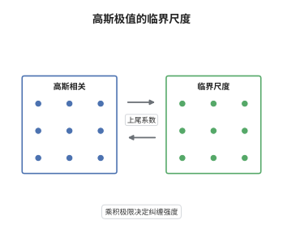

# Hüsler-Reiss 模型

> **一句话大白话**：两个高度相关的高斯序列，各自的最大值不会像独立时那样互不相干，而是被"相关系数亏损乘以 log n"这个乘积粘在一起；乘积的极限就是唯一的纠缠参数。
>
> **小例子**：取 $\rho_n=1-1/\log n$，则 $(1-\rho_n)\log n=1$，故 $\Lambda=1$，于是 $\theta=2\Phi(1)\approx1.683$、$\lambda=2\Phi(-1)\approx0.318$。

## 介绍

高斯过程是空间统计的默认模型，但"独立同分布"的极值理论直接套到相关数据上会严重低估联合极端事件的概率。Hüsler 与 Reiss 在 1989 年刻画了相关高斯向量最大值的极限族：只要相关系数趋于 1 的速度与 $\log n$ 匹配，极限就是一族以 $\Lambda$ 为参数的 max-stable 分布。这个参数不是相关系数本身，而是"相关性亏损"与"样本量的对数"的乘积极限，因此它同时编码了样本量与相依强度。Hüsler-Reiss 分布是极值 copula，可由谱测度或依赖函数表示，上尾相依系数为 $\lambda=2\Phi(-\Lambda)$。它在空间极值插值、网络流量联合风险和基因表达极值中被广泛使用。

## 几何直观

图意在说明：轨道相关性越强，两个分量同时取极大的倾向越强；$\Lambda$ 越小等值线越贴对角线，$\lambda$ 越接近 1，$\Lambda\to\infty$ 时退化为独立。

## 分析

**前置依赖**：高斯过程、极值 copula；补充：二元正态的条件分布、Laplace 型渐近。

**数学内涵**：
- 归一化：$b_n=\Phi^{-1}(1-1/n)$、$a_n=1/b_n$，单个分量满足 $(M_n-b_n)/a_n\xrightarrow{d}G_0$（Gumbel）。
- 参数化：若 $\rho_n\to1$ 且 $(1-\rho_n)\log n\to\Lambda^2$，则联合极限为 $H_\Lambda(x,y)=\exp\{-e^{-x}\Phi(\Lambda+\frac{y-x}{2\Lambda})-e^{-y}\Phi(\Lambda+\frac{x-y}{2\Lambda})\}$，$\Lambda=0$ 与 $\Lambda=\infty$ 按极限理解。
- 端点：$\Lambda\to0$ 给完全相依 $\exp\{-e^{-\min(x,y)}\}$；$\Lambda\to\infty$ 给独立 $\exp\{-e^{-x}-e^{-y}\}$。
- 极值系数：令 $x=y$ 得 $H_\Lambda(x,x)=\exp\{-2\Phi(\Lambda)e^{-x}\}$，故 $\theta=2\Phi(\Lambda)$，上尾相依系数 $\lambda=2-\theta=2\Phi(-\Lambda)$。
- 高维与过程：参数升为矩阵，$\Lambda_{ij}^2=\lim(1-\rho_{ij}(n))\log n$；过程版本把矩阵换成由相关函数决定的 $\Lambda(h)$，标定仍是"$1-\rho$ 乘对数尺度"的乘积极限。
- 常见误区：把 $\Lambda$ 当成相关系数；或只要求 $\rho_n\to1$ 而不带 $\log n$ 尺度，那样 $(1-\rho_n)\log n\to0$、极限退化为完全相依。

**结构**：
1. 条件化，把联合尾概率降为一维积分。
2. 换元 $z=u_x+t/b_n$，用高斯尾部的 Laplace 型集中得到 $\Phi$ 项。
3. 合成分布函数，读出 $\theta$ 与 $\lambda$。

## 思考过程

独立高斯的最大值给出 Gumbel，完全相依时两个分量其实是一个变量，也给出 Gumbel，两端都太简单。Hüsler 与 Reiss 追问的是中间地带：相关系数趋于 1，但"同时超过阈值"仍以 $1/n$ 的量级发生。障碍在于这个量级要求 $(1-\rho_n)$ 与 $1/\log n$ 同阶，快一点就完全相依，慢一点就独立，只有临界尺度才有非平凡极限。关键技巧是条件化：给定 $X_1=z$，$X_2$ 是均值 $\rho z$、方差 $1-\rho^2$ 的正态，其条件尾概率直接写成 $\Phi(\Lambda+\cdot)$，而积分则通过换元变成对 $e^{-t}$ 的加权平均。选择 $\Phi$ 而不是别的函数，是因为整个构造只用到高斯条件分布的尾概率，这也解释了为什么 Hüsler-Reiss 族在高斯世界里是封闭且唯一的。

## 证明过程

**定理**：设 $(X_{1n},X_{2n})$ 为二元标准正态、相关系数 $\rho_n$，$b_n=\Phi^{-1}(1-1/n)$、$a_n=1/b_n$，$u_x=b_n+xa_n$。若 $(1-\rho_n)\log n\to\Lambda^2$，则

$$
P(M_{1n}\le u_x,\,M_{2n}\le u_y)\to H_\Lambda(x,y)=\exp\Big\{-e^{-x}\Phi\Big(\Lambda+\frac{y-x}{2\Lambda}\Big)-e^{-y}\Phi\Big(\Lambda+\frac{x-y}{2\Lambda}\Big)\Big\}.
$$

**证明**：

### 1. 条件化

由独立性，$P(M_{1n}\le u_x,M_{2n}\le u_y)=P(X_1\le u_x,X_2\le u_y)^n$，而

$$
P(X_1\le u_x,X_2\le u_y)=1-\bar\Phi(u_x)-\bar\Phi(u_y)+q_n,\qquad q_n=P(X_1>u_x,X_2>u_y),
$$

其中 $n\bar\Phi(u_x)\to e^{-x}$、$n\bar\Phi(u_y)\to e^{-y}$。

### 2. 联合尾部的极限

条件化后 $q_n=\int_{u_x}^{\infty}\varphi(z)\bar\Phi\big((u_y-\rho_nz)/\sqrt{1-\rho_n^2}\big)dz$。换元 $z=u_x+t/b_n$，利用 $n\varphi(u_x+t/b_n)/b_n\to e^{-x}e^{-t}$，以及由 $b_n^2\sim2\log n$、$(1-\rho_n)b_n^2\to2\Lambda^2$ 得到的

$$
\frac{u_y-\rho_nz}{\sqrt{1-\rho_n^2}}=\Lambda+\frac{y-x-t}{2\Lambda}+o(1),
$$

便有

$$
nq_n\to e^{-x}\int_0^\infty e^{-t}\,\bar\Phi\Big(\Lambda+\frac{y-x-t}{2\Lambda}\Big)dt .
$$

记 $d=y-x$。分部积分并配方可得恒等式

$$
\int_0^\infty e^{-t}\bar\Phi\Big(\Lambda+\frac{d-t}{2\Lambda}\Big)dt=\bar\Phi\Big(\Lambda+\frac{d}{2\Lambda}\Big)+e^{-d}\bar\Phi\Big(\Lambda-\frac{d}{2\Lambda}\Big),
$$

于是 $nq_n\to e^{-x}\bar\Phi(\Lambda+\frac{y-x}{2\Lambda})+e^{-y}\bar\Phi(\Lambda+\frac{x-y}{2\Lambda})$。

### 3. 结论

把三项合并，$n\big(\bar\Phi(u_x)+\bar\Phi(u_y)-q_n\big)\to V(x,y)$，其中

$$
V(x,y)=e^{-x}\Phi\Big(\Lambda+\frac{y-x}{2\Lambda}\Big)+e^{-y}\Phi\Big(\Lambda+\frac{x-y}{2\Lambda}\Big).
$$

由 $\log(1-c_n/n)\sim-c_n/n$ 得 $(1-V/n)^n\to e^{-V}=H_\Lambda(x,y)$。令 $\Lambda\to0$ 时 $\Phi$ 项退化为示性函数，得 $\exp\{-e^{-\min(x,y)}\}$；令 $\Lambda\to\infty$ 得 $\exp\{-e^{-x}-e^{-y}\}$。最后取 $x=y$ 得 $H_\Lambda(x,x)=\exp\{-2\Phi(\Lambda)e^{-x}\}$，故 $\theta=2\Phi(\Lambda)$、$\lambda=2\Phi(-\Lambda)$。$\square$

## 课堂问答

**老师**：为什么高斯相关性的临界尺度是 $(1-\rho_n)\log n$，而不是 $1-\rho_n$ 本身？

**学生**：因为"两个分量同时超阈值"的概率要与 $1/n$ 同阶才不被 $n$ 次幂抹掉。条件尾概率约为 $\bar\Phi(\Lambda+\cdot)$，其中 $\Lambda\approx b_n\sqrt{(1-\rho_n)/2}$，而 $b_n^2\sim2\log n$，所以 $\Lambda^2\approx(1-\rho_n)\log n$。这个乘积收敛才有非平凡极限。

**老师（追问）**：证明中 $\Phi$ 是怎么冒出来的，而不是别的分布函数？

**学生**：因为用的是高斯条件分布：给定 $X_1=z$，$X_2$ 服从均值 $\rho_nz$、方差 $1-\rho_n^2$ 的正态，于是 $P(X_2>u_y\mid X_1=z)=\bar\Phi((u_y-\rho_nz)/\sqrt{1-\rho_n^2})$。换元后这个自变量收敛到 $\Lambda+(y-x-t)/(2\Lambda)$，$\Phi$ 就自然出现。

**老师（拓展）**：三维或空间过程情形怎么办？$\theta=2\Phi(\Lambda)$ 还能用吗？

**学生**：高维时参数换成矩阵 $\Lambda_{ij}^2=\lim(1-\rho_{ij}(n))\log n$，联合律由 $d$ 个 $\Phi$ 项相加给出，不再是单参数公式；$\theta=2\Phi(\Lambda)$ 只是二元的特例。空间过程把矩阵换成函数 $\Lambda(h)$，标定原则相同：把"相关性亏损"乘上对应的对数尺度再看极限。
