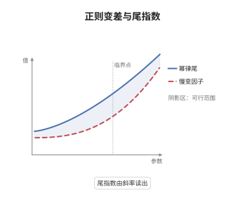

# Karamata 正则变差理论

> **一句话大白话**：很多"重尾"现象在不同尺度下长得几乎一样，正则变差就是给这种"缩放自相似"起名字，并把它写成一个幂函数乘一个缓慢变化因子的形式。
>
> **小例子**：$L(x)=\log(1+x)$ 是慢变函数，$L(2x)/L(x)\to1$；$f(x)=x^{-2}\log x$ 属 $RV_{-2}$，故若 $1-F(x)=x^{-2}\log x$，则尾指数 $\alpha=2$、极值指数 $\xi=1/2$。

## 介绍

正则变差理论研究"$f(tx)/f(t)$ 的极限"这一件事，却支撑起整个极值理论的解析部分。它把"尾概率按幂律衰减"精确化为 $1-F\in RV_{-\alpha}$，并用表示定理把慢变因子写成可积的指数形式。由此得到 Karamata 定理（幂律乘慢变因子的积分渐近）与 Potter 界（把逐点收敛升级为局部一致控制），两者是极值指数估计的相合性证明的标准工具。与极值理论的接口是三条等价：$1-F\in RV_{-\alpha}$、$F$ 属于 Fréchet 吸引域、分位数函数 $U$ 正则变差指数 $1/\alpha$。

## 几何直观

图意在说明：双对数坐标把幂律尾变成直线，斜率就是 $-\alpha$；慢变因子只让曲线缓慢弯曲，不改变斜率，于是 $\xi=1/\alpha$ 可由斜率直接读出。

## 分析

**前置依赖**：极值指数、渐近分析；补充：可积性、控制收敛定理。

**数学内涵**：
- 定义：若对每个 $x>0$ 有 $f(tx)/f(t)\to x^{\rho}$，称 $f\in RV_\rho$；$\rho=0$ 时称慢变，记 $L\in RV_0$。
- 表示定理：$L$ 慢变当且仅当 $L(x)=c(x)\exp\{\int_1^x\varepsilon(t)\,dt/t\}$，其中 $c(x)\to c\in(0,\infty)$、$\varepsilon(t)\to0$；一般地 $f\in RV_\rho$ 当且仅当 $f(x)=x^\rho L(x)$。
- Karamata 定理：$\rho>-1$ 时 $\int_0^x t^\rho L(t)\,dt\sim\frac{x^{\rho+1}L(x)}{\rho+1}$；$\rho<-1$ 时 $\int_x^\infty t^\rho L(t)\,dt\sim-\frac{x^{\rho+1}L(x)}{\rho+1}$。
- Potter 界：对任意 $\delta>0$ 存在 $A=A(\delta)$，使 $\frac{f(y)}{f(x)}\le A\max\{(y/x)^{\rho+\delta},(y/x)^{\rho-\delta}\}$ 对所有 $x,y\ge1$ 成立。
- 与极值：$1-F\in RV_{-\alpha}\iff F\in\mathrm{MDA}(\Phi_\alpha)$（$\xi=1/\alpha$）$\iff U(t)=F^{-1}(1-1/t)\in RV_{1/\alpha}$。
- 常见误区：慢变既不等于收敛（$L(x)=\log x$ 慢变但发散），也不等于有界（$L(x)=1/\log x$ 慢变但趋于 0）；它只约束对数增长率。

**结构**：
1. 用表示定理把正则变差函数写成"幂函数乘慢变因子"。
2. 换元把积分化成单位区间上的积分，用 Potter 界作控制函数，交换极限与积分。
3. 反解分位数函数，得到尾指数与 Fréchet 吸引域的等价刻画。

## 思考过程

Karamata 在 1930 年研究 Tauber 型定理时引入这类函数，他发现许多求和与积分的渐近等价只依赖"比值收敛"这一条，而与函数的具体形状无关。困难在于逐点收敛不足以交换极限与积分：需要一致控制，而正则变差函数本身可能剧烈振荡。表示定理解决了这个问题，它把慢变因子写成 $c(x)\exp\{\int\varepsilon/t\}$，$\varepsilon\to0$ 意味着对数尺度的增长率趋于零，于是可以导出一致的幂律夹逼，这就是 Potter 界。极值理论后来大量借用这套工具：证明 Hill 估计量的相合性、给出吸引域判别的等价条件，都要先有一个可控的尾部展开。可以说，正则变差是极值理论的"微积分"。

## 证明过程

**定理**：设 $L$ 慢变。则对 $\rho>-1$ 有 $\int_0^x t^\rho L(t)\,dt\sim\frac{x^{\rho+1}L(x)}{\rho+1}$，对 $\rho<-1$ 有 $\int_x^\infty t^\rho L(t)\,dt\sim-\frac{x^{\rho+1}L(x)}{\rho+1}$。并且 $1-F\in RV_{-\alpha}$（$\alpha>0$）当且仅当 $U(t)=F^{-1}(1-1/t)\in RV_{1/\alpha}$。

**证明**：

### 1. 换元

以 $\rho>-1$ 为例，令 $t=xu$，$u\in(0,1)$，得

$$
\int_0^x t^\rho L(t)\,dt=x^{\rho+1}\int_0^1 u^\rho\frac{L(xu)}{L(x)}\,du .
$$

### 2. 控制收敛

由 Potter 界，对取定的 $\delta\in(0,\rho+1)$ 存在 $A$ 使 $L(xu)/L(x)\le Au^{-\delta}$，而 $u^{\rho-\delta}$ 在 $(0,1)$ 上可积。又对每个固定 $u$ 有 $L(xu)/L(x)\to1$，故由控制收敛定理

$$
\int_0^1u^\rho\frac{L(xu)}{L(x)}\,du\to\int_0^1u^\rho\,du=\frac1{\rho+1}.
$$

$\rho<-1$ 时在 $(1,\infty)$ 上重复：控制函数取 $Au^{\rho+\delta}$（$\delta<-1-\rho$，可积），得 $\int_1^\infty u^\rho du=-1/(\rho+1)$，结论相同。

### 3. 结论

故两条积分渐近成立。再证等价性：由 $1-F\in RV_{-\alpha}$ 写 $\bar F(x)=x^{-\alpha}L(x)$，而 $1-F(U(t))=1/t$，故 $t^{-1}=U(t)^{-\alpha}L(U(t))$。对 $t$ 与 $tx$ 相除得

$$
\frac1x=\frac{\bar F(U(tx))}{\bar F(U(t))}=\Big(\frac{U(tx)}{U(t)}\Big)^{-\alpha}\frac{L(U(tx))}{L(U(t))} .
$$

慢变性给出第二因子趋于 1，于是 $(U(tx)/U(t))^{\alpha}\to x$，即 $U(tx)/U(t)\to x^{1/\alpha}$，故 $U\in RV_{1/\alpha}$、$\xi=1/\alpha$。反向只需把上述推导逆过来。$\square$

## 课堂问答

**老师**：慢变函数听上去像"几乎是常数"，这个条件是不是太弱了？

**学生**：要在对数尺度上理解：慢变等价于 $\log L(tx)-\log L(t)\to0$，即 $\log L$ 的增长比 $\log t$ 慢一个量级。$L(x)=\log x$ 满足这个条件，却无界；正因为它弱，才覆盖了足够多的重尾模型。

**老师（追问）**：Karamata 定理的证明里，逐点收敛为什么不够？Potter 界起什么作用？

**学生**：要交换极限与积分，需要可积的控制函数。逐点收敛只给出被积函数逐点趋于 $u^\rho$；Potter 界给出 $Au^{\rho-\delta}$ 这样的幂律控制，$\delta$ 取得比 $\rho+1$ 小就可积，于是控制收敛定理可用，这是整个证明的关键一步。

**老师（拓展）**：尾指数 $\alpha$ 除了决定 $\xi$ 还能读出什么？

**学生**：读出矩的存在性：$\bar F\in RV_{-\alpha}$ 时 $E[X^\beta]<\infty$ 当且仅当 $\beta<\alpha$。这正是"重尾"在矩层面的表现，也解释了为什么 $\xi=1/\alpha>1$ 时均值不存在、$\xi>1/2$ 时方差不存在。
