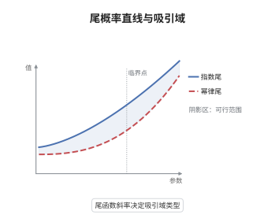

# von Mises 条件与吸引域

> **一句话大白话**：把阈值往上抬一点点，再按"当地尾部自己的尺度"去量这一步，尾概率的比值就会稳定成一条标准曲线；这条曲线是轻尾、重尾还是有界尾，取决于这一步相对于阈值本身有多快。
>
> **小例子**：指数分布取 $\bar F(t)=e^{-t}$、$b(t)=1$，比值 $\bar F(t+x)/\bar F(t)=e^{-x}$ 恰好等于极限；Pareto 分布取 $\bar F(t)=t^{-\alpha}$、$b(t)=t/\alpha$，比值趋于 $(1+x/\alpha)^{-\alpha}$，对应 $\xi=1/\alpha$。

## 介绍

von Mises 条件把"分布 $F$ 属于哪个最大吸引域"这个整体问题，压缩成尾函数在右端点附近的一次局部比值极限。它属于极值理论的解析判别工具，与 Fisher-Tippett-Gnedenko 的分类定理互为表里：后者断言极限分布只有三类，前者给出直接用 $F$ 检验"是哪一类"的可计算准则。条件中的核心对象是辅助函数 $b(t)$，它度量尾部在 $t$ 处的局部尺度。条件成立时，极限的形状参数 $\xi$ 恰好刻画"步长 $b(t)$ 相对于 $t$ 的增长率"，于是吸引域判别简化为对 $\xi$ 符号的判断，而不必先求出归一化常数。

## 几何直观

图意在说明：尾概率在合适的缩放坐标下近似为直线，斜率给出尾指数，右端点是否有限区分出有界尾；辅助函数 $b(t)$ 就是每走一步的横向步长。

## 分析

**前置依赖**：极值分布与最大吸引域、正则变差与 Karamata 表示；补充：右端点、辅助函数与 de Haan 表示。

**数学内涵**：
- 尾函数条件（Gumbel 型）：存在正函数 $b(t)$，使对每个 $x\in\mathbb R$ 有 $\lim_{t\uparrow x^*}\frac{1-F(t+xb(t))}{1-F(t)}=e^{-x}$。
- 统一形式：存在 $b(t)>0$ 与 $\xi\in\mathbb R$，使 $\lim_{t\uparrow x^*}\frac{1-F(t+xb(t))}{1-F(t)}=(1+\xi x)^{-1/\xi}$，右端在 $\xi=0$ 时理解为 $e^{-x}$，在 $\xi>0$ 时要求 $x>-1/\xi$，在 $\xi<0$ 时要求 $x<1/|\xi|$。
- 三类判别：$\xi>0$ 时 $x^*=\infty$、$b(t)/t\to\xi$、$1-F\in RV_{-1/\xi}$；$\xi<0$ 时 $x^*<\infty$、$b(t)/(x^*-t)\to|\xi|$；$\xi=0$ 时 $b(t)=o(t)$，尾函数慢变。
- 常见误区：把 $e^{-x}$ 当成三类通用的形式，它只是 $\xi=0$ 的 Gumbel 情形；重尾必须用 $(1+\xi x)^{-1/\xi}$，若硬套指数形式则比值恒为 1，读不出尾指数。

**结构**：
1. 把 $n(1-F(b_n+xa_n))$ 写成"比值乘以 $n(1-F(b_n))$"。
2. 取 $b_n=U(n)$ 使第二个因子恒等于 1，并令 $a_n=b(b_n)$。
3. 取对数读出 GEV 极限，再由 $\xi$ 的符号回到三类吸引域。

## 思考过程

von Mises 在 1936 年研究最大值分布收敛时，发现可以用尾商函数的单调性代替对归一化常数的直接搜索。Gnedenko 1943 年完成三大类型的分类后，问题变成"给定 $F$，如何不求出极限就判断类型"。困难有两层：一是 $a_n,b_n$ 依赖离散的样本量 $n$，无法直接代入；二是尾部信息只在一个随 $n$ 移动的邻域里有效。关键想法是把离散下标换成连续参数 $t=1/(1-F(u))$，并用辅助函数 $b(t)$ 描述尾部的局部尺度，这正是 de Haan 后来系统化的方法。指数形式只能覆盖"步长相对于 $t$ 可忽略"的情形，重尾时步长与 $t$ 同阶，必须把比值写成 $(1+\xi x)^{-1/\xi}$，$\xi$ 于是成为步长的相对增长率。这一步把三种看似无关的尾型统一成一个参数的符号问题。

## 证明过程

**定理**：设 $F$ 绝对连续，右端点 $x^*=\sup\{x:F(x)<1\}$。若存在正函数 $b$ 与 $\xi\in\mathbb R$，使对每个满足 $1+\xi x>0$ 的 $x$ 有

$$
\lim_{t\uparrow x^*}\frac{1-F(t+xb(t))}{1-F(t)}=(1+\xi x)^{-1/\xi},
$$

则 $F\in\mathrm{MDA}(G_\xi)$；并且 $\xi>0$ 时 $x^*=\infty$、$1-F\in RV_{-1/\xi}$，$\xi<0$ 时 $x^*<\infty$。

**证明**：

### 1. 离散化与尺度选取

记 $U(t)=F^{-1}(1-1/t)$，取 $b_n=U(n)$，则 $F(b_n)=1-1/n$，故 $n(1-F(b_n))=1$。令 $a_n=b(b_n)$，对固定 $x$ 有

$$
n\big(1-F(b_n+xa_n)\big)=\frac{1-F(b_n+xb(b_n))}{1-F(b_n)}\cdot n\big(1-F(b_n)\big)\to(1+\xi x)^{-1/\xi},
$$

第二个因子恒等于 1，第一个因子由假设给出。

### 2. 取对数得极限分布

由 $\log(1-u)=-u+O(u^2)$，当 $n(1-F(b_n+xa_n))\to c(x)$ 时

$$
F^n(b_n+xa_n)=\Big(1-\frac{n(1-F(b_n+xa_n))}{n}\Big)^n\to\exp\{-c(x)\}=G_\xi(x),
$$

其中 $G_\xi(x)=\exp\{-(1+\xi x)^{-1/\xi}\}$ 是尺度为 1 的 GEV 形式，$\xi=0$ 时取极限得 $e^{-e^{-x}}$。

### 3. 结论

故 $F\in\mathrm{MDA}(G_\xi)$。若 $\xi>0$，把条件在 $t$ 与 $t+xb(t)$ 两处对照，得 $b(t)/t\to\xi$，代回即 $\frac{1-F(ty)}{1-F(t)}\to y^{-1/\xi}$，故 $1-F\in RV_{-1/\xi}$，尾指数 $\alpha=1/\xi$。若 $\xi<0$，令 $u=x^*-t\downarrow0$ 与 $\alpha=-1/\xi>0$，条件化为

$$
\frac{1-F\big(x^*-u(1-x/\alpha)\big)}{1-F(x^*-u)}\to(1-x/\alpha)^{\alpha},
$$

故 $1-F(x^*-u)$ 在 $u\downarrow0$ 处正则变差指数为 $\alpha$，对应有界端点。$\square$

## 课堂问答

**老师**：$e^{-x}$ 这个极限形式到底能判出哪一类？

**学生**：只能判出 $\xi=0$ 的 Gumbel 域。三类通用的判别式是 $(1+\xi x)^{-1/\xi}$：把它在 $x=0$ 附近展开得 $1-x+\xi(1+\xi)x^2/2+\cdots$，$\xi$ 的符号决定二阶项，$\xi>0$ 为重尾、$\xi<0$ 为有界尾、$\xi=0$ 才退化为 $e^{-x}$。

**老师（追问）**：为什么步长必须取 $b(t)$ 而不能取常数？

**学生**：因为尺度和 $t$ 同阶时比值才有非平凡极限。取 $a_n=b(b_n)$ 后 $n(1-F(b_n+xa_n))\to(1+\xi x)^{-1/\xi}$；若取常数步长，对 $1-F\in RV_{-\alpha}$ 的分布，比值趋于 1，极值指数完全消失。

**老师（拓展）**：这个条件是必要的吗？举一个不满足却仍在吸引域内的情形。

**学生**：不必要。它依赖尾商函数或辅助函数的正则性，是充分条件。例如在某些区间上叠加缓慢振荡的密度，仍可落在 Gumbel 吸引域，但比值极限不存在；离散分布也要先连续化，才能谈密度与 $b(t)$。
