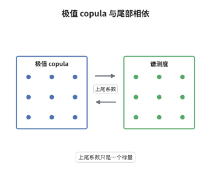

# 极值 copula 与多元极值

> **一句话大白话**：多个变量"同时很大"的相依结构不能靠各自的边缘分布描述，而要由一个满足幂次封闭性的 copula 来管；尾部到底有多"黏"，用一个数 $\lambda$ 概括。
>
> **小例子**：Gumbel copula $C_\theta(u,v)=\exp\{-[(-\log u)^\theta+(-\log v)^\theta]^{1/\theta}\}$ 是极值 copula，其 $\lambda=2-2^{1/\theta}$：$\theta=1$ 时 $\lambda=0$（渐近独立），$\theta\to\infty$ 时 $\lambda\to1$（完全相依）。

## 介绍

多元极值理论研究"多个分量同时取极端值"的概率。把每个分量标准化成同一边缘后，分量最大值的联合极限分布只剩下一个 copula 的自由度，这就是极值 copula。它的特征性质是 max-stable：对幂变换封闭，$C(u_1^t,\dots,u_d^t)=C(u_1,\dots,u_d)^t$。由此得到 Pickands 表示：极值 copula 由单纯形上的谱测度或依赖函数 $A$ 唯一决定。上尾相依系数 $\lambda=\lim_{u\to1}P(U>u\mid V>u)$ 把"尾部有多黏"压缩成一个标量，等于 $2-\ell(1,1)$。多元极值因此从"高维分布拟合"变成"估计一个凸函数或一个测度"，同时也说明单个标量 $\lambda$ 无法还原全部相依结构。

## 几何直观

图意在说明：极值 copula 与单纯形上的谱测度是同一对象的两种语言；依赖函数 $A$ 的凸性决定等值线形状，$A(1/2)$ 的取值给出 $\lambda$。

## 分析

**前置依赖**：copula、极值分布；补充：凸函数与一次齐次函数、边缘变换。

**数学内涵**：
- 定义：$C$ 是极值 copula，当且仅当 $C(u_1^t,\dots,u_d^t)=C(u_1,\dots,u_d)^t$ 对一切 $t>0$ 与 $u\in(0,1]^d$ 成立。
- 表示：$C(u)=\exp\{-\ell(-\log u_1,\dots,-\log u_d)\}$，其中 $\ell$ 凸、一次齐次，且 $\max_j x_j\le\ell(x)\le\sum_j x_j$。
- 二元 Pickands 形式：$C(u,v)=\exp\{(\log u+\log v)A(\frac{\log v}{\log u+\log v})\}$，$A$ 凸、$A(0)=A(1)=1$、$\max(t,1-t)\le A(t)\le1$。
- 上尾相依：$\lambda=\lim_{u\to1}\frac{1-2u+C(u,u)}{1-u}=2-\ell(1,1)=2\big(1-A(1/2)\big)\in[0,1]$。
- 常见误区：$\lambda=0$ 只表示"渐近独立"，并不等于独立，$A$ 在内部仍可小于 1；反过来独立恰对应 $A\equiv1$ 与 $\ell(x)=x_1+x_2$。

**结构**：
1. 由分量最大值的联合极限推出幂次封闭性。
2. 取负对数得到凸的一次齐次函数 $\ell$。
3. 沿对角线 $u=v$ 求极限，把 $\lambda$ 与 $\ell(1,1)$、$A(1/2)$ 挂钩。

## 思考过程

单变量极值有三类极限，多元情形却出现"参数灾难"：维数一高，任何参数族都不够用。Tiago de Oliveira 与 Pickands 在 1950 至 1960 年代意识到，应当先把边缘分布统一，再单独研究相依部分。障碍在于相依部分必须与"取最大值"这个运算相容，否则取幂后就不在同一族里。关键想法是把 copula 的幂次封闭性当作公理：$C(u^t)=C(u)^t$，它等价于 $-\log C$ 是一次齐次的。一旦有齐次性，凸性就自动成立，于是可以用凸分析的工具（支撑函数、谱测度）来描述。上尾相依系数 $\lambda$ 是沿对角线方向的斜率信息，它只捕捉 $t=1/2$ 这一点的取值，因此信息量有限——这也提醒使用者不要把 $\lambda$ 当成相依结构的全貌。

## 证明过程

**定理**：设 copula 列 $C_n(u)=C(u^{1/n})^n$ 逐点收敛到 $C_*$。则 $C_*$ 是极值 copula，满足 $C_*(u^t)=C_*(u)^t$；存在凸、一次齐次的 $\ell$ 使 $C_*(u)=e^{-\ell(-\log u_1,\dots,-\log u_d)}$，且 $\max_j x_j\le\ell(x)\le\sum_j x_j$。当 $d=2$ 时 $\lambda=2-\ell(1,1)=2(1-A(1/2))$。

**证明**：

### 1. 齐次性

对 $t>0$，把 $n$ 换成 $n/t$ 的整数部分，极限不变，于是

$$
C_*(u^t)=\lim_{n\to\infty}C(u^{t/n})^n=\lim_{n\to\infty}\Big[C(u^{1/(n/t)})^{n/t}\Big]^t=C_*(u)^t .
$$

### 2. 构造凸齐次函数

令 $\ell(x)=-\log C_*(e^{-x_1},\dots,e^{-x_d})$，由第 1 步得 $\ell(tx)=t\ell(x)$。$C_*$ 是 copula，故 $\prod_j u_j\le C_*(u)\le\min_j u_j$，取负对数得

$$
\max_j x_j\le\ell(x)\le\sum_j x_j ,
$$

特别地 $\ell$ 有限、非负。凸性来自 Pickands 表示 $\ell(x)=\int_\Delta\max_j(s_jx_j)\,dS(s)$：$\max$ 是凸函数，对非负测度积分后仍然凸。

### 3. 结论

在 $d=2$ 且 $u=v$ 时，$C_*(u,u)=e^{-\ell(1,1)(-\log u)}=u^{\ell(1,1)}$，记 $\theta=\ell(1,1)\in[1,2]$，由洛必达法则

$$
\lambda=\lim_{u\to1}\frac{1-2u+C_*(u,u)}{1-u}=\lim_{u\to1}\frac{1-2u+u^{\theta}}{1-u}=2-\theta .
$$

又 $C_*(u,u)=\exp\{2\log u\,A(1/2)\}=u^{2A(1/2)}$，故 $\theta=2A(1/2)$、$\lambda=2(1-A(1/2))$。$\square$

## 课堂问答

**老师**：为什么多元极值的相依结构非得用满足 $C(u^t)=C(u)^t$ 的 copula？

**学生**：因为分量最大值取 $n$ 次幂后必须回到同一族：$C_*(u)=C_*(u^{1/n})^n$。把这条要求写成幂次封闭就是 $C_*(u^t)=C_*(u)^t$，它等价于 $-\log C_*$ 一次齐次，正是极值 copula 的定义。

**老师（追问）**：$\lambda=0$ 是否等于两个分量独立？

**学生**：不等于。$\lambda=0$ 只说"一个分量超阈值时另一个也超阈值"的条件概率趋于 0，即渐近独立。独立对应更强的 $\ell(x)=x_1+x_2$，即 $A\equiv1$；而 $\lambda=0$ 时 $A$ 在内部仍可低于 1，存在弱相依。

**老师（拓展）**：Gumbel copula 这个例子说明了 $\lambda$ 的什么局限？

**学生**：它给出 $\lambda=2-2^{1/\theta}$，一个参数从独立连续走到完全相依，看起来 $\lambda$ 很万能；但 $\lambda$ 只是 $A(1/2)$ 一个点的信息，不同的 $A$ 可以有相同的 $A(1/2)$，所以 $\lambda$ 相同不代表联合尾概率相同，建模时仍需给出完整的 $A$ 或谱测度。
