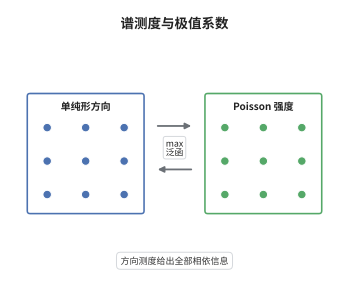

# 极值过程的谱测度表示

> **一句话大白话**：把所有极端观测按"大小乘方向"拆开看，大小服从一个普适的幂律强度，方向却带着全部相依信息；这些方向的分布就是谱测度。
>
> **小例子**：完全相依时谱测度集中在顶点 $(1,0)$，$\theta=\int\max(s_1,s_2)\,dS=1$；渐近独立时它由两个顶点上各一单位质量组成，$\theta=1+1=2$。

## 介绍

谱测度表示是极值理论中"极坐标分解"的严格版本。i.i.d. 单位 Fréchet 变量的散点图在 $n\to\infty$ 时收敛到强度 $u^{-2}du$ 的 Poisson 点过程，于是多元极值的一切相依信息都被压进"方向上抽到的随机元"的分布。这个分布测度 $S$ 就叫谱测度，它定义在单纯形上并满足每个坐标的积分为 1。有了 $S$，max-stable 分布的联合尾概率写成一个 max 泛函的积分，极值系数 $\theta$ 也变成 $S$ 上的一个泛函。这套语言同时覆盖 Pickands 依赖函数与极值 copula，是空间极值与极值指标分析的标准工具。

## 几何直观

图意在说明：单纯形上的谱测度给出方向，径向上的 Poisson 强度给出大小；二者相乘就是极值点过程的强度测度，$\theta$ 是谱测度上的 max 泛函。

## 分析

**前置依赖**：点过程、极值理论；补充：Poisson 点过程、弱收敛、单纯形上的测度。

**数学内涵**：
- 点过程极限：若 $X_i$ 为 i.i.d. 单位 Fréchet 变量，则 $N_n=\sum_{i\le n}\delta_{X_i/n}\Rightarrow N$，$N$ 是强度 $x^{-2}dx$ 的 Poisson 点过程。
- 谱表示：设 $\Delta=\{s\in[0,\infty)^d:\sum_j s_j=1\}$，$S$ 为 $\Delta$ 上的测度且 $\int_\Delta s_j\,dS(s)=1$ 对每个 $j$ 成立（此时总质量恰为 $d$）；若 $\{(U_i,W_i)\}$ 是 $(0,\infty)\times\Delta$ 上强度 $u^{-2}du\otimes S(dw)$ 的 Poisson 点过程，则 $Z_j=\sup_i U_iW_{ij}$ 是 max-stable、单位 Fréchet 边距的向量。
- 联合律：$P(Z_1\le z_1,\dots,Z_d\le z_d)=\exp\{-\int_\Delta\max_j(s_j/z_j)\,dS(s)\}$；取所有 $z_j=z$ 得 $e^{-\theta/z}$，其中 $\theta=\int_\Delta\max_j s_j\,dS(s)\in[1,d]$。
- 归一化：$\max_j s_j\le\sum_j s_j=1$ 且 $\max_j s_j\ge1/d$，故 $\theta\in[1,d]$；若改用总质量为 1 的概率测度 $P=S/d$，则 $\theta=d\int\max_j s_j\,dP$，抄公式前务必确认 $\int s_j\,dS$ 是否等于 1，不存在"用某个质量的倒数表示 $\theta$"的通用写法。
- 常见误区：把序列的极值指标 $\theta_{\mathrm{seq}}=\lim_n P(M_n\le u_n\mid X_1>u_n)\in(0,1]$（簇大小的倒数）与多元极值系数 $\theta\in[1,d]$ 混为一谈，两者取值范围与含义都不同。

**结构**：
1. 把散点图按 $X_i/n$ 缩放，取极限得到 Poisson 点过程。
2. 用"半径乘方向"分解点，方向测度即谱测度。
3. 对"没有点落在禁区"求概率，得到 max 泛函与 $\theta$。

## 思考过程

de Haan 与 Resnick 在 1977 年前后把极值理论与点过程语言接上，动机是摆脱"逐维写分布函数"的笨办法。多元极值分布的参数随维数爆炸，必须找一个低维的充分对象。观察是：高阈值下，极端事件的"大小"有一个普适分布——单位 Fréchet 尺度下就是 $u^{-2}du$，与原始分布无关；因此差异只能来自"方向"。关键一步是把 $d$ 维点写成"半径乘单纯形上的方向"，并证明方向测度足以重建联合律。这样得到的 $\theta$ 只是一维泛函，代价是信息丢失：$\theta$ 相同而 $S$ 不同的分布大量存在。谱测度与 Pickands 依赖函数其实是同一对象的两种坐标，选择哪种取决于计算方便。

## 证明过程

**定理**：设 $S$ 为单纯形 $\Delta$ 上的测度且 $\int_\Delta s_j\,dS(s)=1$（$j=1,\dots,d$），$\{(U_i,W_i)\}$ 为 $(0,\infty)\times\Delta$ 上强度 $u^{-2}du\otimes S(dw)$ 的 Poisson 点过程，$Z_j=\sup_i U_iW_{ij}$。则

$$
P(Z_1\le z_1,\dots,Z_d\le z_d)=\exp\Big\{-\int_\Delta\max_{1\le j\le d}\frac{s_j}{z_j}\,dS(s)\Big\},
$$

特别地 $P(Z_j\le z)=e^{-1/z}$，且 $\theta=\int_\Delta\max_j s_j\,dS(s)\in[1,d]$。

**证明**：

### 1. 事件的改写

$Z_j\le z_j$ 对一切 $j$ 成立，等价于每个点都满足 $U_iW_{ij}\le z_j$ 对一切 $j$，即 $U_i\le\min_j z_j/W_{ij}$。所以

$$
\{Z\le z\}=\Big\{\text{没有点落在区域}\ \bigcup_{j}\{u>z_j/w_j\}\Big\}.
$$

### 2. Poisson 空区概率

点过程的强度测度为 $u^{-2}du\otimes S(dw)$，禁区的强度测度为

$$
\int_\Delta\int_{\min_j z_j/s_j}^{\infty}u^{-2}\,du\,S(ds)=\int_\Delta\max_{1\le j\le d}\frac{s_j}{z_j}\,S(ds),
$$

因为 $\int_{a}^{\infty}u^{-2}du=1/a$ 且 $1/\min_j(z_j/s_j)=\max_j(s_j/z_j)$。Poisson 点过程"区域为空"的概率等于强度的负指数，故

$$
P(Z\le z)=\exp\Big\{-\int_\Delta\max_j\frac{s_j}{z_j}\,dS(s)\Big\}.
$$

### 3. 结论

取 $z_1=z$、其余 $z_j=\infty$，max 退化为 $s_1/z$，由 $\int s_1\,dS=1$ 得 $P(Z_1\le z)=e^{-1/z}$，即单位 Fréchet 边距。取所有 $z_j=z$ 得 $P(Z\le z)=e^{-\theta/z}$，其中 $\theta=\int\max_j s_j\,dS\in[1,d]$：$\theta=1$ 对应 $S$ 集中在一个顶点（完全相依），$\theta=d$ 对应 $S$ 集中在 $d$ 个顶点（渐近独立）。二元的 $\lambda=2-\theta$。$\square$

## 课堂问答

**老师**：为什么极端事件的"大小"分布与原始分布无关，只有"方向"带着相依信息？

**学生**：因为单位 Fréchet 边距已经把尺度归一化掉了。散点图 $X_i/n$ 的极限是强度 $u^{-2}du$ 的 Poisson 点过程，这条强度曲线是普适的；差异只能体现为每次极端事件在单纯形上抽到的方向 $W_i$，这正是谱测度。

**老师（追问）**：$\theta=\int\max_j s_j\,dS$ 里，为什么要求 $\int s_j\,dS=1$？

**学生**：这是让边距成为单位 Fréchet 的归一化条件。此时 $\int\max_j(s_j/z)\,dS=\theta/z$，于是 $P(Z\le z)=e^{-\theta/z}$。若换成总质量为 1 的概率测度 $P=S/d$，公式要写成 $\theta=d\int\max s\,dP$。

**老师（拓展）**：$\theta$ 相同能否说明两个极值分布相同？

**学生**：不能。$\theta$ 只是 $\max$ 泛函在 $S$ 上的积分，是 $S$ 的一维投影。例如两个不同的依赖函数可以在 $t=1/2$ 处取相同值而形状不同。要重建联合律必须给出整个 $S$，这也是空间极值建模要估计谱测度而非单个系数的原因。
