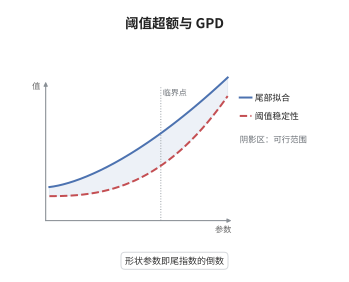

# 超阈值方法与广义 Pareto 分布

> **一句话大白话**：与其每年只盯一个最大值，不如把所有超过高阈值的观测都拿来看；这些"超额量"的分布近似是广义 Pareto 分布，于是尾部外推只需要两个参数。
>
> **小例子**：若 $\bar F(x)=x^{-3}$ 且取阈值 $u=100$，则 $\xi=1/3$、$\sigma(u)=u/3\approx33.3$，超额量近似服从 $G_{1/3,\,33.3}$。

## 介绍

块最大值法把每个时间块压成一个数，浪费了大量极端观测；超阈值法（POT，peaks over threshold）改用全部超过阈值 $u$ 的数据。理论依据是 Pickands-Balkema-de Haan 定理：阈值趋于右端点时，超额量的条件分布一致收敛到广义 Pareto 分布（GPD）。这一步把"拟合整条分布"换成"拟合一条尾部曲线"，且形状参数 $\xi$ 与原分布的尾指数 $\alpha$ 满足 $\xi=1/\alpha$。GPD 还有阈值稳定性：换一个更高的阈值，形状参数不变、只有尺度平移，因此参数可以在不同阈值之间迁移。金融的 VaR 与预期损失、水文的洪峰、保险的巨灾索赔都用这套框架做尾部外推。

## 几何直观

图意在说明：阈值右侧的尾概率被重新归一化后成为一条 GPD 尾曲线，$\xi=1/\alpha$ 决定它的幂律斜率，$\sigma(u)$ 只负责横向平移。

## 分析

**前置依赖**：Pickands-Balkema-de Haan 定理、正则变差；补充：条件分布、均值超额函数。

**数学内涵**：
- 条件超额分布：$F_u(y)=P(X-u\le y\mid X>u)=1-\frac{1-F(u+y)}{1-F(u)}$，$0\le y<x^*-u$。
- GPD 近似：存在 $\sigma(u)>0$ 使 $\sup_{0\le y<x^*-u}\big|F_u(y)-G_{\xi,\sigma(u)}(y)\big|\to0$，其中 $G_{\xi,\sigma}(y)=1-(1+\xi y/\sigma)^{-1/\xi}$，$\xi=0$ 时为 $1-e^{-y/\sigma}$。
- 尾指数关系：若 $1-F\in RV_{-\alpha}$（$\alpha>0$），则 $\xi=1/\alpha$ 且 $\sigma(u)\sim\xi u$；反之 GPD 近似蕴含尾部按指数 $1/\xi$ 正则变差。
- 阈值稳定性：若 $X-u\mid X>u\sim G_{\xi,\sigma}$，则对 $v>u$ 有 $X-v\mid X>v\sim G_{\xi,\sigma+\xi(v-u)}$，形状参数不随阈值改变。
- 均值超额：$e(u)=E[X-u\mid X>u]=\frac{\sigma(u)}{1-\xi}$（$\xi<1$），关于 $u$ 线性，是选阈值的图示依据。
- 常见误区：$\xi\ge1$ 时均值不存在，仍用样本均值去估 $\sigma$ 会系统性失真；也不能指望 $\sigma$ 在不同阈值下不变。

**结构**：
1. 把条件分布写成两个尾概率之比。
2. 代入正则变差的尾展开，得到 GPD 的参数形式。
3. 验证阈值稳定性，并给出尾部外推公式。

## 思考过程

块最大值法的低效在 1970 年代已被注意到：一年只有一个最大值进入似然，极端事件的样本量被压到极低。Pickands 与 Balkema、de Haan 在 1974 至 1975 年各自发现，阈值以上的超额量有一个与 $F$ 的细节无关的极限族，这就是 GPD。真正的困难是阈值的选择：$u$ 越大近似越好，但可用样本越少、方差越大。关键想法是放弃"整条分布"，只保留比值 $\bar F(u+y)/\bar F(u)$，因为比值对 $u$ 的依赖只通过一个尺度参数体现。这也解释了为什么 $\xi$ 能跨阈值迁移：它编码的是尾部的相对衰减率，而不是绝对位置。把 $\xi$ 与尾指数 $\alpha$ 联系起来后，POT 就成了极值指数估计的"连续版本"。

## 证明过程

**定理**：设 $1-F\in RV_{-\alpha}$（$\alpha>0$），$F_u$ 为超额条件分布。则对每个固定 $y\ge0$，

$$
F_u(y)\to1-\Big(1+\frac{y}{u}\Big)^{-\alpha}=G_{\xi,\sigma(u)}(y),\qquad \xi=\frac1\alpha,\quad \sigma(u)=\frac{u}{\alpha},
$$

且收敛对 $y=O(u)$ 一致。

**证明**：

### 1. 比值表示

$$
F_u(y)=1-\frac{1-F(u+y)}{1-F(u)},\qquad 0\le y<x^*-u,
$$

于是问题化为研究尾概率的比值随 $u$ 的行为。

### 2. 代入正则变差

写 $1-F(x)=x^{-\alpha}L(x)$，$L$ 慢变，则

$$
\frac{1-F(u+y)}{1-F(u)}=\Big(1+\frac{y}{u}\Big)^{-\alpha}\frac{L(u+y)}{L(u)}\to\Big(1+\frac{y}{u}\Big)^{-\alpha},
$$

因为 $L(u+y)/L(u)\to1$ 对 $y=O(u)$ 一致。取 $\xi=1/\alpha$ 与 $\sigma(u)=u/\alpha=\xi u$，则 $\xi y/\sigma(u)=y/u$、$-1/\xi=-\alpha$，故

$$
1-\Big(1+\frac{y}{u}\Big)^{-\alpha}=1-\Big(1+\xi\frac{y}{\sigma(u)}\Big)^{-1/\xi}=G_{\xi,\sigma(u)}(y).
$$

### 3. 结论

由此得分布关系 $\bar F(u+y)=\bar F(u)\,\bar G_{\xi,\sigma(u)}(y)$，即尾部被分解为"阈值处的质量乘以 GPD 形状"，外推公式与 $\xi=1/\alpha$ 同时成立。再验证阈值稳定性：对 $v>u$，

$$
P(X-v>y\mid X>v)=\frac{\bar G_{\xi,\sigma(u)}(v-u+y)}{\bar G_{\xi,\sigma(u)}(v-u)}=\Big(1+\frac{\xi y}{\sigma(u)+\xi(v-u)}\Big)^{-1/\xi},
$$

即 $X-v\mid X>v$ 仍是 GPD，形状参数不变、尺度变成 $\sigma(u)+\xi(v-u)$。$\square$

## 课堂问答

**老师**：POT 凭什么只用阈值以上的少数点代表整条尾部？

**学生**：因为 $\bar F(u+y)=\bar F(u)\,\bar G_{\xi,\sigma(u)}(y)$：尾部被拆成阈值处的质量 $\bar F(u)$ 和一个只含 $(y,\xi,\sigma)$ 的形状因子。只要 $\bar F(u)$ 用经验频率估出来，高于阈值的部分就由 GPD 外推。

**老师（追问）**：$\xi$ 与尾指数 $\alpha$ 是什么关系？为什么阈值变高时 $\sigma$ 变而 $\xi$ 不变？

**学生**：$\xi=1/\alpha$，由 $1-F\in RV_{-\alpha}$ 的指数直接读出。阈值稳定性给出 $\sigma(v)=\sigma(u)+\xi(v-u)$，说明 $\xi$ 是尾部的内在量，而 $\sigma$ 只是把单位从 $u$ 换成 $v$ 的尺度。

**老师（拓展）**：阈值怎么选？$\xi\ge1$ 时要小心什么？

**学生**：看均值超额图 $e(u)=\sigma(u)/(1-\xi)$ 是否呈线性，取线性段的起点。$\xi\ge1$ 时一阶矩不存在，$e(u)$ 发散，基于样本均值的阈值诊断与 VaR 之外的 ES 估计都要改用更高阶条件或重尾专用方法。
