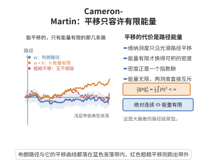

# Cameron-Martin 定理

> **一句话大白话**：布朗运动的分布（Wiener 测度）只容许沿"能量有限"的路径做平移：平移之后仍是一个带密度的概率分布，密度正是指数鞅 $e^{\int\dot h\,dW-\frac12\|\dot h\|_{L^2}^2}$；而若路径的能量无限，平移后的分布与原分布彻底"互不相认"（相互奇异）。
>
> **小例子**：把布朗运动整体加一条直线 $h(t)=at$（$\|h\|_H^2=a^2$），得到的仍是布朗运动的分布，只看 $t=1$ 时刻的密度比就是 $e^{aW_1-a^2/2}$；但若加上一条处处不可微的分形路径，两个分布已无任何"共同可见"的事件。

## 一、定理介绍

> **前置依赖**：Brown运动的存在性、Radon-Nikodym定理、绝对连续函数、Sobolev空间定义、正态分布密度函数。

设 $C_0[0,1]=\{w\in C[0,1]:w(0)=0\}$ 为连续路径空间，$\mu$ 为 Wiener 测度，即标准 Brown 运动 $\{W_t\}_{0\le t\le1}$ 在 $C_0[0,1]$ 上的分布。对 $h\in C_0[0,1]$ 记平移算子 $T_hw=w+h$，并把平移后的测度记作 $\mu_h(A):=(\mu\circ T_h^{-1})(A)=\mu(A-h)$。

Cameron–Martin 定理（又称 Cameron–Martin 公式、测度平移定理）指出：这种平移是否"可逆地"改变 Wiener 测度，完全由 $h$ 是否落在 **Cameron–Martin 空间** 决定：
$$
H=\Big\{h\in C_0[0,1]:\ h\ \text{绝对连续},\ \dot h\in L^2[0,1]\Big\},\qquad \|h\|_H^2=\int_0^1|\dot h(t)|^2\,dt .
$$
它是 Brown 路径空间的"再生核 Hilbert 空间"，其范数即路径的能量。该定理是所有 Brown 运动测度变换（Girsanov 变换、Schilder 定理、Freidlin–Wentzell 理论）的出发点。

## 几何直观

图意在说明：维纳测度只沿能量有限的路径平移后仍绝对连续，能源无限的粗糙平移会让两个测度互相奇异。

## 二、原理思路

1. 先在有限维高斯空间中平移：$\mathbb R^m$ 上的标准 Gauss 测度 $\gamma$ 平移 $a$ 之后仍有密度 $e^{\langle a,x\rangle-|a|^2/2}$，其归一性来自 Gauss 积分的配方技巧。
2. 把 $[0,1]$ 作 $m$ 等分，用增量向量 $\pi_m(w)=(\Delta_1w,\dots,\Delta_mw)$ 把 Wiener 测度投影成有限维 Gauss 测度；平移 $h$ 只改变增量，于是有限维公式可逐字搬到柱集上。
3. 令 $m\to\infty$：柱集上的二次型 $m\sum_i(\Delta_ih)^2$ 收敛到能量 $\int|\dot h|^2=\|h\|_H^2$，线性泛函 $m\sum_i\Delta_ih\,\Delta_iw$ 在 $L^2(\mu)$ 中收敛到 Paley–Wiener 积分 $\int_0^1\dot h\,dw$（其方差恰为 $\|h\|_H^2$）。密度按 $L^1$ 收敛，柱集上的等式随即推广到全体可测集。
4. 反向（奇异方向）：把 Wiener 测度沿 $L^2[0,1]$ 的一组正交基展开成无穷乘积 $\bigotimes_n N(0,1)$，平移 $h$ 相当于把第 $n$ 个因子的均值移到 $a_n$。无穷乘积高斯测度的二择定理（Kakutani）断言：二者等价当且仅当 $\sum_na_n^2<\infty$，且此时 Hellinger 亲和度为 $\prod_ne^{-a_n^2/8}$。由 Parseval 恒等式 $\sum_na_n^2=\|h\|_H^2$，故等价当且仅当 $h\in H$；能量无限时亲和度退化为 $0$，两测度相互奇异。

## 三、定理的严格表述

设 $h\in C_0[0,1]$，$\mu$ 为 Wiener 测度，$\mu_h=\mu\circ T_h^{-1}$。

**(i)（等价的平移）** 若 $h\in H$，则 $\mu_h$ 与 $\mu$ 相互绝对连续（等价），且
$$
\frac{d\mu_h}{d\mu}(w)=\exp\left(\int_0^1\dot h(t)\,dw(t)-\frac12\|h\|_H^2\right)\qquad \mu\text{-a.e.},
$$
其中 $\int_0^1\dot h\,dw$ 为 Paley–Wiener 积分，定义为 $\int_0^1\theta_n\,dw$ 在 $L^2(\mu)$ 中的极限（$\theta_n$ 为逼近 $\dot h$ 的阶梯函数）。等价地，对任意可测集 $A$，
$$
\mu(A-h)=\int_A\exp\left(\int_0^1\dot h\,dw-\frac12\|h\|_H^2\right)d\mu .
$$

**(ii)（奇异的平移）** 若 $h\notin H$，则 $\mu_h\perp\mu$。

特别地 $H$ 是 Wiener 测度"可容许平移"的最大集合：$h\in H$ 时平移保持测度类不变，$h\notin H$ 时平移后测度与原测度无公共正测度集。

## 四、证明过程

**步骤 1（有限维高斯平移）。** 设 $\gamma$ 为 $\mathbb R^m$ 上标准 Gauss 测度，密度为 $(2\pi)^{-m/2}e^{-|x|^2/2}$。对 $a\in\mathbb R^m$ 与 Borel 集 $A$，作变量替换 $x\mapsto x-a$（即令 $y=x+a$，当 $x$ 取遍 $A-a$ 时 $y$ 取遍 $A$）：
$$
\gamma(A-a)=\int_{A-a}(2\pi)^{-m/2}e^{-|x|^2/2}\,dx=\int_A(2\pi)^{-m/2}e^{-|y-a|^2/2}\,dy .
$$
由 $|y-a|^2=|y|^2-2\langle a,y\rangle+|a|^2$，右端等于
$$
\int_A e^{\langle a,y\rangle-\frac12|a|^2}\,\gamma(dy).
$$
这正是平移公式：平移只把密度乘上一个正的可积因子，故 $\gamma(\cdot-a)$ 与 $\gamma$ 等价（这是 Cameron–Martin 公式的有限维原型）。

**步骤 2（投影到柱集）。** 取 $m$ 等分 $0=t_0<t_1<\dots<t_m=1$，$t_i=i/m$。Brown 运动的增量 $\Delta_iW=W_{t_i}-W_{t_{i-1}}$ 相互独立且服从 $N(0,1/m)$。归一化后 $x_i(w)=\sqrt m\,\Delta_iw$ 为 $\mathbb R^m$ 上独立标准正态，故 $\pi_m(w)=(x_1(w),\dots,x_m(w))$ 的分布即为标准 $\gamma$。记 $a_i=\sqrt m\,\Delta_ih$，则
$$
\pi_m(w+h)=\pi_m(w)+(a_1,\dots,a_m),
$$
即对柱集 $A=\pi_m^{-1}(B)$：
$$
\mu(A-h)=\mu\big(\pi_m(w)+(a_1,\dots,a_m)\in B\big)=\gamma(B-a),
$$
由步骤 1，
$$
\mu(A-h)=\int_B e^{\langle a,x\rangle-\frac12|a|^2}\,\gamma(dx)=\int_A\exp\Big(m\sum_{i=1}^{m}\Delta_ih\,\Delta_iw-\frac12\,m\sum_{i=1}^{m}(\Delta_ih)^2\Big)\,d\mu .
$$

**步骤 3（$L^1$ 极限与推广）。** 记
$$
L_m(w)=m\sum_{i=1}^{m}\Delta_ih\,\Delta_iw,\qquad V_m=m\sum_{i=1}^{m}(\Delta_ih)^2 .
$$
$L_m$ 是中心高斯变量，方差为 $m^2\sum_i(\Delta_ih)^2\cdot\frac1m=V_m$；对 $h\in H$（$\dot h\in L^2$），Riemann 和给出 $V_m\to\|h\|_H^2$，且 $L_m\to L:=\int_0^1\dot h\,dw$ 于 $L^2(\mu)$，其中 $L\sim N(0,\|h\|_H^2)$。于是 $Z_m=\exp(L_m-\frac12V_m)\to Z=\exp(L-\frac12\|h\|_H^2)$ 于 $L^1(\mu)$。又 $Z_m=\mathbb E[Z\mid\sigma(\pi_m)]$ 构成 $L^1$ 鞅（这正是步骤 2 的等式），由鞅收敛定理 $Z_m\to Z$ 且 $\mathbb E[Z]=1$。步骤 2 的等式对张成 $\sigma$-代数的柱代数成立，两边作为 $C_0[0,1]$ 上的测度在柱代数上一致，由单调类定理推广到一切可测集，得 (i)。

**步骤 4（奇异情形）。** 取 $L^2[0,1]$ 的一组标准正交基 $\{\varphi_n\}$，令 $\Phi_n(t)=\int_0^t\varphi_n$，则 $\{\Phi_n\}$ 是 $H$ 的标准正交基。Paley–Wiener 展开把 Wiener 测度写成无穷乘积
$$
\mu=\bigotimes_{n\ge1}N(0,1),\qquad W=\sum_{n\ge1}\xi_n\Phi_n\quad(\text{于 }L^2[0,1]),\qquad \xi_n\ \text{独立同分布}\ N(0,1),
$$
而平移 $h\in H$ 只把第 $n$ 个因子 $N(0,1)$ 移到 $N(a_n,1)$，其中 $a_n=\langle\dot h,\varphi_n\rangle$。由 Kakutani 乘积二择定理，两无穷乘积高斯测度等价当且仅当
$$
\sum_{n\ge1}\Big(1-e^{-a_n^2/8}\Big)<\infty\iff\sum_{n\ge1}a_n^2<\infty,
$$
且等价时 Hellinger 亲和度为 $\prod_ne^{-a_n^2/8}=e^{-\|h\|_H^2/8}$。由 Parseval 恒等式 $\sum_na_n^2=\|\dot h\|_{L^2}^2=\|h\|_H^2$，故等价当且仅当 $h\in H$。若 $h\notin H$，则其 $H$-投影范数 $\sum_{n\le N}a_n^2=\|P_Nh\|_H^2$ 无界（否则 $h$ 是 $H$ 中 Cauchy 列的极限，从而绝对连续且 $\dot h\in L^2$，与 $h\notin H$ 矛盾），于是上述级数发散、乘积亲和度趋于 $0$，两测度相互奇异，即 (ii)。$\square$

**推论（指数鞅与 Girsanov）。** 由步骤 3，$Z=\exp(L-\frac12\|h\|_H^2)$ 满足 $\mathbb E_\mu Z=1$，且 $\mathbb E_\mu e^{L}=e^{\frac12\|h\|_H^2}$；在测度 $\mathbb Q=Z\cdot\mu$ 下 $w-h$ 仍为 Brown 运动。这正是 Schilder 定理下界中所用"倾斜测度"的依据。

## 五、应用与意义

- **测度变换的基石**：Cameron–Martin 定理给出 Wiener 测度平移的 Radon–Nikodym 密度，是 Girsanov 定理、指数鞅与随机微分方程漂移变换的前身。
- **大偏差与稀有事件**：Schilder 定理用本定理把 $W^\varepsilon$ 局部集中在最优路径 $f\in H$ 附近，得到速率函数 $\frac12\|f\|_H^2$。
- **路径空间的几何**：$H$ 是 Wiener 测度的再生核 Hilbert 空间，刻画了该测度全体"可容许平移方向"，是无穷维 Gauss 分析的范例。
- **相互奇异性**：$h\notin H$ 时测度相互奇异，说明布朗路径几乎必然处处不可微、能量无限，这一现象在随机分析中反复出现。

## 课堂问答

**老师**：为什么把 Brown 运动沿某条路径$h$平移后，有时仍有密度、有时却与原测度相互奇异？

**学生**：分界就在$h$是否属于 Cameron–Martin 空间$H=\{h\ \text{绝对连续},\ \dot h\in L^2\}$。$h\in H$时平移后测度与原测度等价，密度为$\frac{d\mu_h}{d\mu}=\exp(\int_0^1\dot h\,dw-\frac12\|h\|_H^2)$；$h\notin H$时两测度相互奇异。

**老师（追问）**：这个密度公式是怎么从有限维高斯平移"搬"过来的？

**学生**：$\mathbb R^m$标准 Gauss 测度平移$a$的密度是$e^{\langle a,x\rangle-|a|^2/2}$；把$[0,1]$作$m$等分，Brown 增量标准化后就是标准 Gauss，平移$h$只对应增量平移$a_i=\sqrt m\,\Delta_ih$，于是有限维公式逐字搬到柱集上，再令$m\to\infty$：二次型收敛到$\|h\|_H^2$、线性泛函收敛到$\int_0^1\dot h\,dw$。

**老师（拓展）**：奇异那半边怎么证明？能量为什么是关键？

**学生**：用 Paley–Wiener 展开把 Wiener 测度写成$\bigotimes_n N(0,1)$，平移只把第$n$个因子移到$N(a_n,1)$，由 Kakutani 乘积二择定理，等价当且仅当$\sum_na_n^2<\infty$，而 Parseval 给出$\sum_na_n^2=\|h\|_H^2$。能量$\|h\|_H^2=\infty$时亲和度趋于$0$，两测度相互奇异——这也说明 Brown 路径几乎必然处处不可微。
