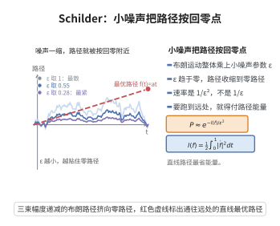

# Schilder定理

> **一句话大白话**：当噪声尺度 $\varepsilon$ 缩到零时，缩放后的 Brown 运动偏离"零路径"的概率按 $\exp(-I(f)/\varepsilon^2)$ 衰减，$I$ 由路径能量 $\frac12\int|\dot f|^2$ 给出。
>
> **小例子**：Brown 运动在 $t=1$ 时超过 $a$ 的概率约 $e^{-a^2/2}$，最优路径是直线 $f(t)=at$。

## 一、定理介绍

> **前置依赖**：标准 Brown 运动、Cameron-Martin 空间、Pinelis 极大不等式、Cameron-Martin 定理（测度平移）、倾斜测度。

设 $\{W_t\}$ 为标准 Brown 运动，$W^\varepsilon(t)=\varepsilon W(t)$。则当 $\varepsilon\to0$ 时 $\{W^\varepsilon\}$ 在 $C[0,1]$ 上满足速率为 $1/\varepsilon^2$ 的大偏差原理，速率函数为
$$
I(f)=\begin{cases}\frac12\int_0^1|\dot f(t)|^2\,dt, & f\in H_0^1[0,1],\ f(0)=0,\\ \infty, & \text{其他},\end{cases}
$$
其中 $H_0^1[0,1]$ 为 Cameron-Martin 空间（$f(0)=0$、$\dot f\in L^2$ 的绝对连续函数）。

## 几何直观

图意在说明：噪声缩小时布朗路径以 1/ε² 的速率贴近零路径，偏离越远所付的路径能量越大。

## 二、原理思路

上界用 Pinelis 不等式（$\mathbb P(\|W\|_\infty\ge r)\le2e^{-r^2/2}$）估计"远离紧集 $K_R=\{f:\|f\|_H\le R\}$"的情形，再在 $K_R\cap C$ 上用 Cameron-Martin 公式展开有限覆盖；下界对 $f\in H_0^1$ 引入倾斜测度 $\frac{d\mathbb Q_\varepsilon}{d\mathbb P}=\exp\big(\frac1\varepsilon\int_0^1\dot f\,dW-\frac1{2\varepsilon^2}\|f\|_H^2\big)$，在 $\mathbb Q_\varepsilon$ 下 $W^\varepsilon-f$ 仍是 Brown 运动，从而概率集中在 $f$ 附近。

## 三、定理的严格表述

$W^\varepsilon=\varepsilon W$ 在 $C[0,1]$ 上满足速率 $1/\varepsilon^2$ 的 LDP，速率函数
$$
I(f)=\frac12\int_0^1|\dot f(t)|^2\,dt,\qquad f\in H_0^1[0,1],\ f(0)=0,
$$
否则 $I(f)=\infty$。即对闭集 $C$、开集 $U$ 有 $\limsup_{\varepsilon\to0}\varepsilon^2\log\mathbb P(W^\varepsilon\in C)\le-\inf_C I$，$\liminf_{\varepsilon\to0}\varepsilon^2\log\mathbb P(W^\varepsilon\in U)\ge-\inf_U I$。

## 四、证明过程

**步骤1：Cameron-Martin 空间。** $H_0^1$ 上范数 $\|f\|_H=(\int|\dot f|^2)^{1/2}$；Brown 运动与 $h\in H_0^1$ 的内积是均值为 0、方差 $\|h\|_H^2$ 的正态变量。

**步骤2：上界。** 由 Pinelis 不等式
$$
\mathbb P(\|W^\varepsilon\|_\infty\ge R)=\mathbb P(\|W\|_\infty\ge R/\varepsilon)\le2e^{-R^2/(2\varepsilon^2)}.
$$
对 $K_R\cap C$ 用有限 $h_i$ 与 Cameron-Martin 公式展开并令 $R,\varepsilon$ 极限，得 $\limsup\varepsilon^2\log\mathbb P(W^\varepsilon\in C)\le-\inf_C I$。

**步骤3：下界。** 对 $f\in H_0^1\cap U$，令
$$
\frac{d\mathbb Q_\varepsilon}{d\mathbb P}=\exp\left(\frac1\varepsilon\int_0^1\dot f\,dW-\frac1{2\varepsilon^2}\|f\|_H^2\right).
$$
由 Cameron-Martin 定理，$\mathbb Q_\varepsilon$ 下 $W^\varepsilon-f$ 仍是标准 Brown 运动，$\mathbb Q_\varepsilon(W^\varepsilon\in B(f,\delta))\to1$。于是
$$
\mathbb P(W^\varepsilon\in B(f,\delta))\gtrsim e^{-\frac1{\varepsilon^2}(\frac12\|f\|_H^2+o(1))},
$$
取 $1/\varepsilon^2$ 对数极限得 $\liminf\varepsilon^2\log\mathbb P\ge-\|f\|_H^2/2=-I(f)$。

**步骤4：合成。** 上下界一致且 $I$ 为好速率函数，$W^\varepsilon$ 满足 LDP。$\square$

## 五、应用与意义

Schilder 定理给出了 Brown 路径在平移空间上偏离原点的指数衰减，是路径空间大偏差的典型结果。它是 Freidlin-Wentzell 理论、热涨落、以及随机微分方程大偏差研究的基础，也用于计算随机过程中的"最小作用路径"与稀有跃迁概率。

## 课堂问答

**老师**：缩放的 Brown 运动$W^\varepsilon=\varepsilon W$偏离"零路径"的概率，衰减速度是多少？

**学生**：速率$1/\varepsilon^2$，速率函数是路径能量
$$
I(f)=\frac12\int_0^1|\dot f(t)|^2\,dt,\qquad f\in H_0^1[0,1],\ f(0)=0,
$$
其他情形$I=\infty$，即$\mathbb P(W^\varepsilon\in\cdot)\approx e^{-I(f)/\varepsilon^2}$。

**老师（追问）**：上界和下界各用什么？

**学生**：上界用 Pinelis 极大不等式$\mathbb P(\|W\|_\infty\ge r)\le2e^{-r^2/2}$控制"远离紧集$K_R=\{f:\|f\|_H\le R\}$"的尾部概率，再在$K_R\cap C$上用 Cameron–Martin 公式作有限覆盖。下界对$f\in H_0^1$引入倾斜测度$\frac{d\mathbb Q_\varepsilon}{d\mathbb P}=\exp(\frac1\varepsilon\int_0^1\dot f\,dW-\frac1{2\varepsilon^2}\|f\|_H^2)$，此测度下$W^\varepsilon-f$仍是 Brown 运动，概率集中在$f$附近。

**老师（拓展）**：为什么最优路径是直线？

**学生**：$t=1$时刻超过$a$即要求$f(1)=a$，在能量$\frac12\int|\dot f|^2$最小的约束下最优路径是直线$f(t)=at$，能量为$\frac12a^2$，故概率约$e^{-a^2/(2\varepsilon^2)}$。它是 Freidlin–Wentzell 理论的基础模块。
