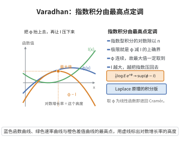

# Varadhan引理

> **一句话大白话**：若一族随机变量满足大偏差原理，那么"指数型积分"$\mathbb E[e^{n\phi(Z_n)}]$ 的对数增长，就由"$\phi$ 减速率函数 $I$"的最大值决定。
>
> **小例子**：对满足 Cramér LDP 的均值族，取 $\phi(x)=x$，则 $\frac1n\log\mathbb E[e^{n\overline X_n}]\to\sup_x\{x-I(x)\}$。

## 一、定理介绍

> **前置依赖**：Gärtner-Ellis定理、指数紧性、水平集紧致、连续函数的模、小区间覆盖与取上确界。

设 $\{Z_n\}$ 取值于 $\mathbb R^d$，满足速率为 $n$、速率函数 $I$（好速率函数）的大偏差原理。则对任意有界连续函数 $\phi:\mathbb R^d\to\mathbb R$，
$$
\lim_{n\to\infty}\frac1n\log\mathbb E\big[e^{n\phi(Z_n)}\big]=\sup_{x\in\mathbb R^d}\{\phi(x)-I(x)\}.
$$
它把 Laplace 型积分的对数渐近与大偏差速率函数联系起来；其逆命题称为 Laplace 原理。

## 几何直观

图意在说明：指数型积分的对数增长率等于 φ 减去速率函数后的上确界，由两者差曲线的最高点给出。

## 二、原理思路

上界：$\mathbb E[e^{n\phi(Z_n)}]$ 的贡献主要来自使 $\phi-I$ 大、同时概率不衰减的区域，用 LDP 上界与好速率函数的水平集紧致性把 $\mathbb R^d$ 分解后取上确界。下界：取接近 $\sup_x\{\phi-I\}$ 的 $x_0$ 与小球 $B(x_0,\delta)$，在 $B(x_0,\delta)$ 内 $\phi$ 接近 $\phi(x_0)$，再由 LDP 下界放大概率贡献。

## 三、定理的严格表述

设 $\{Z_n\}$ 满足速率 $n$、速率函数 $I$ 的 LDP，$I$ 为好速率函数，$\phi:\mathbb R^d\to\mathbb R$ 有界连续。则
$$
\lim_{n\to\infty}\frac1n\log\mathbb E\big[e^{n\phi(Z_n)}\big]=\sup_{x\in\mathbb R^d}\{\phi(x)-I(x)\}.
$$

## 四、证明过程

**步骤1：上界。** 设 $|\phi|\le K$。对 $M>0$，把 $\mathbb R^d$ 按水平集 $A_M=\{x:I(x)\le M\}$ 与其补集分解；补集由指数紧性忽略。对 $x\in A_M$ 用开球 $B(x,\delta)$ 覆盖，结合 LDP 上界与 $\phi$ 的振荡模 $\omega(\delta)$，
$$
\limsup_n\frac1n\log\mathbb E\big[e^{n\phi(Z_n)}\mathbf1_{\{Z_n\in B(x,\delta)\}}\big]\le\phi(x)+\omega(\delta)-\inf_{y\in\overline{B(x,\delta)}}I(y).
$$
令 $\delta\to0$ 并对 $x$ 取上确界，得 $\limsup\frac1n\log\mathbb E[e^{n\phi(Z_n)}]\le\sup_x\{\phi(x)-I(x)\}$。

**步骤2：下界。** 对 $\varepsilon>0$ 取 $x_0$ 使 $\phi(x_0)-I(x_0)>\sup_x\{\phi-I\}-\varepsilon$。由 $\phi$ 连续性取 $\delta$ 使 $B(x_0,\delta)$ 上 $|\phi-\phi(x_0)|<\varepsilon$。由 LDP 下界
$$
\liminf_n\frac1n\log\mathbb E[e^{n\phi(Z_n)}]\ge\phi(x_0)-\varepsilon-\inf_{y\in B(x_0,\delta)}I(y)\ge\phi(x_0)-I(x_0)-2\varepsilon,
$$
（末步用 $I$ 的下界半连续性），令 $\varepsilon\to0$ 得下界。

**步骤3：结合。** 上下界相等，即得等式。$\square$

## 五、应用与意义

Varadhan 引理是大偏差理论中连接"概率测度的指数渐近"与"变分问题"的桥梁。它用于计算随机过程的矩生成函数渐近、推导 Freidlin-Wentzell 的作用泛函、在统计物理（自由能）与信息论（错误指数）中给出经验量的大偏差刻画；其逆命题 Laplace 原理是证明 LDP 的反向工具。

## 课堂问答

**老师**：大偏差的速率函数$I$，和控制$\mathbb E[e^{n\phi(Z_n)}]$的增长，是怎么联系起来的？

**学生**：结论是$\frac1n\log\mathbb E[e^{n\phi(Z_n)}]\to\sup_x\{\phi(x)-I(x)\}$。直观上指数积分的贡献被"$\phi$大、而$I$小"的点主导，即由$\phi-I$的最大值决定，这正是一个 Laplace 型积分的对数渐近。

**老师（追问）**：上界为什么需要$I$是好速率函数？

**学生**：好速率函数水平集$\{I\le M\}$紧，可先把全空间按水平集分解：补集用指数紧性忽略，水平集上用小片覆盖并逐片用 LDP 上界，得到$\frac1n\log$上界不超过$\phi(x)+\omega(\delta)-\inf I$，令$\delta\to0$并取上确界即得。

**老师（拓展）**：下界怎么处理？它与 Laplace 原理什么关系？

**学生**：取使$\phi-I$接近上确界的$x_0$，在其小邻域上$\phi\approx\phi(x_0)$，用 LDP 下界放大概率即得下界，末步用$I$的下半连续性。逆命题叫 Laplace 原理：由所有有界连续$\phi$的极限可反推 LDP，是证明大偏差原理的反向工具。
