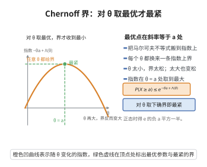

# 切比雪夫型指数不等式

> **一句话大白话**：把马尔可夫不等式用到指数函数 $e^{\theta X}$ 上，再对参数 $\theta$ 取最优，就得到尾部概率的指数型上界。
>
> **小例子**：对标准正态 $X$，$\mathbb P(X\ge a)\le\inf_{\theta>0}e^{\theta^2/2-\theta a}=e^{-a^2/2}$，正是高斯尾概率的正确指数界。

## 一、定理介绍

> **前置依赖**：马尔可夫不等式（切比雪夫不等式）、矩生成函数及其收敛域、指数函数与对数函数的单调性、对数矩生成函数的凸性与 Legendre 变换、下确界与最值的基本性质。

切比雪夫型指数不等式（exponential Chebyshev inequality，又称 Chernoff 界、Cramér 上界）是概率论中最基本的大偏差型估计。普通马尔可夫不等式只能给出多项式衰减（如 $1/n$），而把马尔可夫不等式应用到 $e^{\theta X}$ 上，可使尾部概率获得指数衰减。它是 Cramér 定理上界部分的全部来源，也是集中不等式、鞅指数不等式与假设检验错误指数分析的起点。

## 几何直观

图意在说明：每个 θ 都给出一条指数上界，指数在 θ 等于 a 处达到最大，此时得到的界最紧。

## 二、原理思路

对 $\theta>0$，事件 $\{X\ge a\}$ 等价于 $\{e^{\theta X}\ge e^{\theta a}\}$（指数函数单调递增）。对非负随机变量 $e^{\theta X}$ 用马尔可夫不等式：
$$
\mathbb P(X\ge a)\le e^{-\theta a}\,\mathbb E[e^{\theta X}]=e^{-(\theta a-\Lambda(\theta))},
$$
其中 $\Lambda(\theta)=\log\mathbb E[e^{\theta X}]$ 是对数矩生成函数。右端对每个 $\theta>0$ 都成立，故可对 $\theta>0$ 取下确界。下尾 $\{X\le a\}$ 用 $\theta<0$ 同理。对独立和，矩生成函数可乘，指数界自动带上 $n$ 的速率。

## 三、定理的严格表述

设 $X$ 为实随机变量，其矩生成函数 $M(\theta)=\mathbb E[e^{\theta X}]$ 在 $\theta=0$ 的某邻域内有限，记对数矩生成函数 $\Lambda(\theta)=\log M(\theta)$。

**（上尾）** 对任意 $a\in\mathbb R$，
$$
\mathbb P(X\ge a)\le\exp\Big(-\sup_{\theta>0}\big\{\theta a-\Lambda(\theta)\big\}\Big).
$$

**（下尾）** 对任意 $a\in\mathbb R$，
$$
\mathbb P(X\le a)\le\exp\Big(-\sup_{\theta<0}\big\{\theta a-\Lambda(\theta)\big\}\Big).
$$

**（独立和形式）** 若 $X_1,\dots,X_n$ 独立同分布，$S_n=\sum_{i=1}^nX_i$，则对任意 $a$ 与 $\theta>0$，
$$
\mathbb P(S_n\ge na)\le\exp\big(-n\{\theta a-\Lambda(\theta)\}\big).
$$

**（有界情形的推论）** 若 $X_1,\dots,X_n$ 独立同分布且取值于 $[0,1]$，$\mu=\mathbb E[X_1]$，则对任意 $t>0$，
$$
\mathbb P\!\left(\frac{S_n}{n}-\mu\ge t\right)\le e^{-2nt^2}.
$$

## 四、证明过程

**（上尾）。** 固定 $\theta>0$。因 $u\mapsto e^{\theta u}$ 严格递增，有 $\{X\ge a\}\subseteq\{e^{\theta X}\ge e^{\theta a}\}$。对非负随机变量 $Y=e^{\theta X}$ 用马尔可夫不等式 $\mathbb P(Y\ge c)\le\mathbb E[Y]/c$，得
$$
\mathbb P(X\ge a)\le\mathbb P\big(e^{\theta X}\ge e^{\theta a}\big)\le\frac{\mathbb E[e^{\theta X}]}{e^{\theta a}}=e^{-(\theta a-\Lambda(\theta))}.
$$
此式对所有 $\theta>0$ 成立，故可对右端取下确界
$$
\mathbb P(X\ge a)\le\inf_{\theta>0}e^{-(\theta a-\Lambda(\theta))}=\exp\Big(-\sup_{\theta>0}\{\theta a-\Lambda(\theta)\}\Big). \qquad\square
$$

**（下尾）。** 取 $\theta<0$。此时 $u\mapsto e^{\theta u}$ 严格递减，故 $X\le a\iff\theta X\ge\theta a\iff e^{\theta X}\ge e^{\theta a}$。仍由马尔可夫不等式
$$
\mathbb P(X\le a)\le e^{-\theta a}M(\theta)=e^{-(\theta a-\Lambda(\theta))}\qquad(\theta<0),
$$
对 $\theta<0$ 取上确界即得结论。$\square$

**（独立和）。** 由独立性
$$
M_{S_n}(\theta)=\mathbb E\big[e^{\theta\sum_iX_i}\big]=\prod_{i=1}^n\mathbb E[e^{\theta X_i}]=M(\theta)^n,
$$
故 $\Lambda_{S_n}(\theta)=n\Lambda(\theta)$。代入上尾不等式并对 $a$ 换成 $a$ 即得
$$
\mathbb P(S_n\ge na)\le\exp\big(-n\{\theta a-\Lambda(\theta)\}\big). \qquad\square
$$

**（最优 $\theta$ 与凸性）。** $\Lambda$ 是凸函数：对 $t\in[0,1]$ 与 $\theta_1,\theta_2$，由 Hölder 不等式
$$
M(t\theta_1+(1-t)\theta_2)=\mathbb E\big[e^{t\theta_1X}e^{(1-t)\theta_2X}\big]\le M(\theta_1)^{t}M(\theta_2)^{1-t},
$$
取对数得 $\Lambda(t\theta_1+(1-t)\theta_2)\le t\Lambda(\theta_1)+(1-t)\Lambda(\theta_2)$。于是 $f(\theta)=\theta a-\Lambda(\theta)$ 是凹函数，其内点极值由一阶条件 $\Lambda'(\theta)=a$ 给出；若该方程在 $\theta>0$ 上无解，则上确界在边界 $\theta\to0^+$ 处以 $\limsup$ 取到，给出平凡的界 $1$。

**（有界情形的推论）。** 设 $X\in[0,1]$，$\mu=\mathbb E[X]$。Hoeffding 引理给出，对任意 $\theta$，
$$
\Lambda(\theta)-\theta\mu=\log\mathbb E\big[e^{\theta(X-\mu)}\big]\le\frac{\theta^2}{8}.
$$
于是对任意 $\theta>0$，
$$
\mathbb P\!\left(\frac{S_n}{n}-\mu\ge t\right)\le\exp\big(-n\{\theta t-(\Lambda(\theta)-\theta\mu)\}\big)\le\exp\Big(-n\Big\{\theta t-\frac{\theta^2}{8}\Big\}\Big).
$$
右端对 $\theta$ 取下确界，在 $\theta=4t$ 处达到 $\sup_\theta\{\theta t-\theta^2/8\}=2t^2$，故
$$
\mathbb P\!\left(\frac{S_n}{n}-\mu\ge t\right)\le e^{-2nt^2}. \qquad\square
$$

## 五、应用与意义

- **大偏差上界**：Cramér 定理的闭集上界正是本不等式经 Legendre 变换优化所得，本不等式是其"单变量、单侧"原型。
- **集中不等式**：Hoeffding、Chernoff、Bernstein 界均由它导出，是统计学习与随机算法误差分析的标准工具。
- **随机算法与抽样**：用于估计所需样本量、分析随机化算法的失败概率。
- **鞅与适应性推广**：把马尔可夫不等式换成条件形式，可推广为鞅指数不等式（Azuma–Hoeffding），用于依赖结构下的集中。

## 课堂问答

**老师**：普通马尔可夫不等式只给多项式衰减，怎么改成指数衰减？

**学生**：把马尔可夫不等式用到$e^{\theta X}$上。因$u\mapsto e^{\theta u}$单调，$\{X\ge a\}=\{e^{\theta X}\ge e^{\theta a}\}$，对$\theta>0$得
$$
\mathbb P(X\ge a)\le e^{-\theta a}\mathbb E[e^{\theta X}]=e^{-(\theta a-\Lambda(\theta))},
$$
再对$\theta>0$取下确界，即$\exp(-\sup_{\theta>0}\{\theta a-\Lambda(\theta)\})$。

**老师（追问）**：为什么对独立和会自动带上$n$的速率？

**学生**：因为矩生成函数对独立和可乘：$M_{S_n}(\theta)=\prod_i\mathbb E[e^{\theta X_i}]=M(\theta)^n$，故$\Lambda_{S_n}=n\Lambda$，代入得$\mathbb P(S_n\ge na)\le\exp(-n\{\theta a-\Lambda(\theta)\})$，指数界天然带$n$。

**老师（拓展）**：最优$\theta$怎么定？有界情形能推成什么样？

**学生**：$\Lambda$是凸函数（可由 Hölder 不等式证），故$f(\theta)=\theta a-\Lambda(\theta)$为凹，内点极值由一阶条件$\Lambda'(\theta)=a$给出。若$X\in[0,1]$，由 Hoeffding 引理$\Lambda(\theta)-\theta\mu\le\theta^2/8$，取$\theta=4t$得$\mathbb P(\frac{S_n}{n}-\mu\ge t)\le e^{-2nt^2}$——这正是 Hoeffding 界，也是 Cramér 定理上界的单变量原型。

## 相关条目

- [Cramér 定理](./Cramér定理.md)：本不等式是其上界部分的直接工具。
- [Gärtner-Ellis 定理](./Gärtner-Ellis定理.md)：把指数矩条件推广到一般尺度，本不等式是其单变量特例。
