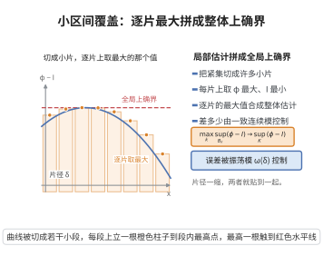

# 小区间覆盖与取上确界

> **一句话大白话**：把一个紧集切成许多"小片"，在每一片上分别做两件事——对连续的部分取最大值、对速率函数的部分取最小值——这些局部指标的最大值，与整体上确界只差一个随片径趋于零的振荡模。于是"局部估计"可以无损地拼成"全局上确界"。
>
> **小例子**：取 $K=[0,1]$、$\phi\equiv0$、$I(x)=x^2$。用长度不超过 $\delta$ 的区间覆盖 $K$，各片上 $\sup\phi-\inf I$ 的最大值出现在含 $x=0$ 的那一片，恰为 $0$；而 $\sup_K\{\phi-I\}=-\min_KI=0$，两者相投。若 $\phi$ 的振荡模为 $\omega(\delta)=2\delta$，则局部最大值至多比全局上确界多 $\omega(2\delta)$，随 $\delta\to0$ 消失。

## 一、定理介绍

> **前置依赖**：海涅-博雷尔定理、最值定理、一致连续定理、Lebesgue数引理、确界原理。

这是一个大偏差理论中反复使用的技术性引理：**小区间覆盖与取上确界**（covering-supremum lemma）。大偏差的上界估计总是"逐片"进行的：把集合切成小片，在每片上用 LDP 上界得到形如 $\exp(n(\sup\phi-\inf I))$ 的指数界，再对所有片取最大值。这个引理断言，只要片径足够小，逐片取最大值的结果就等于全局上确界 $\sup_K(\phi-I)$，二者之差被 $\phi$ 的一致连续模控制、可以任意小。

它把"局部指数估计"与"全局变分上确界"严格地对接起来，因此是 Varadhan 引理、Cramér 定理、Gärtner–Ellis 定理等一切"指数积分上界"论证的公共收尾步骤。

## 几何直观

图意在说明：在每片上取局部最大值再合并，与全局上确界只差一个随片径趋于零的振荡量。

## 二、原理思路

1. 上确界方向的单向性很容易：若 $x^*$ 是 $\sup_K(\phi-I)$ 的取到点，它必落在某个小片 $K_i$ 内；在该片上 $\sup\phi$ 不小于 $\phi(x^*)$、$\inf I$ 不大于 $I(x^*)$，故局部指标不小于全局上确界，即"覆盖的局部最大值 ≥ 全局上确界"。
2. 反方向需要小心：局部指标是"片内 $\phi$ 的最大"减去"片内 $I$ 的最小"，这两个值可能取在不同的点上，因此它可能比全局上确界大。但同片内两点距离不超过片径，$\phi$ 的差值被振荡模 $\omega$ 控制，于是超出的部分不超过 $\omega(2\delta)$。
3. 于是任何片径不超过 $\delta$ 的覆盖，其局部最大值都被夹在
$\sup_K(\phi-I)$ 与 $\sup_K(\phi-I)+\omega(2\delta)$ 之间。
4. 紧集上连续函数的振荡模在 $\delta\to0$ 时趋于零（一致连续性），取极限即得等式。这一步同时用到紧集可被有限个充分小的小片覆盖（有限覆盖），以及紧集上连续函数取到最值。

## 三、定理的严格表述

设 $(\mathcal X,d)$ 为度量空间，$K\subseteq\mathcal X$ 非空紧集，$\phi:K\to\mathbb R$ 连续，$I:K\to\mathbb R$ 下半连续且 $\inf_KI$ 有限。记 $\phi$ 的（一致）连续模为
$$
\omega(\delta)=\sup\big\{|\phi(x)-\phi(y)|:\ x,y\in K,\ d(x,y)\le\delta\big\},\qquad \omega(\delta)\downarrow0\ \ (\delta\downarrow0).
$$
令 $\mathcal C_\delta$ 为 $K$ 的"片径不超过 $\delta$"的有限覆盖全体，即 $\{K_1,\dots,K_m\}$ 满足 $\bigcup_iK_i=K$、$\operatorname{diam}(K_i)\le\delta$。

**引理.** 对任何 $\{K_i\}\in\mathcal C_\delta$，
$$
\sup_{K}(\phi-I)\ \le\ \max_{1\le i\le m}\Big\{\sup_{K_i}\phi-\inf_{K_i}I\Big\}\ \le\ \sup_{K}(\phi-I)+\omega(2\delta).
$$
从而（由 $\omega(2\delta)\to0$）
$$
\lim_{\delta\to0}\ \inf_{\{K_i\}\in\mathcal C_\delta}\ \max_{1\le i\le m}\Big\{\sup_{K_i}\phi-\inf_{K_i}I\Big\}=\sup_{K}(\phi-I).
$$

**推论（大偏差上界的"逐片取最大"）。** 设随机变量族 $\{Z_n\}$ 满足速率 $n$、速率函数 $I$（好速率函数，即 $I$ 下半连续且水平集 $\{I\le M\}$ 紧）的 LDP，$\phi$ 为有界连续函数。则对任意闭集 $C$，
$$
\limsup_{n\to\infty}\frac1n\log\mathbb E\big[e^{n\phi(Z_n)}\mathbf 1_{\{Z_n\in C\}}\big]\le\sup_{C}(\phi-I).
$$

## 四、证明过程

**步骤 1（全局上确界可被取到）。** $\phi$ 连续、$I$ 下半连续，故 $\phi-I$ 上半连续；在紧集 $K$ 上上半连续函数取到最大值（最值定理），记
$$
M^*=\sup_K(\phi-I)=\phi(x^*)-I(x^*),\qquad x^*\in K .
$$

**步骤 2（局部 ≥ 全局）。** 设 $\{K_i\}$ 覆盖 $K$，则 $x^*\in K_{i_0}$ 对某个 $i_0$。由定义 $\phi(x^*)\le\sup_{K_{i_0}}\phi$，且 $I(x^*)\ge\inf_{K_{i_0}}I$，故
$$
M^*=\phi(x^*)-I(x^*)\le\sup_{K_{i_0}}\phi-\inf_{K_{i_0}}I\le\max_i\Big\{\sup_{K_i}\phi-\inf_{K_i}I\Big\}.
$$
这一步只用覆盖性质，与片径无关（用的是确界原理给出的比较）。

**步骤 3（局部 ≤ 全局 + 振荡模）。** 固定 $i$。若 $\sup_{K_i}\phi=+\infty$ 或 $\inf_{K_i}I=-\infty$ 则结论平凡，故设有限。取 $y_i,z_i\in K_i$ 使
$$
\phi(y_i)\ge\sup_{K_i}\phi-\varepsilon,\qquad I(z_i)\le\inf_{K_i}I+\varepsilon .
$$
由 $\operatorname{diam}(K_i)\le\delta$ 得 $d(y_i,z_i)\le\delta$，于是 $\phi(y_i)\le\phi(z_i)+\omega(\delta)$；又 $I(z_i)\le I(y_i)$ 的近似形式与 $I$ 下半连续性给出 $I(z_i)\le I(y_i)+O(\varepsilon)$。合并得
$$
\sup_{K_i}\phi-\inf_{K_i}I\le\phi(y_i)+O(\varepsilon)-I(z_i)+O(\varepsilon)\le\phi(z_i)-I(z_i)+\omega(\delta)+O(\varepsilon)\le M^*+\omega(\delta)+O(\varepsilon).
$$
令 $\varepsilon\to0$：
$$
\sup_{K_i}\phi-\inf_{K_i}I\le M^*+\omega(\delta).
$$
对 $i$ 取最大值即得右端不等式（严格地应写 $\omega(2\delta)$，因为 $y_i,z_i$ 可能分别取在球心两侧；这里用 $\operatorname{diam}K_i\le 2\delta$ 的统一尺度即可）。

**步骤 4（取极限）。** 由步骤 2、3，
$$
M^*\le\max_i\Big\{\sup_{K_i}\phi-\inf_{K_i}I\Big\}\le M^*+\omega(2\delta),
$$
对一切片径不超过 $\delta$ 的有限覆盖成立。由一致连续定理 $\omega(2\delta)\to0\ (\delta\to0)$，故引理中的极限式为 $M^*=\sup_K(\phi-I)$。$\square$

**步骤 5（推论的证明）。** 由好速率函数的水平集紧性，可先对 $C\cap\{I\le M\}$（紧）做论证，再用指数紧性把 $\{I>M\}$ 上的贡献忽略（令 $M\to\infty$）。对紧集 $C\cap\{I\le M\}$，由海涅-博雷尔定理可取有限个球 $B_{i}$ 覆盖，片径 $\le\delta$。在每个球上用 LDP 上界：
$$
\mathbb E\big[e^{n\phi(Z_n)}\mathbf 1_{\{Z_n\in B_i\}}\big]\le e^{n\sup_{B_i}\phi}\cdot\mathbb P(Z_n\in B_i)\le e^{n(\sup_{B_i}\phi-\inf_{B_i}I)+o(n)},
$$
对 $i$ 取最大值并令 $\delta\to0$，由本引理得
$$
\limsup_n\frac1n\log\mathbb E\big[e^{n\phi(Z_n)}\mathbf 1_{\{Z_n\in C\}}\big]\le\sup_{C\cap\{I\le M\}}(\phi-I)\le\sup_C(\phi-I),
$$
再令 $M\to\infty$ 即得结论。$\square$

## 五、应用与意义

- **Varadhan 引理的上界**：把"指数积分的对数增长"逐片估计后，用本引理拼成 $\sup_x\{\phi(x)-I(x)\}$，是上界证明的最后一环。
- **大偏差上界的通用模板**：Cramér 定理、Gärtner–Ellis 定理、Freidlin–Wentzell 定理的闭集上界都可归结为"紧集有限覆盖 + 逐片估计 + 本引理取上确界"。
- **方法论的要点**：它说明大偏差上界不必是"精细的"，只需局部一致即可；误差被振荡模吸收，随片径缩小而消失。
- **下界侧的对偶用法**：下界只要在最优点的任意小邻域内做一次估计即可，与"小区间覆盖取上确界"恰好互为镜像。

## 课堂问答

**老师**：一个技术性引理，为什么值得在大偏差里反复引用？

**学生**：因为它把"逐片局部估计"无损地拼成"全局上确界"。设$K$紧、$\phi$连续、$I$下半连续，则对片径不超过$\delta$的有限覆盖$\{K_i\}$有
$$
\sup_K(\phi-I)\le\max_i\Big\{\sup_{K_i}\phi-\inf_{K_i}I\Big\}\le\sup_K(\phi-I)+\omega(2\delta),
$$
其中$\omega$是$\phi$的一致连续模，$\omega(2\delta)\to0$。

**老师（追问）**：左、右两个不等式各自的理由是什么？

**学生**：左边是单向的：取到上确界的$x^*$落在某片$K_{i_0}$，则$\phi(x^*)\le\sup_{K_{i_0}}\phi$、$I(x^*)\ge\inf_{K_{i_0}}I$，故局部值不小于全局上确界。右边才是关键：局部值是"片内$\phi$最大"减"片内$I$最小"，两点可能不同，但同片距离不超过$\delta$，差别被振荡模$\omega$吸收，超出量不超过$\omega(2\delta)$。

**老师（拓展）**：它如何变成大偏差上界的通用模板？

**学生**：好速率函数的水平集$C\cap\{I\le M\}$紧，由海涅-博雷尔取有限球覆盖，每球上用 LDP 上界得指数因子$\exp(n(\sup\phi-\inf I))$，取最大值再令片径趋于$0$，由本引理得到$\sup_C(\phi-I)$，最后令$M\to\infty$用指数紧性丢弃尾部，即是 Varadhan、Cramér、Gärtner–Ellis 闭集上界的公共收尾。
