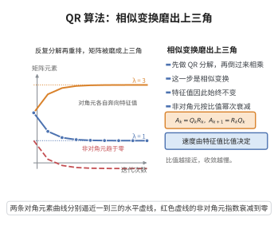

# QR算法的收敛性

> **一句话大白话**：把矩阵反复做 QR 分解再重建就会"变形"成上三角（Schur）形，对角线上逐渐浮现出特征值——QR 算法就是数值计算特征值最可靠的一把"磨刀石"。
>
> **小例子**：对对称矩阵 $\begin{pmatrix}2&1\\1&2\end{pmatrix}$ 做一次 QR 迭代后，对角线项分别趋于 $1$ 与 $3$——这正是它的两个特征值。

## 一、定理介绍

> **前置依赖**：QR 分解、相似矩阵与特征值不变性、幂法（幂迭代）、Gram-Schmidt 正交化、矩阵的对角化与谱分解。

QR 算法是计算矩阵全部特征值的最重要迭代算法：对 $A_0=A$，每次做 $A_k=Q_kR_k$（QR 分解），再令 $A_{k+1}=R_kQ_k$。在适当条件下（特征值模两两不同时），$A_k$ 的次对角元趋于零，迭代格式趋于上三角矩阵（对对称矩阵趋于对角阵），对角线即特征值（详见 QR 收敛性定理的收敛速度分析）。

## 几何直观

图意在说明：QR 迭代是相似变换，特征值不变，而非对角元按特征值比值衰减，对角元逐渐浮现为特征值。

## 二、原理思路

QR 迭代可看作广义幂法：$A_k$ 与 $A$ 是相似矩阵（因为 $A_{k+1}=R_kQ_k=Q_k^\top A_kQ_k$），故特征值不变。分析收敛要靠 $QR$ 迭代与"矩阵幂 + Gram–Schmidt"之间的联系——$A^k$ 的 QR 分解的前 $k$ 次迭代产物的正交因子恰好是幂迭代的 Schmidt 正交化结果。于是特征值分离度决定收敛速度，绝对收敛速度取决于相邻特征值模之比。

## 三、定理的严格表述（收敛性与收敛速度）

设 $A\in\mathbb{R}^{n\times n}$ 的特征值满足 $|\lambda_1|>|\lambda_2|>\cdots>|\lambda_n|>0$（模两两不同），且 $A$ 可对角化，$A=X\operatorname{diag}(\lambda_1,\dots,\lambda_n)X^{-1}$，其全部顺序主子式（leading principal minors）非零（保证 QR 分解可延拓且对角顺序匹配）。则 QR 迭代 $A_{k+1}=R_kQ_k$（其中 $A_k=Q_kR_k$）满足：$A_k$ 的 $(i,i+1)$ 次对角元趋于 $0$，且对角线项以
$$
\text{次对角元素} = O\left(\left|\frac{\lambda_{i+1}}{\lambda_i}\right|^k\right)
$$
的速率趋于 $0$；对角线项收敛到特征值。

**注（关于 $|\lambda_{i+1}/\lambda_i|<1$）** 若相邻特征值之比接近 $1$，收敛极慢，需用位移（shift）加速——减去位移、迭代、再加回。

## 四、证明过程（收敛速度的启发式） 

1. **相似关系**。$A_{k+1}=R_kQ_k$，而 $A_k=Q_kR_k$，故 $A_{k+1}=Q_k^\top A_k Q_k$，即 $A_k=Q_0Q_1\cdots Q_{k-1} A Q_k^\top\cdots Q_0^\top$ 与 $A$ 相似。特征值不变。

2. **与幂的联系**。记 $P_k=Q_0Q_1\cdots Q_k$，$S_k=P_k^\top R_k$，可证 $A^k=P_k\,R_k$（$QR$ 分解的关系）。故 $Q_k$ 反映 $A^k$ 的 Schmidt 正交化结果。

3. **特征向量主导**。$A^k=X\operatorname{diag}(\lambda_1^k,\dots,\lambda_n^k)X^{-1}$。当 $k$ 大时，第 $1$ 列主要由 $\lambda_1^k$ 与第 $1$ 个特征向量主导，前 $m$ 列主要由前 $m$ 个主特征值主导。于是 $Q_k$ 的前若干列收敛到对应特征向量的方向。

4. **上三角化**。$A_k$ 是 $A$ 在由 $Q_k$ 前若干列张成的"近似不变子空间"下的表示。由于特征值分离，这些子空间收敛到不变子空间，$A_k$ 的次对角元趋于 0。收敛速率由特征值之比（谱间隙）控制：
   $$
   (A_k)_{i,i+1}=O\bigl(|\lambda_{i+1}/\lambda_i|^k\bigr),\qquad (A_k)_{ii}\to\lambda_i.
   $$

5. **对称情形**。若 $A$ 对称，$A_k$ 保持对称，次对角元趋于 0 即收敛到对角阵，对角线给出全部特征值。位移与隐式位移（Francis QR）在此框架上加速并保证数值稳定。$\blacksquare$

**注（精确刻画）** 严格的全局收敛与每次迭代的算术复杂度分析需借助更精细的"QR-flow"理论与分裂技巧，但谱间隙主导的收敛速度是工程上最实用的部分。

## 五、应用与意义

- **全面特征值求解**：对称与一般矩阵的完整特征分解、奇异值分解的 Golub–Kahan 算法都建立在 QR 迭代之上，是 LAPACK/ARPACK 等库的基石。
- **数值稳定性**：配合 Hessenberg 化预处理与隐式位移，复杂度 $O(n^3)$ 且数值稳定，是"列的可靠算法"。
- **变体**：带位移 QR、双位移 QR、严格对角化、Jacobi（对称情况）等，都在面对重根或特征值相近时保持数值鲁棒。
- **意义**：把抽象的"相似特征值不变性"转化为可落地的迭代格式，是整个数值线性代数方法论的典型代表。

## 课堂问答

**老师**：QR 迭代 $A_k=Q_kR_k,\ A_{k+1}=R_kQ_k$ 为什么最终会变成上三角矩阵（对称时对角阵）？

**学生**：因为 $A_{k+1}=R_kQ_k=Q_k^\top A_kQ_k$，每一步都是正交相似变换，特征值不变。收敛的关键是把它看成"广义幂法"：累积乘积 $P_k=Q_0Q_1\cdots Q_k$ 与 $A^k$ 的 QR 分解的正交因子一致，故 $A_k=P_k^\top A P_k$ 反映了 $A^k$ 经 Gram–Schmidt 正交化后的结构；当按模分离的特征向量在 $A^k$ 的列中取得主导地位，$A_k$ 的次对角元就趋于零。

**老师（追问）**：收敛速度由什么决定？

**学生**：由相邻特征值的模之比决定。在 $|\lambda_1|>|\lambda_2|>\cdots>|\lambda_n|>0$ 且顺序主子式非零时，次对角元满足 $(A_k)_{i,i+1}=O\!\left(\left|\frac{\lambda_{i+1}}{\lambda_i}\right|^k\right)$，而对角元 $(A_k)_{ii}\to\lambda_i$。

**老师（拓展）**：比值接近 $1$ 时怎么办？对称矩阵有何特别？

**学生**：比值接近 $1$ 意味着谱间隙小，收敛极慢，需引入位移 $A_k-\mu_k I$ 再做 QR 加速（带位移或隐式双位移 Francis QR）。常见误区是把 QR 算法与 QR 分解混为一谈——分解 $A=QR$ 是静态工具，QR 算法是用它迭代求全部特征值。对称时 $A_k$ 保持对称，次对角元趋于零即收敛到对角阵，对角线就是全部特征值；这使它成为 LAPACK 等库的基石，配合 Hessenberg 预处理后复杂度为 $O(n^3)$ 且数值稳定。
