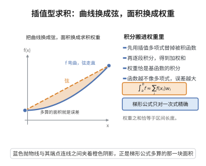

# 插值型求积公式

> **一句话大白话**：把被积函数先用插值多项式代替，再逐项积分，就得到"加权求和"型的近似求积公式——权重恰是 Lagrange 基函数的积分。
>
> **小例子**：用两点线性插值（梯形公式）$\int_a^bf\approx\frac{b-a}{2}[f(a)+f(b)]$，它对一次多项式精确；对 $f(x)=x^2$ 在 $[0,1]$ 上给出 $1/2$，而真值为 $1/3$。

## 一、定理介绍

> **前置依赖**：插值多项式的存在唯一性（Lagrange 插值）、Lagrange 基函数的性质、插值误差定理、积分中值定理与 Rolle 定理、多项式积分与代数精度的定义。

插值型求积公式（interpolatory quadrature formula）是数值积分最基本的一类构造：给定区间 $[a,b]$ 上 $n+1$ 个互异节点 $x_0,\dots,x_n$ 与对应的函数值 $f(x_k)$，用这些点上的插值多项式 $P_n$ 逼近 $f$，再对 $P_n$ 精确积分。Newton–Cotes 公式（梯形、Simpson 等）都是它的特例；Gauss 求积则是通过优化节点得到的它的最优变体。

## 几何直观

图意在说明：先用插值多项式代替被积函数再积分，就得到权重为基函数积分的加权求和公式。

## 二、原理思路

插值多项式的存在唯一性保证：对给定节点，任何次数不超过 $n$ 的多项式都等于它在这 $n+1$ 个节点上的插值多项式。于是
$$
\int_a^bP_n(x)\,dx=\int_a^b\sum_{k=0}^n f(x_k)\ell_k(x)\,dx=\sum_{k=0}^n\Big(\int_a^b\ell_k(x)\,dx\Big)f(x_k),
$$
即得"权重为基函数积分"的加权求和公式。由于该构造对任意次数 $\le n$ 的多项式精确，代数精度至少为 $n$；误差则由插值误差定理给出。当节点关于区间中点对称时，最高次误差项可能消失，代数精度再提高一阶（如 Simpson 公式）。

## 三、定理的严格表述

设 $a\le x_0<x_1<\dots<x_n\le b$ 为互异节点，$\ell_k$ 为相应的 Lagrange 基函数
$$
\ell_k(x)=\prod_{j\ne k}\frac{x-x_j}{x_k-x_j},\qquad \ell_k(x_j)=\delta_{kj}.
$$

**插值型求积公式**：定义权重
$$
A_k=\int_a^b\ell_k(x)\,dx,\qquad k=0,\dots,n,
$$
则
$$
I(f):=\int_a^bf(x)\,dx\ \approx\ Q(f):=\sum_{k=0}^nA_kf(x_k).
$$

**性质**：

1. （代数精度）对任意次数不超过 $n$ 的多项式 $f$，$Q(f)=I(f)$，即代数精度至少为 $n$；对一般的互异节点代数精度恰为 $n$，当 $n$ 为偶数且节点关于区间中点对称时可提高到 $n+1$（如 Simpson 公式）。
2. （权重和）$\sum_{k=0}^nA_k=b-a$。
3. （误差）若 $f\in C^{n+1}[a,b]$，则
$$
I(f)-Q(f)=\int_a^b\frac{f^{(n+1)}(\xi(x))}{(n+1)!}\,\omega_{n+1}(x)\,dx,
$$
其中 $\omega_{n+1}(x)=\prod_{k=0}^n(x-x_k)$。若 $\omega_{n+1}$ 在 $[a,b]$ 上不变号（如 Newton–Cotes 节点），则存在 $\eta\in(a,b)$ 使
$$
I(f)-Q(f)=\frac{f^{(n+1)}(\eta)}{(n+1)!}\int_a^b\omega_{n+1}(x)\,dx.
$$

## 四、证明过程

**（1）代数精度。** 设 $f$ 为次数 $\le n$ 的多项式，$P_n$ 为其在节点 $x_0,\dots,x_n$ 上的插值多项式。由插值多项式的存在唯一性，$f-P_n$ 是次数 $\le n$ 且以这 $n+1$ 个互异点为根的多项式，故 $f-P_n\equiv0$，即
$$
f=P_n=\sum_{k=0}^nf(x_k)\ell_k .
$$
两端在 $[a,b]$ 上积分：
$$
\int_a^bf(x)\,dx=\sum_{k=0}^nf(x_k)\int_a^b\ell_k(x)\,dx=\sum_{k=0}^nA_kf(x_k)=Q(f).
$$
故 $Q$ 对次数 $\le n$ 的多项式精确，代数精度至少为 $n$。$\square$

**（2）权重和。** 取 $f\equiv1$（次数 $0\le n$），由 (1) 得 $Q(f)=I(f)=b-a$，即 $\sum_kA_k=b-a$。$\square$

**（3）误差。** 由插值误差定理，对每个 $x\in[a,b]$ 存在 $\xi(x)\in(a,b)$ 使
$$
f(x)-P_n(x)=\frac{f^{(n+1)}(\xi(x))}{(n+1)!}\omega_{n+1}(x).
$$
两端积分，并注意 $\int_a^bP_n=\sum_kA_kf(x_k)=Q(f)$：
$$
I(f)-Q(f)=\int_a^b\big(f(x)-P_n(x)\big)dx=\int_a^b\frac{f^{(n+1)}(\xi(x))}{(n+1)!}\omega_{n+1}(x)\,dx .
$$
当 $\omega_{n+1}$ 在 $[a,b]$ 上不变号时，$\int_a^b\omega_{n+1}(x)\,dx\ne0$ 且取定符号；由积分中值定理（对连续被积函数与不变号权函数）存在 $\eta\in(a,b)$，使
$$
I(f)-Q(f)=\frac{f^{(n+1)}(\eta)}{(n+1)!}\int_a^b\omega_{n+1}(x)\,dx. \qquad\square
$$

**（4）Newton–Cotes 与 Simpson 的上调。** 取等距节点 $x_k=a+kh$，$h=(b-a)/n$，对基函数积分即得 Newton–Cotes 权重。$n=1$ 得梯形公式，误差为 $-\frac{(b-a)^3}{12}f''(\eta)$；$n=2$ 得 Simpson 公式，其权重为
$$
A_0=A_2=\frac{b-a}{6},\qquad A_1=\frac{4(b-a)}{6}.
$$
直接计算可得 $\sum_{k=0}^2A_kx_k^3=\int_a^bx^3dx$，即 Simpson 公式对三次多项式也精确，代数精度提高到 $3=n+1$：这是节点关于中点对称使 $n+1$ 阶误差项消失所致。$\square$

## 五、应用与意义

- **统一的构造框架**：一切"取点—插值—积分"的求积公式（Newton–Cotes、Gauss、Radau、Lobatto）都在此框架内，区别仅在节点与权重的取法。
- **代数精度与收敛性**：为比较求积公式优劣（代数精度、误差阶）提供基准；Gauss 求积正是在"固定节点数、最大化代数精度"意义下由它优化的结果。
- **误差控制**：误差公式指示可用高阶导数的模与 $\omega_{n+1}$ 的积分来选取节点与步长，指导自适应积分。
- **局限与推广**：等距 Newton–Cotes 公式在高阶时权重出现负值与数值不稳定，推动分段低阶公式、复合求积与 Gauss 型公式的发展。

## 课堂问答

**老师**：一切"取点—插值—积分"的求积公式，权重到底是怎么来的？

**学生**：权重就是 Lagrange 基函数的积分。用节点上的插值多项式 $P_n(x)=\sum_k f(x_k)\ell_k(x)$ 代替 $f$ 再逐项积分，得 $\int_a^b P_n=\sum_k\left(\int_a^b \ell_k(x)\,dx\right)f(x_k)$，即 $A_k=\int_a^b\ell_k(x)\,dx$。由插值多项式的存在唯一性，任何 $\deg\le n$ 的多项式都等于它的插值多项式，故该公式代数精度至少为 $n$。

**老师（追问）**：为什么 Simpson 公式（$n=2$）能精确到三次，而不是只到二次？

**学生**：因为节点关于区间中点对称时，$n+1$ 阶误差项会消失。一般误差为 $I(f)-Q(f)=\int_a^b\frac{f^{(n+1)}(\xi(x))}{(n+1)!}\omega_{n+1}(x)\,dx$，其中 $\omega_{n+1}(x)=\prod_{k=0}^n(x-x_k)$。当 $\omega_{n+1}$ 在 $[a,b]$ 上不变号时，用积分中值定理化为 $\frac{f^{(n+1)}(\eta)}{(n+1)!}\int_a^b\omega_{n+1}(x)\,dx$。Simpson 的 $\omega_3$ 关于中点奇对称，直接计算可得 $\sum_k A_k x_k^3=\int_a^b x^3dx$，精度提高到 $n+1=3$。

**老师（拓展）**：$n=1$ 的梯形公式误差是多少？这些权重有什么简单性质？

**学生**：权重和恒有 $\sum_k A_k=b-a$（取 $f\equiv1$ 即得）。$n=1$ 给出梯形公式 $\int_a^b f\approx\frac{b-a}{2}[f(a)+f(b)]$。常见误区是盲目提高等距节点阶数——高阶 Newton–Cotes 权重出现负值且数值不稳定，实际应改用分段低阶、复合求积或 Gauss 型公式。Gauss 求积正是把节点也优化、在固定节点数下最大化代数精度，因而是本框架的最优变体。

## 相关条目

- [插值多项式的存在唯一性](./插值多项式的存在唯一性.md)：本公式构造的出发点。
- [插值误差定理](./插值误差定理.md)：给出求积误差的表达式。
- [Gauss 求积公式的代数精度](./Gauss求积公式的代数精度.md)：插值型求积在最优节点下的推广。
