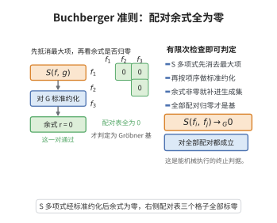

# Buchberger准则

> **一句话大白话**：判断一堆多项式是不是 Gröbner 基，不用"把里面所有多项式统统检查一遍"（那无穷无尽），只要把多项式两两配对、算各自的那个 S-多项式，看它化简后是不是 0——全都被化简成 0，就是 Gröbner 基。把"无穷检验"简化成"有限检验"。
>
> **小例子**：$G=\{x+y,\,y^2\}$ 是不是 Gröbner 基？只要算 $S(x+y,\,y^2)$，若化简得 0，$G$ 就是；否则不是、需再补项。这就是准则在做的事。

## 一、定理介绍

> **前置依赖**：Gröbner 基的定义、单项式序、S-多项式、约化（除法）算法、理想的首项与 lcm。

**Buchberger 准则**给出判断 $G$ 是否为理想 $I=\langle G\rangle$ 的 Gröbner 基的**有限判据**：对所有 $i\neq j$，S-多项式 $S(g_i,g_j)$ 用 $G$ 化简的余式都为 0，当且仅当 $G$ 是 Gröbner 基。它避免了定义中"对每个 $f\in I$ 逐项检查"的无穷步骤，是 Buchberger 算法的理论支点。

## 几何直观

图意在说明：只要每个 S 多项式的标准余式都为零，生成集就已是 Gröbner 基，判定可以机械完成。

## 二、原理思路

一个集合 $G$ 是 Gröbner 基，意味着每个 $f\in I$ 的首项都能被某个 $\mathrm{LT}(g_i)$ 整除。困难的不是"单个"首项，而是表示 $f=\sum h_i g_i$ 里"多个首项互相抵消"的情形——而 **S-多项式正是对这种"首项互相抵消"的标准化捕捉**。若所有 S-多项式都能约化到 0，那么任何表示中由多项抵消产生的麻烦都可被"归位"，从而保证首项总可被某个 $\mathrm{LT}(g_i)$ 整除。

## 三、定理的严格表述

设 $G=\{g_1,\dots,g_t\}\subset\mathbb{K}[x_1,\dots,x_n]$，$\prec$ 为单项式序，$I=\langle G\rangle$。则 $G$ 是 $I$ 的 Gröbner 基，当且仅当对所有 $i\neq j$：

$$
S(g_i,g_j)\xrightarrow{G} 0\qquad(\text{用 }G\text{ 化简的余式为 }0).
$$

## 四、证明要点

1. **必要性**.若 $G$ 是 Gröbner 基，则每个 $f\in I$（含 $S(g_i,g_j)$）用 $G$ 化简的余式唯一为 0。
2. **充分性**.设每个 $S(g_i,g_j)\to0$。取任意 $0\neq f\in I$，写 $f=\sum_{i}h_ig_i$，并在所有表示中选 $\bm m=\max_i\mathrm{LT}(h_i)\mathrm{LT}(g_i)$ 最小的一个（关于 $\prec$）。
3. **情形一**：若 $\bm m=\mathrm{LT}(f)$，则 $\mathrm{LT}(g_j)\mid\mathrm{LT}(f)$ 对某个 $j$，得证。
4. **情形二**：若 $\bm m>\mathrm{LT}(f)$，说明首项彼此抵消。记指标集 $S=\{i:\mathrm{LT}(h_i)\mathrm{LT}(g_i)=\bm m\}$，设 $\gamma_{ij}=\mathrm{lcm}(\mathrm{LT}(g_i),\mathrm{LT}(g_j))$。因 $S(g_i,g_j)\to0$，$S(g_i,g_j)$ 有表示 $\sum_k p_{ijk}g_k$ 且每个 $\mathrm{LT}(p_{ijk})\mathrm{LT}(g_k)<\gamma_{ij}$。用这些表示将 $\sum_{i\in S}h_ig_i$ 中对应部分替换，可使 $\bm m$ 严格下降，与最小性矛盾。
5. 故只能 $\bm m=\mathrm{LT}(f)$，$G$ 为 Gröbner 基。$\blacksquare$

## 五、应用与意义

- **判定 Gröbner 基**：把无穷检验降为"所有对子"的有限检验（$t$ 个元至多 $\binom{t}{2}$ 对）。
- **Buchberger 算法终止判据**.算法输出条件"所有 $S$-多项式余式为 0"正是准则的充分性方向。
- **更优实现思路**.可结合重构（自动处理重复）、Buchberger 准则的子集判据加速实际计算。
- **理论价值**.它使 Gröbner 基理论"可计算化"，是交换代数与计算代数交汇的枢纽。

## 课堂问答

**老师**：判定一堆多项式是不是 Gröbner 基，要不要检查整个理想？

**学生**：不用，只需两两配对。$G=\{g_1,\dots,g_t\}$ 是 $I=\langle G\rangle$ 的 Gröbner 基 $\iff$ 对所有 $i\ne j$，S-多项式
$$
S(g_i,g_j)=\frac{\mathrm{lcm}(\mathrm{LT}(g_i),\mathrm{LT}(g_j))}{\mathrm{LT}(g_i)}g_i-\frac{\mathrm{lcm}(\mathrm{LT}(g_i),\mathrm{LT}(g_j))}{\mathrm{LT}(g_j)}g_j
$$
用 $G$ 约化的余式都为 $0$。这把定义里"对每个 $f\in I$ 检查首项"的无穷验证降为至多 $\binom t2$ 对的有限验证。

**老师（追问）**：为什么要盯住 S-多项式？

**学生**：因为唯一的麻烦是"首项互相抵消"。若 $f=\sum h_ig_i$ 中最高项 $\bm m$ 严格大于 $\mathrm{LT}(f)$，说明某些 $h_ig_i$ 的首项相消，而 S-多项式正是这种相消的标准形。若每个 $S(g_i,g_j)\to0$，就能把这类相消逐块改写成首项更小的表示，反复下降直到 $\bm m=\mathrm{LT}(f)$（用"$\bm m$ 最小的表示"这个最小性反证），从而每个 $\mathrm{LT}(f)$ 都被某个 $\mathrm{LT}(g_i)$ 整除。

**老师（拓展）**：这个准则在算法里怎么用？

**学生**：它就是 Buchberger 算法的终止判据：算法反复把非零 S-余式加入 $G$，直到所有 S-多项式都约化为零，此时由充分性方向即可断定 $G$ 是 Gröbner 基。实际实现还配合消去准则、乘积准则跳过大量注定为零的对子来加速。
