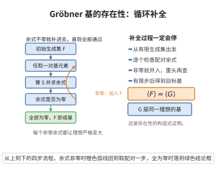

# Gröbner基的存在性（Buchberger算法）

> **一句话大白话**：给一堆多项式，想找出一个"好用的生成组"（Gröbner 基）——靠一种机械的算法：不停地把多项式两两"撮合"出一个 S-多项式，如果能化简出新的非零余式就加入集合，直到再也化简不出来为止；这个过程保证在有限步内结束，产出的就是 Gröbner 基。
>
> **小例子**：解方程组 $x^2+y^2-1=0,\ x+y-z=0$ 时，Buchberger 算法反复两两相加消去首项，最后得到形如 $x+y-z,\ y^2-\dots,\ z^2+\dots$ 的三角化形式，一路不回代就能把根解出来。

## 一、定理介绍

> **前置依赖**：Hilbert 基定理、Gröbner 基的概念、S-多项式、约化余式、Buchberger 准则、单项式理想的严格链。

**Buchberger 算法**是在多项式环 $\mathbb{K}[x_1,\dots,x_n]$ 上，给定一个理想 $I=\langle f_1,\dots,f_m\rangle$ 和任一单项式序，**在有限步内终止并输出 $I$ 的一个 Gröbner 基**。它把"是否存在 Gröbner 基"这个存在性问题变成一个可执行的构造性算法，是计算代数中 Gr:bner 理论落地的基石。

## 几何直观

图意在说明：余式非零就把新多项式并入生成集重查，每次并入都让理想内的可约化多项式增多，有限步必停。

## 二、原理思路

关键观察：若某集合还不是 Gröbner 基，必有一对多项式 $p,q$ 的 S-多项式化简得非零余式 $r$。把 $r$ 加入集合会**严格扩大**首项单项式理想 $L=\langle\mathrm{LT}(g)\rangle$。而由 Hilbert 基定理的推论，单项式理想的严格递增链必然有限终止——这就保证了算法终止。至于正确性：算法终止时所有 S-多项式余式都为 0，再经 Buchberger 准则（见另篇）即可断定它是 Gröbner 基。

## 三、定理的严格表述

给定理想 $I=\langle f_1,\dots,f_m\rangle\subset\mathbb{K}[x_1,\dots,x_n]$ 与单项式序 $\prec$，算法：

> 输入 $F=(f_1,\dots,f_m)$；置 $G=F$；REPEAT 对 $G$ 中每对有 $S$-多项式 $S(p,q)$，用 $G$ 化简得余式 $r$，若 $r\neq0$ 则 $G:=G\cup\{r\}$；UNTIL $G$ 不变。返回 $G$。

**定理**：上述循环在有限步终止，并返回 $I$ 的一个 Gröbner 基。

## 四、证明过程

1. **记首项理想链**.设第 $k$ 轮集合为 $G_k$，令 $L_k=\langle\mathrm{LT}(g):g\in G_k\rangle$。新加入的 $r$ 是约化余式，故 $\mathrm{LT}(r)$ 不为任何 $\mathrm{LT}(g)\ (g\in G_k)$ 整除，于是 $\mathrm{LT}(r)\notin L_k$，从而 $L_{k+1}\supsetneq L_k$（严格包含）。
2. **终止性**.由 Hilbert 基定理的推论，多项式环中不存在严格递增的无限单项式理想链，故算法有限步终止。
3. **正确性**.终止时对所有 $p\neq q\in G$，$S(p,q)$ 用 $G$ 化简的余式为 0；由 Buchberger 准则，$G$ 即 $I$ 的一个 Gröbner 基。$\blacksquare$

## 五、应用与意义

- **多项式方程组求解**：Gröbner 基使方程组化为三角化结构，便于消元回代求解。
- **理想成员判定与求交**：可判定 $f\in I$、计算理想交、消除变量、求遍零集。
- **计算机代数系统**：Maple、Mathematica、Sage、Singular 均以此类算法为核心。
- **理论地位**：把 Hilbert 基的存在性（理论）升级为可执行算法，是交换代数与计算的最佳结合点。

## 课堂问答

**老师**：怎么保证 Gröbner 基一定存在，而且还能算出来？

**学生**：Buchberger 算法就是构造性的存在性证明。输入 $F$，置 $G=F$，反复对每对算 $S(p,q)$、用 $G$ 约化，非零余式就加入 $G$，直到 $G$ 不变；输出即 $I$ 的一个 Gröbner 基，且有限步终止。它把 Hilbert 基定理的"存在性"升级为可执行算法。

**老师（追问）**：终止性靠什么保证？

**学生**：靠单项式理想升链条件。第 $k$ 轮记 $L_k=\langle\mathrm{LT}(g):g\in G_k\rangle$。新加入的 $r$ 是约化余式，其 $\mathrm{LT}(r)$ 不被任何已有 $\mathrm{LT}(g)$ 整除，故 $\mathrm{LT}(r)\notin L_k$，于是 $L_{k+1}\supsetneq L_k$。由 Hilbert 基定理，$\mathbb{K}[x_1,\dots,x_n]$ 中单项式理想无无穷严格升链，故算法有限步停。

**老师（拓展）**：正确性呢？为什么一停就对了？

**学生**：终止时对一切 $p\ne q\in G$ 都有 $S(p,q)\xrightarrow{G}0$，正好满足 Buchberger 准则的充分性方向，故 $G$ 是 Gröbner 基。常见误区是把"算法停机"直接当成"得到约化 Gröbner 基"：约化还需额外做首项互不整除的化简，但停机本身已给出 Gröbner 基。
