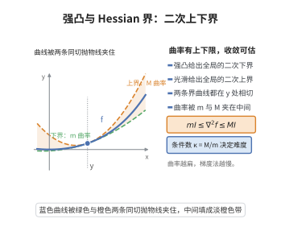

# 强凸函数与 Hessian 界

> **一句话大白话**：一个二阶可微函数若"曲率被夹住"——每一点的 Hessian 都落在 $mI$ 与 $MI$ 之间——那它就同时具备两件好事：从下方被一个开口为 $m$ 的抛物面托住（$m$-强凸），从上方被一个开口为 $M$ 的抛物面罩住（$M$-光滑）。比值 $\kappa=M/m$ 就是条件数，直接决定一阶算法收敛的快慢。
>
> **小例子**：$f(x)=\frac12x^\top Qx$（$Q$ 对称正定）有 $\nabla^2f\equiv Q$，故 $m=\lambda_{\min}(Q)$、$M=\lambda_{\max}(Q)$。取 $Q=\operatorname{diag}(1,9)$ 时 $\kappa=9$，最速梯度下降的收缩率 $(M-m)/(M+m)=0.8$，条件数越大（等高线越扁）收敛越慢。

## 一、定理介绍

> **前置依赖**：凸函数与凸集、强凸性及其蕴含的误差界、二次型主轴定理、泰勒定理、下降引理。

对二阶连续可微的 $f:\mathbb R^n\to\mathbb R$，最常用的一类"良态"假设是它的 Hessian 一致地被两个正定矩阵夹住：
$$
mI\preceq\nabla^2f(x)\preceq MI\qquad(\text{对一切 }x),\qquad 0<m\le M .
$$
下界 $mI\preceq\nabla^2f$ 就是把强凸性写成二阶形式，上界 $\nabla^2f\preceq MI$ 就是梯度 $M$-Lipschitz（$M$-光滑，见下降引理）。二者合起来给出**二次夹逼**：目标函数被两个同心的抛物面夹住，误差、梯度与到最优点的距离三者之间可以互相换算。

这套不等式是所有"强凸一阶方法"收敛性分析的共同起点：梯度下降的线性收敛率、步长 $2/(m+M)$ 的最优性、条件数的角色，都从它导出。二次函数是最典型的例子，由二次型主轴定理，$m$ 与 $M$ 恰为 $Q$ 的最小、最大特征值。

## 几何直观

图意在说明：Hessian 的特征值被 m 与 M 夹住，函数就落在两条同切抛物线之间，条件数决定收敛快慢。

## 二、原理思路

1. 用带积分余项的 Taylor 公式把函数值差写成
$$
f(y)-f(x)-\nabla f(x)^\top(y-x)=\int_0^1(1-t)\,(y-x)^\top\nabla^2f\big(x+t(y-x)\big)(y-x)\,dt .
$$
2. 若 $\nabla^2f\succeq mI$，被积项不小于 $m\|y-x\|^2$，积分得 $\frac m2\|y-x\|^2$，于是得到强凸下界（与强凸性及其蕴含的误差界完全一致）。
3. 若 $\nabla^2f\preceq MI$，同法得 $\frac M2\|y-x\|^2$ 的上界，即下降引理中的二次上界。
4. 反方向：把下界（或上界）用在 $y=x+tv$ 上、令 $t\to0^+$，立即读回二次型不等式 $v^\top\nabla^2f(x)v\ge m\|v\|^2$（或 $\le M\|v\|^2$）。
5. 把 Hessian 界沿线段积分，得到梯度差的两个不等式：$M$-Lipschitz 与单调性（$m$-共强制性）；再把它们与最优点处 $\nabla f(x^*)=0$ 结合，得到误差—梯度—距离的二次夹逼。

## 三、定理的严格表述

设 $f\in C^2(\mathbb R^n)$，$0<m\le M$。以下三条等价：

**(H)** $\ mI\preceq\nabla^2f(x)\preceq MI$ 对一切 $x\in\mathbb R^n$ 成立（$\preceq$ 为二次型意义下的半序）。

**(Q)** 对一切 $x,y\in\mathbb R^n$，
$$
f(x)+\nabla f(x)^\top(y-x)+\frac m2\|y-x\|^2\ \le\ f(y)\ \le\ f(x)+\nabla f(x)^\top(y-x)+\frac M2\|y-x\|^2 .
$$

**(G)** 对一切 $x,y\in\mathbb R^n$，
$$
m\|x-y\|^2\le\big(\nabla f(x)-\nabla f(y)\big)^\top(x-y),\qquad \|\nabla f(x)-\nabla f(y)\|\le M\|x-y\| .
$$

**二次夹逼（推论）**：若 (H) 成立且 $x^*$ 为 $f$ 的唯一极小点，则对一切 $x$
$$
\frac m2\|x-x^*\|^2\le f(x)-f(x^*)\le\frac M2\|x-x^*\|^2,\qquad m\|x-x^*\|\le\|\nabla f(x)\|\le M\|x-x^*\| .
$$
特别地，若 $f(x)=\frac12x^\top Qx$（$Q\succ0$），则 $m=\lambda_{\min}(Q)$、$M=\lambda_{\max}(Q)$，上述各不等式均取等（可验证的紧例子）。

## 四、证明过程

**步骤 1（Taylor 积分余项）。** 令 $\varphi(t)=f\big(x+t(y-x)\big)$，$t\in[0,1]$。由泰勒定理（带积分余项的一元形式）与其二阶导数
$$
\varphi''(t)=(y-x)^\top\nabla^2f\big(x+t(y-x)\big)(y-x),
$$
得
$$
f(y)-f(x)-\nabla f(x)^\top(y-x)=\varphi(1)-\varphi(0)-\varphi'(0)=\int_0^1(1-t)\varphi''(t)\,dt .
$$

**步骤 2（(H) ⇒ (Q)）。** 在步骤 1 的积分中，若 $\nabla^2f\succeq mI$，则对每个 $t$ 有 $\varphi''(t)\ge m\|y-x\|^2$，故
$$
f(y)-f(x)-\nabla f(x)^\top(y-x)\ge m\|y-x\|^2\int_0^1(1-t)\,dt=\frac m2\|y-x\|^2,
$$
即 (Q) 的左半不等式。若 $\nabla^2f\preceq MI$，则 $\varphi''(t)\le M\|y-x\|^2$，同法给出 (Q) 的右半不等式。

**步骤 3（(Q) ⇒ (H)）。** 设 (Q) 的左半成立。对任意 $x,v$ 与 $t>0$ 取 $y=x+tv$：
$$
f(x+tv)-f(x)-t\,\nabla f(x)^\top v\ge\frac m2t^2\|v\|^2 .
$$
两端除以 $t^2$ 并令 $t\to0^+$：左端的极限是 $\frac12\,v^\top\nabla^2f(x)v$（二阶 Taylor 展开），故 $v^\top\nabla^2f(x)v\ge m\|v\|^2$，对一切 $v$ 成立即 $\nabla^2f(x)\succeq mI$。同理，由 (Q) 右半取 $y=x+tv$、令 $t\to0^+$ 得 $v^\top\nabla^2f(x)v\le M\|v\|^2$，即 $\nabla^2f(x)\preceq MI$。故 (Q) 与 (H) 等价。

**步骤 4（(H) ⇒ (G)）。** 由微积分基本定理沿线段积分：
$$
\nabla f(y)-\nabla f(x)=\int_0^1\nabla^2f\big(x+t(y-x)\big)(y-x)\,dt .
$$
左乘 $(y-x)^\top$，用 $\nabla^2f\succeq mI$ 得
$$
(y-x)^\top\big(\nabla f(y)-\nabla f(x)\big)=\int_0^1(y-x)^\top\nabla^2f(\cdot)(y-x)\,dt\ge m\|y-x\|^2,
$$
即 (G) 的第一式（共强制性）。再取范数，用 $\nabla^2f\preceq MI$ 蕴涵算子范数 $\|\nabla^2f(z)\|\le M$：
$$
\|\nabla f(y)-\nabla f(x)\|\le\int_0^1\|\nabla^2f(\cdot)\|\,\|y-x\|\,dt\le M\|y-x\|,
$$
即 (G) 的第二式（$M$-Lipschitz）。对称地，由 (G) 的第一式对 $y=x+tv$ 令 $t\to0$ 也可回推 (H)。

**步骤 5（二次夹逼）。** 设 $x^*$ 为极小点，则 $\nabla f(x^*)=0$。在 (Q) 左半中取 $x=x^*$、$y=x$：
$$
f(x)\ge f(x^*)+\nabla f(x^*)^\top(x-x^*)+\frac m2\|x-x^*\|^2=f(x^*)+\frac m2\|x-x^*\|^2,
$$
得函数值差的**下界**。在 (Q) 右半中取 $x=x^*$、$y=x$：
$$
f(x)\le f(x^*)+\frac M2\|x-x^*\|^2,
$$
得函数值差的**上界**。梯度与距离的夹逼：由 (G) 第一式与 $\nabla f(x^*)=0$，
$$
m\|x-x^*\|^2\le\big(\nabla f(x)-\nabla f(x^*)\big)^\top(x-x^*)\le\|\nabla f(x)\|\,\|x-x^*\|,
$$
得 $\|\nabla f(x)\|\ge m\|x-x^*\|$；由 (G) 第二式得 $\|\nabla f(x)\|\le M\|x-x^*\|$。全部夹逼成立。

**二次函数情形。** 若 $f(x)=\frac12x^\top Qx$（$Q=Q^\top\succ0$），则 $\nabla f=Qx$、$\nabla^2f\equiv Q$。由二次型主轴定理，存在正交 $P$ 使 $Q=P\operatorname{diag}(\lambda_1,\dots,\lambda_n)P^\top$，$\lambda_1\ge\dots\ge\lambda_n>0$。于是 $\nabla^2f\succeq\lambda_nI$、$\preceq\lambda_1I$，故 $m=\lambda_{\min}(Q)$、$M=\lambda_{\max}(Q)$ 且不能再改进；$x^*=0$ 时 $f(x)-f(x^*)=\frac12x^\top Qx$ 落在 $\frac m2\|x\|^2$ 与 $\frac M2\|x\|^2$ 之间，各沿主轴方向取等。$\blacksquare$

**推论（梯度下降的收缩性）。** 设 (H) 成立、$x^*$ 为极小点。取步长 $\alpha\in(0,2/M)$，迭代 $x_{k+1}=x_k-\alpha\nabla f(x_k)$。展开 $\|x_{k+1}-x^*\|^2$ 并用步骤 5 的两个界：
$$
\|x_{k+1}-x^*\|^2=\|x_k-x^*\|^2-2\alpha\nabla f(x_k)^\top(x_k-x^*)+\alpha^2\|\nabla f(x_k)\|^2\le\big(1-2\alpha m+\alpha^2M^2\big)\|x_k-x^*\|^2 .
$$
当 $1-2\alpha m+\alpha^2M^2<1$（即 $\alpha<2m/M^2$）时线性收敛；更精细的三点不等式给出最优步长 $\alpha=\frac{2}{m+M}$ 与最优因子 $\frac{M-m}{M+m}$（见梯度下降法的收敛性）。

## 五、应用与意义

- **收敛率与条件数**：$\kappa=M/m$ 决定强凸一阶方法的迭代次数上界 $\Theta(\kappa\log(1/\varepsilon))$，是"病态问题慢"的定量解释。
- **步长设计**：固定步长 $2/(m+M)$、回溯线搜索与自适应步长都以 Hessian 界为安全依据。
- **误差界换算**：二次夹逼把"函数值下降"翻译成"参数距离缩小"与"梯度变小"，是停止准则（$\|\nabla f\|\le\varepsilon$）合理性的来源。
- **与无约束优化的联系**：牛顿法与拟牛顿法的局部分析都在 Hessian 界或其一阶近似下展开，$\kappa$ 也是正规方程与最小二乘病态程度的度量。

## 课堂问答

**老师**：为什么 $\nabla^2 f\preceq MI$ 和梯度 $M$-Lipschitz 是同一件事？

**学生**：因为把 Hessian 界沿线段积分：$\nabla f(y)-\nabla f(x)=\int_0^1\nabla^2 f(x+t(y-x))(y-x)\,dt$，取范数并用 $\|\nabla^2 f\|\le M$ 即得 $\|\nabla f(y)-\nabla f(x)\|\le M\|y-x\|$。

**老师（追问）**：反过来，从 $\|\nabla f(x)-\nabla f(y)\|\le M\|x-y\|$ 能推出 $\nabla^2 f\preceq MI$ 吗？

**学生**：能。对 $y=x+tv$ 用 Taylor 展开 $\nabla f(x+tv)-\nabla f(x)=t\nabla^2 f(x)v+o(t)$，两边除以 $t$ 并令 $t\to0^+$，再与 Lipschitz 不等式取极限，得 $\|\nabla^2 f(x)v\|\le M\|v\|$，即 $\nabla^2 f(x)\preceq MI$。这就是 (H)、(Q)、(G) 三组条件等价的证明骨架。

**老师（拓展）**：条件数 $\kappa=M/m$ 为什么既管收敛速度又管"病态"？

**学生**：二次夹逼给出 $\frac m2\|x-x^*\|^2\le f(x)-f(x^*)\le\frac M2\|x-x^*\|^2$，同一函数值差对应的距离区间宽达 $\sqrt\kappa$ 倍；梯度下降的收缩率是 $(M-m)/(M+m)=(\kappa-1)/(\kappa+1)$，$\kappa$ 越大越贴近 1、收敛越慢。所以"曲率被夹得多扁"就同时决定迭代次数与数值稳定性，这正是等高线越扁越难优化的定量解释。
