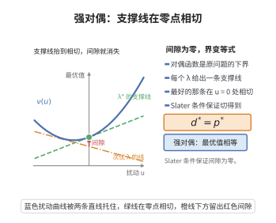

# 强对偶定理（Slater条件）

> **一句话大白话**：对凸问题，只要存在一个"守住可行域内部、让所有不等式都严格放松"的点（Slater 点），那么"最优原值"和"最优对偶值"就严格相等——对偶间隙为零。可以放心地转成对偶去解。
>
> **小例子**：$\min e^{-x}$ s.t. $x\le0$。$x=-1$ 严格满足 $x\le0$，Slater 成立，故 $\min e^{-x}=1$ 等于对偶最大值；而若不满足 Slater（可行集只剩一个点），强对偶可能破缺。

## 一、定理介绍

> **前置依赖**：弱对偶、凸优化的理论与 Lagrange 对偶函数、Hahn-Banach几何形式、支持超平面、相对内点与 Slater 条件。

**强对偶定理**：对凸优化问题，在 **Slater 条件**（存在严格内点使所有非仿射不等式约束严格成立）成立时，原值 $p^*$ 等于对偶值 $d^*$。该定理建立"原–对偶等价"，是支撑对偶分解、仅据对偶恢复原解的理论基础。

## 几何直观

图意在说明：每个对偶乘子给出一条支撑线，最好的那条在扰动为零处与曲线相切，此时对偶间隙消失。

## 二、原理思路

弱对偶 $d^*\le p^*$ 恒真，关键要证 $d^*\ge p^*$。做法是通过"可行性干扰的**摄动集**"：在 $m$ 维方向把约束放松 $u_i$，收集所有可能的（干扰，目标）对构成凸集 $\mathcal A\subseteq\mathbb{R}^{m+1}$（由凸性保证凸）。点 $(0,p^*)$ 在该集的边界。用凸集分离定理在 $(0,p^*)$ 处取支撑超平面，得到非负系数 $(\tilde\lambda,\tilde\mu)$；Slater 条件精确保证 $\tilde\mu>0$（否则矛盾），归一化后再代回对偶函数即得 $d^*\ge p^*$。

## 三、定理的严格表述

凸问题 $\min f_0(x)$ s.t. $f_i(x)\le0\ (i=1,\dots,m)$，$Ax=b$。若存在 $x\in\operatorname{relint}\mathcal D$（$\mathcal D=\bigcap\operatorname{dom}f_i$）使所有非仿射 $f_i(x)<0$ 且 $Ax=b$（Slater），且 $p^*>-\infty$，则存在对偶解使 $p^*=d^*$（强对偶）。

## 四、证明要点

1. **摄动集构造**.$\mathcal A=\{(u,t):\exists x,\ f_i(x)\le u_i\ \forall i,\ f_0(x)\le t\}$ 为凸集；$(0,p^*)\in\partial\mathcal A$ 且 $(0,p^*-\epsilon)\notin\mathcal A\ (\epsilon>0)$。
2. **支撑超平面**.由分离定理得非零 $(\tilde\lambda,\tilde\mu)\ge0$（因 $u_i,t$ 可取任意大）使
   $$
   \tilde\lambda^\top u+\tilde\mu t\ge\tilde\mu p^*,\quad\forall(u,t)\in\mathcal A.
   $$
3. **Slater 保证 $\tilde\mu>0$**.取 Slater 点 $x_0$：$f_i(x_0)<0$。若 $\tilde\mu=0$，则 $\sum_i\tilde\lambda_i f_i(x_0)\ge0$ 且 $\le0$，故 $=0$；因 $f_i(x_0)<0$ 得 $\tilde\lambda_i=0$，与 $(\tilde\lambda,\tilde\mu)\neq0$ 矛盾。故 $\tilde\mu>0$。
4. **归一化**.令 $\lambda_i=\tilde\lambda_i/\tilde\mu$，得 $\sum_i\lambda_i f_i(x)+f_0(x)\ge p^*$（对任意 $x$）。取 $x$ 使 $g(\lambda,0)=\inf_x L(x,\lambda,0)\ge p^*$，从而 $d^*=\sup g\ge p^*$；联合 $d^*\le p^*$ 得 $p^*=d^*$。$\blacksquare$

## 五、应用与意义

- **对偶求解**.模型在有 Slater 内点时，可转化为对偶问题（常更易优化）。
- **灵敏度/影子价格**.最优对偶变量给出约束松弛的边际价值，用于经济学与资源分配。
- **内点与分解**.Slater 保证原–对偶内点法收敛到同一最优值，支撑大规模分解算法。
- **理论地位**.把"原–对偶等价"严格化，是凸优化的核心结论之一。

## 课堂问答

**老师**：强对偶证明里，为什么要点出"Slater 保证"的那一步？

**学生**：因为证明用摄动集 $\mathcal A=\{(u,t)\}$ 的支撑超平面得到乘子 $(\tilde\lambda,\tilde\mu)\ge0$，要把它归一化成 $\lambda=\tilde\lambda/\tilde\mu$ 才能回代拉格朗日函数，就必须 $\tilde\mu>0$，而这一步只有 Slater 能保证。

**老师（追问）**：请还原"Slater $\Rightarrow\tilde\mu>0$"的反证。

**学生**：取 Slater 点 $x_0$ 使所有非仿射约束 $f_i(x_0)<0$。由支撑超平面不等式 $\tilde\lambda^\top u+\tilde\mu t\ge\tilde\mu p^*$。若 $\tilde\mu=0$，代入 $(u_i,t)=(f_i(x_0),f_0(x_0))\in\mathcal A$ 得 $\sum_i\tilde\lambda_i f_i(x_0)\ge0$；但 $\tilde\lambda_i\ge0,\ f_i(x_0)<0$ 又给出 $\le0$，故该和为 $0$，因每个 $f_i(x_0)<0$ 必有 $\tilde\lambda_i=0$，于是 $(\tilde\lambda,\tilde\mu)=0$，与"非零"矛盾。

**老师（拓展）**：哪些约束可以豁免 Slater 的"严格"要求？

**学生**：仿射约束。因为 $f_i(x_0)<0$ 的严格不等是为了对负项做严格放缩；仿射约束 $a_i^\top x-b_i\le0$ 允许取等（本质只需在相对内点可行），对应项的 $\tilde\lambda_i$ 无法被强制归零。这正是定理表述里说"relint 内、非仿射约束严格成立"的原因——常见误区是把 Slater 误读成"所有约束都必须严格"，那会错误地排除掉带等式约束的正则问题。
