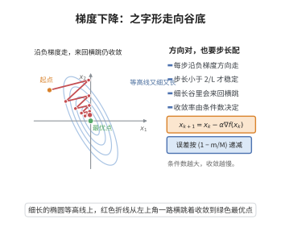

# 梯度下降法的收敛性（强凸情形）

> **一句话大白话**：目标函数如果"墙壁足够陡挺"（强凸：曲率夹在 $m$ 和 $M$ 之间），那么最朴素的梯度下降不仅收敛，还以固定比的**线性速度**逼近最优解，步长取 $2/(m+M)$ 时效最佳，收敛率只看"胖瘦比" $\kappa=M/m$。
>
> **小例子**：$f(x)=\tfrac12(x^2+9y^2)$，$m=1,M=9,\kappa=9$。梯度下降按 $\frac{9-1}{9+1}=0.8$ 每步比例收缩，几十步内贴近最优点；$\kappa$ 越大（更椭的等高线）收敛越慢——正是条件数在"报时"。

## 一、定理介绍

> **前置依赖**：强凸函数与 Hessian 界、$L$-光滑梯度 Lipschitz、二次函数的距离展开、步长选择与收缩系数、条件数。

**强凸梯度下降收敛性**：设 $f:\mathbb R^n\to\mathbb R$ 二次连续可微且强凸（$\nabla^2 f(x)\succeq mI$ 与 $\preceq MI$，$m,M>0$），则梯度下降 $x_{k+1}=x_k-\alpha\nabla f(x_k)$ 在 $\alpha\in(0,2/M)$ 时对任意初值线性收敛到唯一最优解 $x^*$；取 $\alpha=\tfrac{2}{m+M}$ 得最佳收缩率 $(M-m)/(M+m)$。

## 几何直观

图意在说明：沿负梯度每步下降，在细长谷里方向来回横跳，收敛速度由条件数控制。

## 二、原理思路

强凸保证目标被夹在"两类二次函数"之间，据此得到两个关键界：(a) 梯度内积 $(\nabla f(x)-\nabla f(y))^\top(x-y)\ge m\|x-y\|^2$；(b) 梯度 Lipschitz $\|\nabla f(x)-\nabla f(y)\|\le M\|x-y\|$。把梯度下降代距离的平方展开，用这两界放缩得到"误差平方被乘以常数 $(1-\alpha m+\alpha^2M^2)$"型估计；对 $\alpha$ 最小化该系数（约化因子上界 $\max\{|1-\alpha m|,|1-\alpha M|\}$），最优步长使两条线同时远离 1。

## 三、定理的严格表述

设存在 $M\ge m>0$ 使 $mI\preceq\nabla^2 f(x)\preceq MI$（所有 $x$）。记 $x^*$ 为唯一极小。则梯度下降在步长 $\alpha\in(0,2/M)$ 下满足：存在 $\rho<1$ 使每个步内 $\|x_{k+1}-x^*\|\le\rho\|x_k-x^*\|$；特别地当 $\alpha=\tfrac{2}{m+M}$ 时
$$
\|x_{k+1}-x^*\|\le\frac{M-m}{M+m}\,\|x_k-x^*\|.
$$

## 四、证明要点

1. **距离平方展开**.$\|x_{k+1}-x^*\|^2=\|x_k-x^*\|^2-2\alpha\,{\nabla f(x_k)}^\top(x_k-x^*)+\alpha^2\|\nabla f(x_k)\|^2$。
2. **下/上界**.${\nabla f(x_k)}^\top(x_k-x^*)\ge m\|x_k-x^*\|^2$；（利用 $\nabla f(x^*)=0$ 与 $M$-Lipschitz）$\|\nabla f(x_k)\|^2\le M^2\|x_k-x^*\|^2$。
3. **合并**.得 $\|x_{k+1}-x^*\|^2\le(1-2\alpha m+\alpha^2 M^2)\|x_k-x^*\|^2$。更紧地用
   $$
   \|x_{k+1}-x^*\|\le\max\{|1-\alpha m|,|1-\alpha M|\}\,\|x_k-x^*\|.
   $$
4. **最优步长**.最小化 $\max\{|1-\alpha m|,|1-\alpha M|\}$：当 $\alpha=\tfrac{2}{m+M}$ 时两个值相等为 $\tfrac{M-m}{M+m}<1$。$\blacksquare$

## 五、应用与意义

- **步长策略**.固定/最佳步长 $2/(m+M)$ 与回溯（Armijo）步长均为其直接产物。
- **条件数度量**.$\kappa=M/m$ 决定收敛速度，指引预处理（Hessian 近似）设计。
- **动量/Nesterov**.在改收缩率（$\kappa\to\sqrt\kappa$）时以本结果作基线。
- **深度学习**.虽非强凸，其"误差几何收缩"的思想仍是各类一阶优化算法分析与启发源头。

## 课堂问答

**老师**：固定步长梯度下降在强凸下的收缩率是什么？最优步长怎么来的？

**学生**：每步 $\|x_{k+1}-x^*\|\le\max\{|1-\alpha m|,|1-\alpha M|\}\cdot\|x_k-x^*\|$，取 $\alpha=2/(m+M)$ 时两个绝对值相等，收缩率为 $(M-m)/(M+m)$。

**老师（追问）**：展开距离平方时那两条不等式是怎么用于放缩的？

**学生**：展开得 $\|x_{k+1}-x^*\|^2=\|x_k-x^*\|^2-2\alpha\nabla f(x_k)^\top(x_k-x^*)+\alpha^2\|\nabla f(x_k)\|^2$。用强凸性（共强制性）$\nabla f(x_k)^\top(x_k-x^*)\ge m\|x_k-x^*\|^2$ 处理一次项，用 $M$-Lipschitz 与 $\nabla f(x^*)=0$ 得 $\|\nabla f(x_k)\|\le M\|x_k-x^*\|$ 处理二次项，合成 $\|x_{k+1}-x^*\|^2\le(1-2\alpha m+\alpha^2M^2)\|x_k-x^*\|^2$。

**老师（拓展）**：那 $\alpha=2/(m+M)$ 是"平方型上界"的最优点吗？为什么更紧还要用 $\max$ 形式？

**学生**：对 $1-2\alpha m+\alpha^2M^2$ 求导确实得 $\alpha=m/M^2$，但它给出的是距离平方层面的界；在距离层面用更紧的 $\max\{|1-\alpha m|,|1-\alpha M|\}$，其最小点正是让两条直线等高的 $\alpha=2/(m+M)$，因子 $(M-m)/(M+m)$。两者不冲突：平方型界较松，$\max$ 型界才是精确收缩率。误区是拿 $\alpha=m/M^2$ 当最优步长，其实强凸情形常用的是 $2/(m+M)$。
