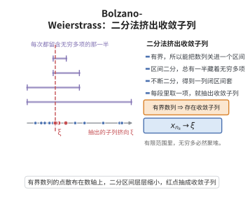

# Bolzano-Weierstrass 定理

> **一句话大白话**：一个被限制在有限范围（有界）里却无穷多的局面，总能“抠”出一小段无限多项聚到同一点的子列——就像一大群人挤在有限场地里，必有足够多的人挤向同一角落。
>
> **小例子**：$a_n=(-1)^n$ 本身不收敛，但它有界；抽出的偶项子列 $1,1,1,\dots$ 收敛于 $1$——正是定理保证的存在性。

## 介绍

Bolzano-Weierstrass 定理是实数分析中的核心定理：有界无穷数列必有收敛子列。该定理是实数完备性的重要推论，是研究紧致性和序列紧性的基础。

## 几何直观

图意在说明：每次二分都保留含无穷多项的一半，区间套锁定一点，从中逐段取值就得到收敛子列。

## 分析

**前置依赖**：闭区间套定理。

## 思考过程

Bolzano-Weierstrass 定理的核心思想是从有界无穷数列中"挤出"一个收敛子列。其直观方法是二分法：将包含整个数列的闭区间不断二等分，总有一半区间包含无穷多项，如此反复即可得到一列逐层缩小的区间，每个区间都包含原数列的无穷多项。

这一构造过程与闭区间套定理紧密相连——二分法产生的区间列满足闭区间套的条件，从而存在唯一的公共点 $\xi$，在每个区间中选取一项即可得到收敛到 $\xi$ 的子列。

该定理在分析学中处于核心地位，它是实数完备性的重要表现形式，也是研究紧致性（compactness）概念的基础。在 $\mathbb{R}^n$ 中，Bolzano-Weierstrass 定理推广为"有界序列必有收敛子列"，称为序列紧致性。

## 证明过程

**证明**：设 $\{x_n\}$ 有界，存在 $[a, b]$ 包含所有 $x_n$。将 $[a, b]$ 等分为两区间，必有一区间包含无穷多项 $x_n$，记该区间为 $[a_1, b_1]$。重复此过程，得闭区间套 $\{[a_k, b_k]\}$，$b_k - a_k = \frac{b-a}{2^k} \to 0$。由闭区间套定理，存在唯一 $\xi \in \bigcap [a_k, b_k]$。在每个 $[a_k, b_k]$ 中取一项 $x_{n_k}$（$n_k$ 递增），则 $x_{n_k} \to \xi$。$\square$

## 课堂问答

**老师**：有界无穷数列凭什么一定能挑出收敛子列？

**学生**：结论：有界数列必有收敛子列。设 $\{x_n\}$ 落于 $[a,b]$，把 $[a,b]$ 二等分，两半中至少有一个含 $\{x_n\}$ 的无穷多项，记为 $[a_1, b_1]$；再二分、取含无穷多项的那半，得到嵌套区间 $[a_k, b_k]$，长度 $b_k - a_k = \frac{b-a}{2^k} \to 0$。

**老师（追问）**：这个区间套帮我们抓到了什么？

**学生**：由闭区间套定理，存在唯一公共点 $\xi \in \bigcap_k [a_k, b_k]$。因为每个 $[a_k, b_k]$ 都含无穷多项，可以在其中依次取下标递增的项 $x_{n_k}$，由 $|x_{n_k} - \xi| \le b_k - a_k \to 0$ 得 $x_{n_k} \to \xi$。要防的误区是误以为原数列本身收敛——定理只保证存在收敛子列。

**老师（拓展）**：它为什么被视为实数完备性的核心推论？

**学生**：它正是"有界闭区间是序列紧的"这一事实，在 $\mathbb{R}^n$ 中推广为"有界序列必有收敛子列"，等价于"闭且有界即紧"。它是分析里提取收敛子列的万能工具，Cauchy 准则的充分性与最值定理都靠它完成关键一步。例如 $a_n = (-1)^n$ 发散，但偶项子列恒为 $1$、收敛，正说明"子列收敛"与"原列收敛"不是一回事。
