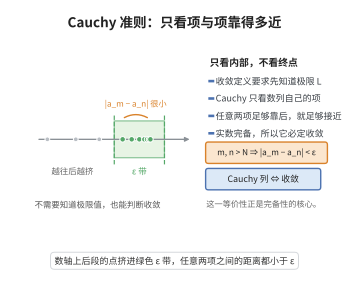

# Cauchy 收敛准则

> **一句话大白话**：一个数列收不收敛，不用知道极限是多少——只要“越往后任意两项都凑得越来越近”，它就会收敛（在完备的实数里）。
>
> **小例子**：$a_n=\frac1n$ 各项越往后彼此越近（Cauchy 列），故收敛于 $0$；而 $a_n=\sqrt n$ 相邻项虽走近，任意两项却仍可隔很远，因而不收敛。

## 介绍

Cauchy 收敛准则是数列收敛性的充要条件：数列 $\{a_n\}$ 收敛当且仅当它是 Cauchy 列，即对任意 $\varepsilon > 0$，存在 $N$，使得当 $m, n > N$ 时，$|a_m - a_n| < \varepsilon$。该准则在实数完备性的刻画中居于核心地位，在尚未知道极限值的情况下即可判断数列是否收敛。

## 几何直观

图意在说明：不必知道极限是多少，只要足够靠后的任意两项都能靠得很近，数列就一定收敛。

## 分析

**前置依赖**：实数完备性公理。

## 思考过程

### 1. 为什么需要 Cauchy 准则？

收敛数列的极限定义要求我们知道极限值 $L$ 才能判断数列是否收敛。但在许多实际问题中，我们并不知道极限值，却仍希望判断数列是否收敛。Cauchy 准则的**最大优势**在于：它只依赖于数列本身的值，而不需要预先知道极限。

### 2. Cauchy 列的直观理解

Cauchy 列要求"随着 $n$ 增大，任意两项之间的距离可以任意小"。这比"相邻两项距离趋于 0"要强得多。例如 $a_n = \sqrt{n}$，虽然 $a_{n+1} - a_n \to 0$，但它不是 Cauchy 列（也不收敛）。

### 3. 完备性的核心地位

Cauchy 准则的成立本质上等价于实数系的完备性——在有理数系 $\mathbb{Q}$ 中，Cauchy 列不一定收敛（例如 $\sqrt{2}$ 的有理逼近序列）。正是实数完备性公理保证了一切 Cauchy 列都收敛，这一性质是分析学得以建立的基础。

## 证明过程

**证明**：
必要性：若 $a_n \to L$，则对 $\varepsilon > 0$，$\exists N$，$n > N$ 时 $|a_n - L| < \varepsilon/2$。故 $m, n > N$ 时 $|a_m - a_n| \leq |a_m - L| + |L - a_n| < \varepsilon$。

充分性：设 $\{a_n\}$ 是 Cauchy 列，则 $\{a_n\}$ 有界。由 Bolzano-Weierstrass 定理，存在收敛子列 $a_{n_k} \to L$。由 Cauchy 条件，对 $\varepsilon > 0$，$\exists N$，$m, n > N$ 时 $|a_m - a_n| < \varepsilon/2$。取 $k$ 充分大使 $n_k > N$ 且 $|a_{n_k} - L| < \varepsilon/2$，则 $n > N$ 时 $|a_n - L| \leq |a_n - a_{n_k}| + |a_{n_k} - L| < \varepsilon$。$\square$

## 课堂问答

**老师**：不知道极限值，怎么还能判断收敛？Cauchy 准则到底抓住了什么？

**学生**：结论：$\{a_n\}$ 收敛 $\iff$ 它是 Cauchy 列，即 $\forall \varepsilon > 0, \exists N$，当 $m, n > N$ 时 $|a_m - a_n| < \varepsilon$。它的最大优势是只用到数列自身取值，不需要预知极限 $L$。

**老师（追问）**：为什么"相邻两项趋近"不够，非要用"任意两项"？

**学生**：因为相邻趋 $0$ 太弱。$a_n = \sqrt{n}$ 有 $a_{n+1} - a_n \to 0$，但取 $m = 4n$ 时 $|\sqrt{4n} - \sqrt{n}| = \sqrt{n}$ 并不趋 $0$，它不是 Cauchy 列，也不收敛。要防的误区是以为"任何度量空间里 Cauchy 列都收敛"——完备性正是保证这一点的额外条件。

**老师（拓展）**：充分性怎么证？它的成立和什么深层性质绑定？

**学生**：Cauchy 列必有界，由 Bolzano-Weierstrass 定理取收敛子列 $a_{n_k} \to L$，再用 Cauchy 条件把整个数列"拉向" $L$：$|a_n - L| \le |a_n - a_{n_k}| + |a_{n_k} - L| < \varepsilon$。它的成立本质上等价于 $\mathbb{R}$ 的完备性——在 $\mathbb{Q}$ 中，逼近 $\sqrt{2}$ 的有理 Cauchy 列并不收敛。
